# PERF-GS

[](https://electronicarts.github.io/perf-gs/)
[](#overview)
[](#requirements)

PERF-GS is a 3D Gaussian Splatting trainer. Give it a COLMAP scene, or a folder of photos and let the hub run COLMAP for you. On an RTX 4090, the Ultrafast training loop averaged **10.51 seconds at 27.13 dB** and Quality averaged **22.68 seconds at 27.90 dB** across the nine Mip-NeRF 360 scenes (held-out PSNR).

[Overview and presets](#overview) · [Quickstart](#quickstart) · [Benchmarks](#mip-nerf-360) · [Gallery](#reconstructions) · [RTX 4080 comparison with LiteGS, SAD-GS and FastGS](docs/benchmarks.md#rtx-4080-comparison)

<div align="center">

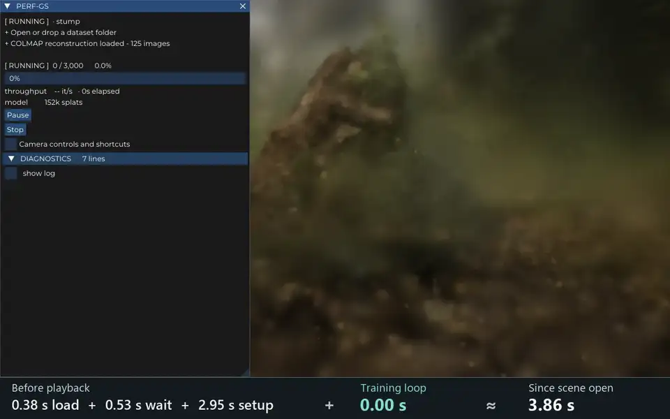

*Stump · Ultrafast · RTX 4090 · real-time training* · [Open GIF](assets/stump-preview.gif) · [Full-resolution WebP](assets/stump-rtx4090-orbit.webp)

</div>

**9.21 s for 3,000 optimization steps.** Playback starts with the training loop. Before the clip, the hub spent 0.38 s loading Stump, 0.53 s waiting for Start, and 2.95 s preparing training. The result appeared **13.08 s after scene open**. The same loop took 8.96 s in a separate unrecorded hub run and 8.95 s in the original headless benchmark.


<a id="architecture-from-a-high-level"></a>

## Overview

We wanted to change a few lines in a shader, move a growth update in the Python frontend, or tweak a hyperparameter, then train the whole scene and fly around it. The target was a hundred experiments in a day. On our RTX 4090, the nine Ultrafast runs on Mip-NeRF 360 add up to 94.6 seconds in the training loop. Loading the photos, initializing the splats, scoring the held-out views and exporting the model take additional time.

The hub is built for that same loop. It keeps the cameras and original COLMAP cloud around, so you can inspect a result, change a setting, and start again from the same reconstruction. For a comparison across scenes, the command line uses the same trainer and preset settings.

<details>
<summary><strong>How the trainer works</strong></summary>

[Initialization](#where-the-first-splats-come-from) · [Forward pass](#drawing-one-training-view) · [Backward passes](#the-backward-passes) · [Densification](#deciding-where-to-grow) · [Presets](#presets)

### Why SlangPy and Slang

We started with **SlangPy** so we could write the training schedule in Python and work directly on the renderer in Slang. Python picks a training camera, sets the learning rates and decides when to grow the model. SlangPy compiles each shader entry point from source and caches the kernel for the session. To try a shader change, edit the file and rerun the trainer. There’s no separate native extension to build.

A splat supplies its projection, its coverage at a pixel, and its color. The compositor takes care of blending it over what’s behind it. With Slang.D we can mark the projection and coverage functions as differentiable. Change the math in one of those functions and Slang generates its derivatives from the same source. We still write the backward passes ourselves so we control what each GPU thread computes and what it saves. There’s a small disk primitive in the tests that uses the same forward blend loop with its own coverage function. [Primitive interfaces](shaders/core/interfaces.slang) · [Disk primitive test](tests/test_disk_primitive.py)

Vulkan is the cross-platform target. Direct3D 12 on Windows uses the same shader sources. Training has no CUDA or PyTorch dependency. One detail that mattered across vendors was wave size. The backward shader works on groups of 32 splats, so a 64-lane wave handles two independent groups. We’ve run Vulkan training on Windows with the RTX 4080, RTX 4090 and Radeon RX 7900 XT. Linux and macOS are unverified.

### Where the first splats come from

COLMAP gives us camera poses and a sparse cloud of colored points. Each point becomes a round splat. Its color initializes the constant spherical harmonic coefficient, its opacity starts at 0.1, and its initial scale comes from the root-mean-square distance to its three nearest neighbors. That lets a dense patch of points start with smaller splats than a sparse one.

We also seed geometry between those points. We take up to 28 anchor photos from the training split, rectify stereo pairs and match them in both directions. We triangulate matches that agree left-to-right and right-to-left, then check where the 3D point lands in a third training photo. We keep it if the color agrees. This adds up to 256,000 splats in places the sparse reconstruction may barely have sampled. Their initial scale corresponds to about 1.5 pixels at the stereo working resolution.

The photos tell us something about the lens too. A landmark may be near the center in one view and near a darker corner in another. For a single-camera reconstruction with enough landmarks in the binary COLMAP tracks, we fit one radial falloff strength during setup and apply it when rendering. Otherwise the trainer uses a flat response. [Stereo initialization](src/trainer/data/stereo.py) · [Lens fit](src/trainer/data/lens_calibration.py)

### Drawing one training view

One ordinary step records the forward render, image loss, backward passes and Adam update in one GPU submission. After growth, we reorder splats along a Morton curve so nearby splats sit together in memory. At the start of a view the GPU can then cull an off-screen cluster of 128 splats with one bounding-box test. The renderer projects each surviving Gaussian to an ellipse, counts the 8 × 8 pixel tiles it overlaps, and evaluates its view-dependent color if it touches the image. We use Mip-Splatting here. The training cameras set a 3D smoothing scale for each splat, and a 2D filter widens small projected footprints while compensating their opacity.

A large splat can touch many tiles. Sorting a depth key for every copy would repeat a lot of work. We sort splats by depth **once per view**, emit the splat–tile pairs in that order, then do a stable GPU radix sort on just the tile ID. Each tile gets a front-to-back list. The blend skips alpha below 1/255 and stops a pixel once its remaining transmittance falls below 0.0001. The loss compares the render with the training photo using pixel error and SSIM. The SSIM shader filters each 11 × 11 neighborhood first along rows, then along columns. [Rasterizer](src/trainer/backend/render/rasterizer.py) · [SSIM shader](shaders/losses/ssim_loss.slang)

### The backward passes

A single splat can cover hundreds of pixels, and a single pixel can see hundreds of splats. We keep a per-pixel backward shader as a reference. The path used by the presets turns the work around. Every 32 splats in a tile, the forward pass saves the accumulated RGB and remaining transmittance for each active pixel. Those four half-precision values are enough to resume the blend at that point.

The per-tile version gives each tile a workgroup, even though a tile looking through foliage can have a much longer list than its neighbor. In the default version the GPU collects the 32-splat groups reached by at least one supervised pixel into a single list and writes the indirect dispatch size itself. Python can queue the backward pass before that count is known. Each lane takes one splat, uses wave operations to reconstruct its place in the blend, and adds up contributions from the tile’s pixels in registers. That cuts the number of threads trying to add to the same gradient in memory.

Once those contributions have been summed across tiles, a separate pass differentiates the projection once per contributing splat. All of its pixels saw the same projected ellipse, so we can sum their 2D gradients before mapping them back to 3D position, scale and rotation. Another pass handles spherical harmonic color and its dependence on view direction. Adam updates the parameters in 32-bit float. Its two running moments are stored in bfloat16 with stochastic rounding, which halves the storage for those moments and lets small updates accumulate. [Blend backward](shaders/rasterize/tile_binned/backward_persplat.slang) · [Projection backward](shaders/rasterize/tile_binned/projection_backward.slang) · [Adam precision](shaders/common/adam_precision.slang)

### Deciding where to grow

We use structure-aware densification from SAD-GS. During growth, every tenth step samples a structure tensor built from RGB gradients in the training photo. The tensor gives us an estimate of the local image frequency. The shader projects the splat’s three axes into that view and scores each projected length against that frequency. Think of a long splat on a fence. Seen end-on it might cover a couple of pixels. From the side it might stretch across several slats. We accumulate those observations across cameras before deciding which axes to split.

Every 500 steps during growth, a splat can split if over 64% of its eligible observations vote for more detail and its screen-position loss gradient is large enough. Depending on which axes need subdivision, one parent can become two, four or eight children. On the intervening 100-step growth updates, we use an AbsGS-style update driven by accumulated screen-position gradients. Small splats with a large gradient can be cloned and larger ones can split. Growth updates can also prune splats with low opacity or little accumulated blend weight. With Quality’s 4M cap, proposed splits can outnumber the free slots. We rank expansions by the parent’s average screen-position gradient divided by the proposed family size and give space to whole families, strongest axis first. [Structure scoring](shaders/densify/score_structure_aware.slang) · [Split allocation](shaders/densify/rank_families.slang)

</details>

### Presets

All four presets use the renderer and growth rules above. What changes is how many pixels and splats get work, where the photos live, and how long we keep refining. The timings and held-out PSNR below are means over the nine Mip-NeRF 360 scenes on the RTX 4090, with equal weight per scene.

#### Ultrafast

This is what we use to try a shader idea. We keep the training photos and their structure maps on the GPU, cap growth at 1.85M splats and stop adding splats at step 1,600. The renderer still draws the full image at the selected resolution. A spatiotemporal blue-noise mask picks a quarter of the pixels for the backward pass, scales their gradients by four, and advances on the next visit to that camera. SSIM still sees the full neighborhood. Degree-2 spherical harmonics and 3,000 steps gave **10.51 s at 27.13 dB**.

To isolate what pixel sampling buys you, run Ultrafast twice on the same scene and seed. Set `--stbn-pixel-fraction 1` on the second run. You get full pixel supervision with the same growth cap, color model and GPU image cache.

#### Balanced

Balanced runs for the same 3,000 steps with the same degree-2 color model, and uses every pixel for supervision. It’s the default. It allows up to 2.6M splats and grows through step 1,900. We stream the current photo from system RAM into a reusable GPU texture and compute its structure map when needed. On Bicycle alone, caching all 169 training photos takes 656 MiB of packed pixels and their structure maps add another 1,311 MiB before texture padding. Reusing those textures is how Balanced fits more splats in less VRAM than Ultrafast. It averaged **15.91 s at 27.40 dB**, with **2.81 GiB** of GPU memory at loop end versus Ultrafast’s 5.29 GiB.

#### Quality

Here we still stream the photos and use every pixel. Moving from degree-2 to degree-3 spherical harmonics gives each color channel 16 coefficients instead of nine to fit changes with viewing angle. It can grow to 4M splats through step 1,900. For the next 200 steps, we sample one pixel per 4 × 4 block and estimate how much its RGB would change if a splat disappeared. The estimate accounts for the splats in front of it and the color that would show through from behind.

At step 2,100 the CPU ranks the removal costs collected on the GPU, and the GPU compacts the surviving splats. We aim to keep 75% of the live population and always keep splats we didn’t observe during scoring. The final 1,400 steps refine the survivors. That gave **22.68 s at 27.90 dB** and 2.10M final splats on average. We tried the same 75% trim on Bicycle and Kitchen with the two faster presets. SSIM and LPIPS got worse in all four runs, so we left it out of those presets.

#### Quality+

This runs Quality’s 3,500 steps and continues with the model it just trained. The splat count stays fixed and we keep the Adam state, final learning rates and loss weights. To decide when to stop, we render up to eight fixed training views every four passes’ worth of updates (at least 100 steps). A cumulative gain of 0.05 dB in mean PSNR resets the counter. Three checks without that gain end the run. The held-out views are used for reporting. On the 4090 that bought another 0.33 dB on average, reaching **28.227 dB in 122.66 s** including the convergence checks. The four indoor scenes gained 0.69 dB on average and the five outdoor scenes gained 0.04 dB. [Preset settings and stopping rule](docs/usage.md#training) · [Benchmark results](docs/benchmarks.md#rtx-4090-presets)

## Requirements

- **OS and Python.** Python 3.10+. Tested on Windows 11. Linux and macOS are unverified.
- **GPU.** Tested on the AMD Radeon RX 7900 XT (20 GB), NVIDIA RTX 4080 (16 GB) and RTX 4090 (24 GB). The rasterizer supports 32- and 64-lane waves and uses 64-bit integer buffer atomics through Vulkan (default) or Direct3D 12 (Windows).
- **VRAM.** *Balanced* preset used 2.72-2.90 GiB at the end of headless Mip-NeRF 360 training. Peak and viewer usage can be higher. Minimum card capacity is unverified. [Memory measurements](docs/benchmarks.md#where-memory-goes)

## Quickstart
Perf-gs was designed to be extremely simple to setup and install.

1. Get **perf-gs.** You can:

   - **Clone with Git.**:
   ```powershell
   git clone https://github.com/electronicarts/perf-gs.git
   ```
   - Or **download a release.**: Open **Releases**, choose a version, then under **Assets** click **Source code (zip)**.
   - Or **download the latest source.**: Click **Code -> Download ZIP**.

2. **Open PowerShell in the project folder.**
3. **Setup venv and install PERF-GS (once)**: In PowerShell, run `py -3.11 --version`.

   - If you see `Python 3.11` followed by a patch number (for example, `Python 3.11.9`), Python is ready.
   - If you get an error, download and open the **Python install manager** from the [Python for Windows page](https://www.python.org/downloads/windows/). After installing it, reopen PowerShell in the project folder and run `pymanager install 3.11` to download and install Python 3.11.

   Once Python is ready, run these two commands, one at a time, to setup a virtual environemnt and install PERF-GS.

   ```powershell
   py -3.11 -m venv .venv
   .\.venv\Scripts\python.exe -m pip install -e .
   ```

4. **Open the training window.**  

   ```powershell
   .\.venv\Scripts\python.exe -m trainer.frontend.app --hub
   ```

5. **Open your photos or scene.** Click **Open dataset folder...**. For a folder of photos, click **Install reconstruction tools** if prompted, then **Reconstruct to COLMAP**. The hub estimates the camera poses and builds a sparse point cloud. An existing COLMAP scene opens directly.
6. **Train and save.** Once the point cloud appears, click **Start Training**. When training finishes, click **Export PLY...** to save your model.


### Train from the command line

After step 3, you can train directly from PowerShell. From the project folder, run these commands to download the Truck sample (about 650 MB) and train it without opening a window.

```powershell
.\.venv\Scripts\python.exe scripts/data/download_tandt_db.py --set tandt
.\.venv\Scripts\python.exe -m trainer.frontend.app --scene "datasets/tandt/truck" --no-viewer --save-ply
```

For your own COLMAP scene, skip the download and replace `"datasets/tandt/truck"` with your folder path in quotes. The default is Balanced at 3,000 steps. With `--save-ply`, the model is saved in a timestamped folder under `outputs/train/` as `output.ply`.

Run `.\.venv\Scripts\python.exe -m trainer.frontend.app --help` to see every flag. If you already installed PERF-GS in an active Python environment, use `python` in place of `.\.venv\Scripts\python.exe`. [Presets and training settings](docs/usage.md#training) · [Evaluation and export flags](docs/usage.md#evaluation-and-ply-export)

[Hub walkthrough](docs/usage.md#interactive-hub) · [Datasets](docs/usage.md#datasets) · [First-run help](docs/usage.md#first-run-help)

Select **Quality+** in the hub or add `--preset quality+` to the training command. It starts with Quality’s 3,500 steps, then refines the same splats. [How Quality+ decides when to stop](docs/usage.md#quality-convergence)

## Mip-NeRF 360

All headline results give equal weight to the nine Mip-NeRF 360 scenes. On the RTX 4080, Quality+ averaged **28.225 dB across all nine** and **29.834 dB across the seven scenes used by gsplat and LichtFeld**, which exclude *Flowers* and *Treehill*. [Per-scene results](docs/NVIDIA_GeForce_RTX_4080_qualityplus.csv) · [gsplat benchmark](https://github.com/nerfstudio-project/gsplat/blob/main/docs/source/tests/eval.rst) · [LichtFeld benchmark](https://lichtfeld.io/bounty/bounty4/)

### Radeon RX 7900 XT

Across the nine Mip-NeRF 360 scenes, headless Vulkan training averaged **16.44 s for Ultrafast** and **27.02 s for Balanced** at 3,000 steps, and **39.47 s for Quality** at 3,500 steps. Each preset used seed 42 and completed all 246 held-out views with zero sort overflows during training and evaluation.

Replaying the same Stump and Kitchen models on the RX 7900 XT and RTX 4080 gave **83.86 dB** and **82.53 dB** between their rendered images. Across 51 views, 712 of 219,272,010 RGB8 channel values differed by more than one level. [Cross-vendor rendering measurements](docs/benchmarks.md#cross-vendor-rendering-checks)

### RTX 4090

| Preset | Steps | Training loop | PSNR ↑ | SSIM ↑ | VGG LPIPS ↓ | Final splats | VRAM at loop end |
| --- | ---: | ---: | ---: | ---: | ---: | ---: | ---: |
| Ultrafast | 3,000 | 10.51 s | 27.13 dB | 0.7935 | 0.2564 | 1.43M | 5.29 GiB |
| Balanced (default) | 3,000 | 15.91 s | 27.40 dB | 0.8141 | 0.2228 | 2.07M | 2.81 GiB |
| **Quality** | 3,500 | 22.68 s | 27.90 dB | 0.8285 | 0.1996 | 2.10M | 4.81 GiB |
| **[Quality+](docs/NVIDIA_GeForce_RTX_4090_qualityplus.csv)** | [17,044 avg.](docs/assets/qualityplus-convergence-4090.png) | 122.66 s | 28.227 dB | 0.8317 | 0.1909 | 2.10M | 4.81 GiB |

Compared with the previous 3,000-step Quality preset on this 4090, the 3,500-step preset gained **0.11 dB** on average and improved PSNR on **all nine scenes**. Mean final splat count fell **31.6%**, from 3.07M to 2.10M. Mean loop time went from 23.24 s to 22.68 s. [Current 4090 CSV](docs/NVIDIA_GeForce_RTX_4090_presets_current.csv) · [Previous 4090 CSV](docs/NVIDIA_GeForce_RTX_4090_presets.csv)

Each row averages nine scenes equally, with one headless Vulkan run per scene at seed 42. Graphdeco scored 246 held-out views per preset at quarter resolution outdoors and half resolution indoors. Training-loop times exclude COLMAP reconstruction, loading, initialization, held-out evaluation and export. VRAM is process-local GPU memory sampled at loop end. [Reproduce the benchmark](docs/benchmark-rtx4090.md)

Ultrafast and Balanced keep their 3,000-step settings. Applying Quality’s 75% post-growth retention produced about 25% fewer final splats on Bicycle and Kitchen. SSIM and VGG LPIPS worsened in all four runs. [Pruning comparison](docs/benchmarks.md#pruning-in-ultrafast-and-balanced)


<details>
<summary>RTX 4080 results</summary>

| Preset | Steps | Training loop | PSNR ↑ | SSIM ↑ | VGG LPIPS ↓ | Final splats | VRAM at loop end |
| --- | ---: | ---: | ---: | ---: | ---: | ---: | ---: |
| Ultrafast | 3,000 | 17.62 s | 27.13 dB | 0.7936 | 0.2567 | 1.43M | 5.29 GiB |
| Balanced (default) | 3,000 | 25.97 s | 27.39 dB | 0.8143 | 0.2229 | 2.07M | 2.80 GiB |
| **Quality** | 3,500 | 32.44 s | 27.90 dB | 0.8286 | 0.1997 | 2.11M | 4.80 GiB |
| **Quality+** | 17,536 avg. | 216.40 s | 28.225 dB | 0.8316 | 0.1907 | 2.11M | 4.80 GiB |

Quality+ stopped between 8,652 and 21,996 steps. Compared with Quality, it gained 0.33 dB on average and improved VGG LPIPS on all nine scenes. Its loop time includes training-view convergence checks. [Quality+ per-scene results](docs/NVIDIA_GeForce_RTX_4080_qualityplus.csv) · [Convergence plot](assets/qualityplus-convergence-4080.png) · [Fixed-budget results](docs/NVIDIA_GeForce_RTX_4080_presets.csv)

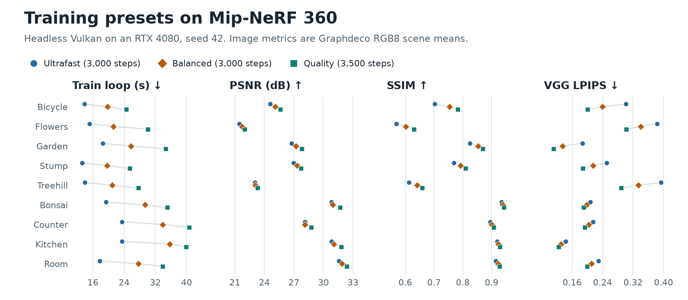

</details>


## Reconstructions

Ultrafast and Balanced ran for 3,000 steps and Quality for 3,500, all at seed 42. [All-view benchmark results](#mip-nerf-360)

<table>
  <thead>
    <tr>
      <th scope="col" width="25%">Reference photo</th>
      <th scope="col" width="25%">Ultrafast</th>
      <th scope="col" width="25%">Balanced</th>
      <th scope="col" width="25%">Quality</th>
    </tr>
  </thead>
  <tbody>
    <tr><th scope="rowgroup" colspan="4" align="left">Kitchen · DSCF0912.JPG · Quality 34.99 dB</th></tr>
    <tr>
      <td><a href="docs/assets/reconstructions/kitchen-reference.webp">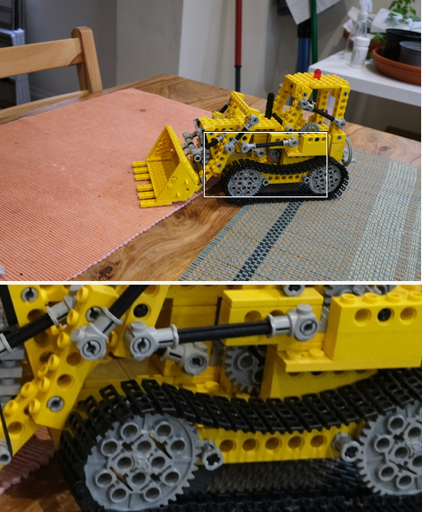</a></td>
      <td><a href="docs/assets/reconstructions/kitchen-ultrafast.webp">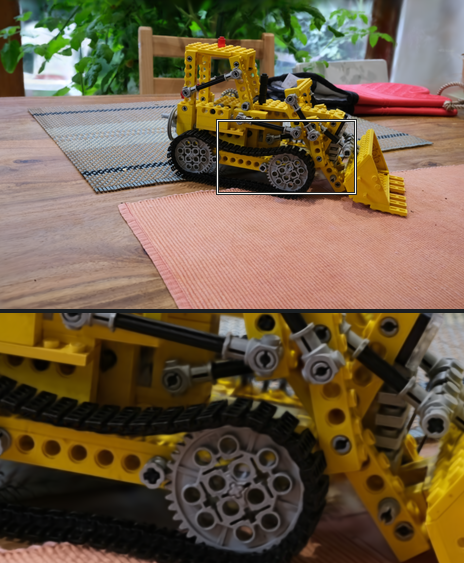</a></td>
      <td><a href="docs/assets/reconstructions/kitchen-balanced.webp">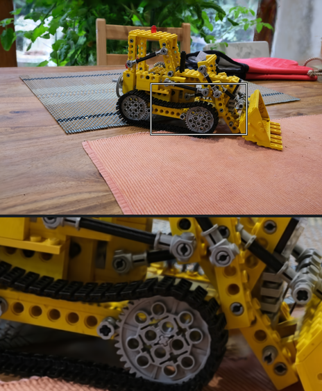</a></td>
      <td><a href="docs/assets/reconstructions/kitchen-quality.webp"></a></td>
    </tr>
  </tbody>
  <tbody>
    <tr><th scope="rowgroup" colspan="4" align="left">Bicycle · _DSC8824.JPG · Quality 29.74 dB</th></tr>
    <tr>
      <td><a href="docs/assets/reconstructions/bicycle-reference.webp"></a></td>
      <td><a href="docs/assets/reconstructions/bicycle-ultrafast.webp"></a></td>
      <td><a href="docs/assets/reconstructions/bicycle-balanced.webp">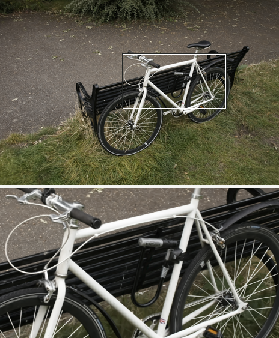</a></td>
      <td><a href="docs/assets/reconstructions/bicycle-quality.webp"></a></td>
    </tr>
  </tbody>
  <tbody>
    <tr><th scope="rowgroup" colspan="4" align="left">Stump · _DSC9277.JPG · Quality 30.65 dB</th></tr>
    <tr>
      <td><a href="docs/assets/reconstructions/stump-reference.webp"></a></td>
      <td><a href="docs/assets/reconstructions/stump-ultrafast.webp">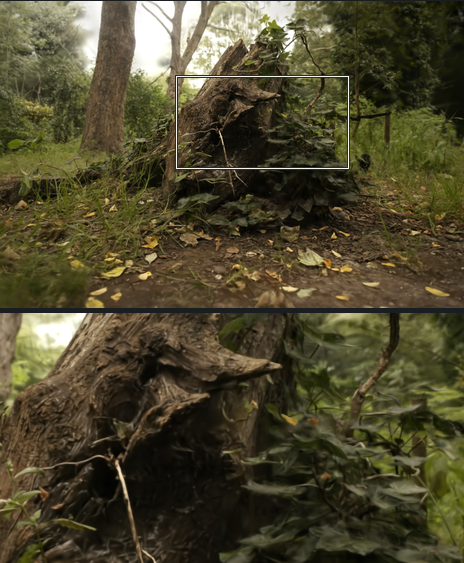</a></td>
      <td><a href="docs/assets/reconstructions/stump-balanced.webp">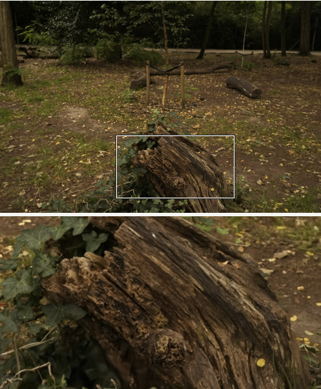</a></td>
      <td><a href="docs/assets/reconstructions/stump-quality.webp">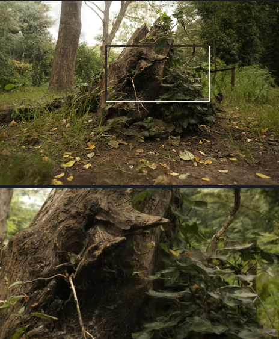</a></td>
    </tr>
  </tbody>
  <tbody>
    <tr><th scope="rowgroup" colspan="4" align="left">Room · DSCF4763.JPG · Quality 36.30 dB</th></tr>
    <tr>
      <td><a href="docs/assets/reconstructions/room-reference.webp"></a></td>
      <td><a href="docs/assets/reconstructions/room-ultrafast.webp">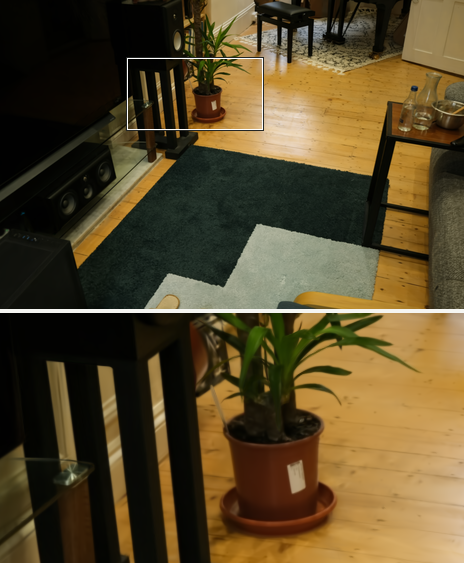</a></td>
      <td><a href="docs/assets/reconstructions/room-balanced.webp">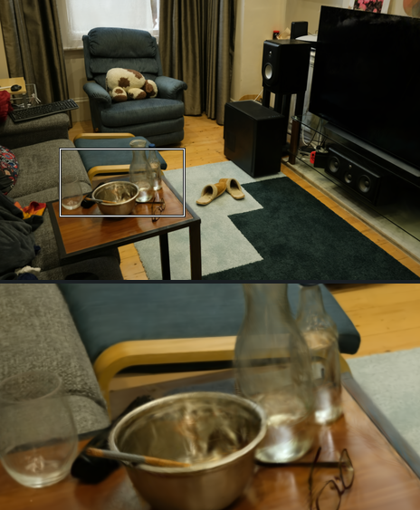</a></td>
      <td><a href="docs/assets/reconstructions/room-quality.webp">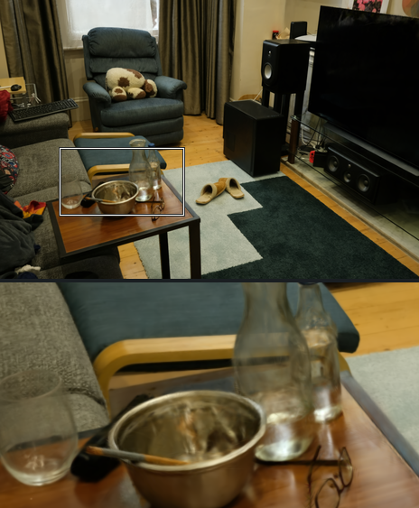</a></td>
    </tr>
  </tbody>
  <tbody>
    <tr><th scope="rowgroup" colspan="4" align="left">Bonsai · DSCF5725.JPG · Quality 35.45 dB</th></tr>
    <tr>
      <td><a href="docs/assets/reconstructions/bonsai-reference.webp">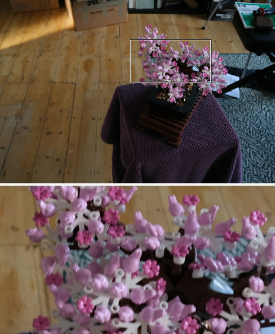</a></td>
      <td><a href="docs/assets/reconstructions/bonsai-ultrafast.webp">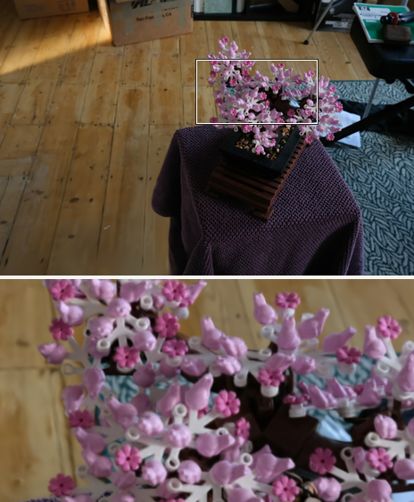</a></td>
      <td><a href="docs/assets/reconstructions/bonsai-balanced.webp">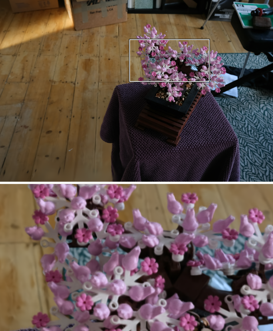</a></td>
      <td><a href="docs/assets/reconstructions/bonsai-quality.webp"></a></td>
    </tr>
  </tbody>
</table>

Scenes and reference photography from Barron et al., CVPR 2022. [Mip-NeRF 360 dataset](https://jonbarron.info/mipnerf360/)

## Datasets

The download helpers link to three datasets that can be obtained separately by users · [Download instructions](docs/usage.md#datasets)

| Dataset | Project / attribution | Included scene selection |
| --- | --- | --- |
| Mip-NeRF 360 | [Barron et al., CVPR 2022](https://jonbarron.info/mipnerf360/) | bicycle, bonsai, counter, garden, kitchen, room, stump (plus optional flowers and treehill) |
| Tanks & Temples | [Knapitsch et al., ACM TOG 2017](https://www.tanksandtemples.org/) | train, truck |
| Deep Blending | [Hedman et al., ACM TOG 2018](https://repo-sam.inria.fr/fungraph/deep-blending/) | drjohnson, playroom |

## License

This project is provided under the BSD 3-Clause License, see [LICENSE](LICENSE) for details. See [NOTICE](NOTICE.md) for licensing details on other software and data.

## Contributing

Before you can contribute, EA must have a Contributor License Agreement (CLA) on file that has been signed by each contributor. You can sign [here](https://electronicarts.na1.echosign.com/public/esignWidget?wid=CBFCIBAA3AAABLblqZhByHRvZqmltGtliuExmuV-WNzlaJGPhbSRg2ufuPsM3P0QmILZjLpkGslg24-UJtek*).

## How to Cite

Scolari, S. (2026). *PERF-GS*. Electronic Arts. <https://github.com/electronicarts/perf-gs>

```bibtex
@software{scolari2026perfgs,
  author    = {Scolari, Stefano},
  title     = {{PERF-GS}},
  year      = {2026},
  publisher = {Electronic Arts},
  url       = {https://github.com/electronicarts/perf-gs}
}
```

## SEED

<p align="center"><a href="https://seed.ea.com"></a><br>
<b>Search for Extraordinary Experiences Division (SEED) - Electronic Arts <br> http://seed.ea.com</b><br>
We are a cross-disciplinary team within EA Worldwide Studios.<br>
Our mission is to explore, build and help define the future of interactive entertainment.<br>
PERF-GS was created by <a href="https://stefanoscolapasta.github.io/nozbufferallowed/about.html">Stefano Scolari</a>.</p>
