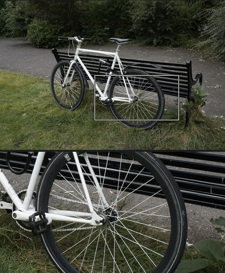
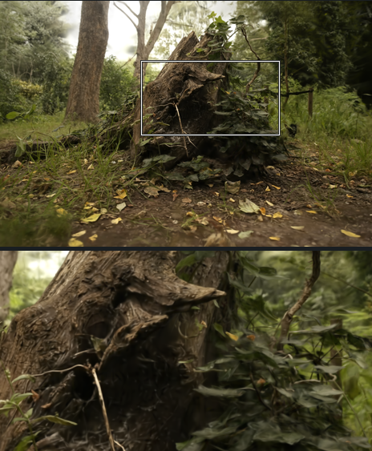

# PERF-GS

**3DGS in seconds.**

On a **24 GB RTX 4090**, Ultrafast averages **27.10 dB PSNR in 11.85 seconds** of training-loop time across the nine Mip-NeRF 360 scenes. Quality reaches **27.79 dB in 23.24 seconds**. Both run for 3,000 steps.

For GPUs with less VRAM, start with **Balanced**. It streams training photos from system RAM and used **2.72–2.89 GiB of VRAM at loop end** across the nine scenes. On Bicycle, it finished with 2.49 million splats and buffers sized for 2.60 million. [VRAM and system RAM breakdown](docs/benchmarks.md#where-memory-goes)
**Balanced**, the default preset, streams training photos from system RAM. It averaged **27.42 dB in 17.31 seconds** on the RTX 4090, using **2.73–2.90 GiB** of process VRAM at loop end. On the **16 GB RTX 4080**, it reached **27.39 dB in 25.97 seconds** with **2.72–2.89 GiB** at loop end. Peak and viewer usage can be higher. [VRAM by preset and workstation](docs/benchmarks.md)

[Quickstart](#quickstart) · [Benchmarks](#mip-nerf-360) · [Gallery](#reconstructions)

<p align="center">
  <a href="assets/perfgs-demo.webp?raw=true"></a>
  <br><em>Stump · Ultrafast · RTX 4090 · real-time playback</em> · <a href="assets/perfgs-demo.gif?raw=true">GIF (14 MiB)</a>
</p>

**12.71 s from opening Stump to the trained result**, including **8.95 s for 3,000 optimization steps**. Playback continues for about four seconds to show the finished scene. The same hub run took 8.96 s of optimization with recording off, and the headless Stump benchmark took 8.95 s.

## Mip-NeRF 360

| Preset (RTX 4090 24 GB) | Training loop | PSNR ↑ | SSIM ↑ | VGG LPIPS ↓ | VRAM at loop end |
| --- | ---: | ---: | ---: | ---: | ---: |
| Ultrafast | 11.85 s | 27.10 dB | 0.7930 | 0.2567 | 5.29 GiB |
| Balanced (default) | 17.31 s | 27.42 dB | 0.8143 | 0.2229 | 2.81 GiB |
| Quality | 23.24 s | 27.79 dB | 0.8274 | 0.2011 | 6.14 GiB |

Each entry is a mean across nine scenes, with one headless Vulkan run per scene at seed 42. The clock covers 3,000 training steps and excludes loading, initialization, evaluation and export. Graphdeco scored all 246 held-out views per preset at quarter resolution outdoors and half resolution indoors. [Per-scene CSV](docs/NVIDIA_GeForce_RTX_4090_presets.csv) · [Workstation and software](docs/NVIDIA_GeForce_RTX_4090_system.txt) · [Reproduce the benchmark](docs/benchmark-rtx4090.md)


Ultrafast requires NVIDIA’s separately licensed non-commercial research masks. Download them once with `python scripts/data/download_stbn.py`. Balanced and Quality work with the base install. [Mask terms](docs/stbn_pixel_sampling.md)

The peer comparison uses the earlier RTX 4080 workstation for every trainer. There, PERF-GS Quality averaged **27.78 dB in 33.85 s**, and FastGS-Big reached **27.83 dB in 325.86 s** on the same nine scenes. [RTX 4080 comparison plot, settings and results](docs/benchmarks.md#rtx-4080-comparison)

## Requirements

- **OS and Python.** Python 3.10+. Tested on Windows 11. Linux and macOS are unverified.
- **GPU.** Tested on the NVIDIA RTX 4080 (16 GB) and RTX 4090 (24 GB). The default shaders use 32-lane waves and 64-bit integer buffer atomics through Vulkan (default) or Direct3D 12 (Windows).
- **VRAM.** *Balanced* preset used 2.72-2.90 GiB at the end of headless Mip-NeRF 360 training. Peak and viewer usage can be higher. Minimum card capacity is unverified. [Memory measurements](docs/benchmarks.md#where-memory-goes)

## Quickstart

**First run on Windows 11**

1. **Get PERF-GS.** On this project's GitHub page, click **Code** and choose either option.

   - **Download a ZIP.** Click **Download ZIP**, then right-click the downloaded file in File Explorer and choose **Extract All**.
   - **Clone with Git.** Copy the **HTTPS** URL. In a terminal, type `git clone` followed by a space, paste the URL, and press **Enter**.

2. **Open PowerShell in the project folder.** In File Explorer, open the folder containing `README.md` and `pyproject.toml`. Click the address bar, type `powershell`, and press **Enter**.
3. **Install PERF-GS once.** If you need Python 3.11, install the Python install manager and run `py install 3.11` in PowerShell. Then run these two commands, one at a time. [Get Python for Windows](https://www.python.org/downloads/windows/)

   ```powershell
   py -3.11 -m venv .venv
   .\.venv\Scripts\python.exe -m pip install -e .
   ```

4. **Open the training window.** Run the command below in the same PowerShell window. Next time, just open PowerShell in the project folder and run this command again.

   ```powershell
   .\.venv\Scripts\python.exe -m trainer.frontend.app --hub
   ```

5. **Train and save.** Click **Open dataset folder...** and select your scene folder. If it contains only photos, click **Install reconstruction tools** if prompted, then **Reconstruct to COLMAP**. An existing COLMAP scene opens directly. When the point cloud appears, click **Start Training**. When training finishes, click **Export PLY...** to save your model.


### Train from the command line

After step 3, you can train directly from PowerShell. From the project folder, run these commands to download the Truck sample (about 650 MB) and train it without opening a window.

```powershell
.\.venv\Scripts\python.exe scripts/data/download_tandt_db.py --set tandt
.\.venv\Scripts\python.exe -m trainer.frontend.app --scene "datasets/tandt/truck" --no-viewer --save-ply
```

For your own COLMAP scene, skip the download and replace `"datasets/tandt/truck"` with your folder path in quotes. The default is Balanced at 3,000 steps. With `--save-ply`, the model is saved in a timestamped folder under `outputs/train/` as `output.ply`.

Run `.\.venv\Scripts\python.exe -m trainer.frontend.app --help` to see every flag. If you already installed PERF-GS in an active Python environment, use `python` in place of `.\.venv\Scripts\python.exe`. [Presets and training settings](docs/usage.md#training) · [Evaluation and export flags](docs/usage.md#evaluation-and-ply-export)

[Hub walkthrough](docs/usage.md#interactive-hub) · [Datasets](docs/usage.md#datasets) · [First-run help](docs/usage.md#first-run-help)

## Reconstructions

Each row pairs a held-out photograph with the three renders scored in the RTX 4090 benchmark. Each preset trained for 3,000 steps. The box marks the detail shown beneath each full view. Select a tile to see the crop at native resolution.

<table>
  <thead>
    <tr>
      <th scope="col" width="25%">Reference photo</th>
      <th scope="col" width="25%">Ultrafast</th>
      <th scope="col" width="25%">Balanced</th>
      <th scope="col" width="25%">Quality</th>
    </tr>
  </thead>
  <tbody>
    <tr><th scope="rowgroup" colspan="4" align="left">Kitchen</th></tr>
    <tr>
      <td><a href="assets/reconstructions/kitchen-reference.webp"></a></td>
      <td><a href="assets/reconstructions/kitchen-ultrafast.webp"></a></td>
      <td><a href="assets/reconstructions/kitchen-balanced.webp"></a></td>
      <td><a href="assets/reconstructions/kitchen-quality.webp"></a></td>
    </tr>
  </tbody>
  <tbody>
    <tr><th scope="rowgroup" colspan="4" align="left">Bicycle</th></tr>
    <tr>
      <td><a href="assets/reconstructions/bicycle-reference.webp"></a></td>
      <td><a href="assets/reconstructions/bicycle-ultrafast.webp"></a></td>
      <td><a href="assets/reconstructions/bicycle-balanced.webp"></a></td>
      <td><a href="assets/reconstructions/bicycle-quality.webp"></a></td>
    </tr>
  </tbody>
  <tbody>
    <tr><th scope="rowgroup" colspan="4" align="left">Stump</th></tr>
    <tr>
      <td><a href="assets/reconstructions/stump-reference.webp"></a></td>
      <td><a href="assets/reconstructions/stump-ultrafast.webp"></a></td>
      <td><a href="assets/reconstructions/stump-balanced.webp"></a></td>
      <td><a href="assets/reconstructions/stump-quality.webp"></a></td>
    </tr>
  </tbody>
  <tbody>
    <tr><th scope="rowgroup" colspan="4" align="left">Room</th></tr>
    <tr>
      <td><a href="assets/reconstructions/room-reference.webp"></a></td>
      <td><a href="assets/reconstructions/room-ultrafast.webp"></a></td>
      <td><a href="assets/reconstructions/room-balanced.webp"></a></td>
      <td><a href="assets/reconstructions/room-quality.webp"></a></td>
    </tr>
  </tbody>
  <tbody>
    <tr><th scope="rowgroup" colspan="4" align="left">Bonsai</th></tr>
    <tr>
      <td><a href="assets/reconstructions/bonsai-reference.webp"></a></td>
      <td><a href="assets/reconstructions/bonsai-ultrafast.webp"></a></td>
      <td><a href="assets/reconstructions/bonsai-balanced.webp"></a></td>
      <td><a href="assets/reconstructions/bonsai-quality.webp"></a></td>
    </tr>
  </tbody>
</table>

Scenes and reference photography from Barron et al., CVPR 2022. [Mip-NeRF 360 dataset](https://jonbarron.info/mipnerf360/)

## How it works

Python and SlangPy drive the same Slang rendering, optimization and densification shaders on Vulkan and D3D12. The trainer starts with COLMAP points, adds stereo matches from training views and fits a lens response from those views. Vulkan is the default. On Windows, select D3D12 with `--backend d3d12`. [Shaders](shaders/) · [Preset settings](docs/usage.md#training)

## Datasets

The download helpers link to three datasets that can be obtained separately by users · [Download instructions](docs/usage.md#datasets)

| Dataset | Project / attribution | Included scene selection |
| --- | --- | --- |
| Mip-NeRF 360 | [Barron et al., CVPR 2022](https://jonbarron.info/mipnerf360/) | bicycle, bonsai, counter, garden, kitchen, room, stump (plus optional flowers and treehill) |
| Tanks & Temples | [Knapitsch et al., ACM TOG 2017](https://www.tanksandtemples.org/) | train, truck |
| Deep Blending | [Hedman et al., ACM TOG 2018](https://repo-sam.inria.fr/fungraph/deep-blending/) | drjohnson, playroom |

## License

This project is provided under the BSD 3-Clause License, see [LICENSE](LICENSE) for details. See [NOTICE](NOTICE.md) for licensing details on other software and data.

## Contributing

Before you can contribute, EA must have a Contributor License Agreement (CLA) on file that has been signed by each contributor. You can sign [here](https://electronicarts.na1.echosign.com/public/esignWidget?wid=CBFCIBAA3AAABLblqZhByHRvZqmltGtliuExmuV-WNzlaJGPhbSRg2ufuPsM3P0QmILZjLpkGslg24-UJtek*).
