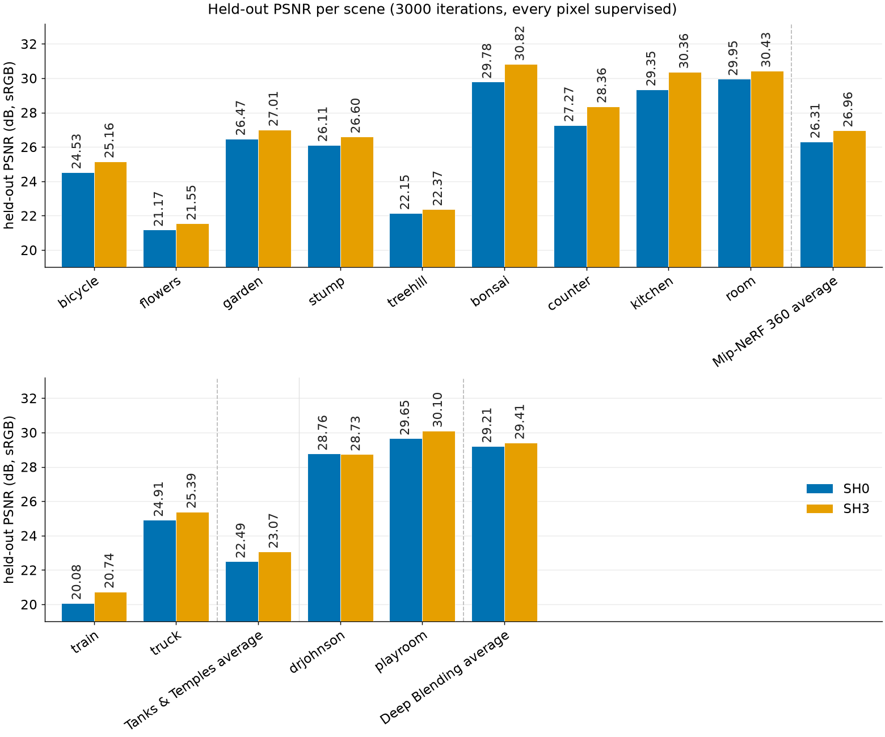

<!-- Images in assets/ are real outputs of this repo: teaser.jpg and
     examples_strip.jpg are renders from a trained bicycle scene (Mip-NeRF 360,
     30k iters); the Results figures are generated from the benchmark runs by
     scripts/plots/plot_readme_results.py. -->

# SCATTO-GS
## Slang-Compiled Accelerated Training-Time Optimization for Gaussian Splatting
A fast and efficient Slang-based 3DGS trainer.


An extensible 3D Gaussian Splatting trainer written in [Slang](https://shader-slang.org) and driven from Python through [SlangPy](https://slangpy.shader-slang.org).<br>
On an RTX 4080 it trains a Mip-NeRF 360 scene in under 30 seconds on average (28.8 seconds at SH0 with 50% sparse supervision). The codebase has no CUDA dependencies, is directly integratable with pytorch frontend and all shaders are dispatched via SlangPy and written in Slang.

<p align="center">
  
  <br><em>Mip-NeRF 360 bicycle, trained end to end by this pipeline and rendered from a held-out camera.</em>
</p>

By writing the kernels in Slang and having the whole system driven by slangpy, we aim to allow distributing this trainer on any system and any backend. 

**Portability first.** The rasterizer, the gradients, the optimizer, and the densification kernels are all Slang. The same source compiles to SPIR-V for Vulkan and DXIL for D3D12 today, with room for more backends as slang-rhi grows. There are no `.cu` files anywhere and nothing that assumes a specific vendor.

**Modular codebase.** Most 3DGS trainer usually live on a performance-readability spectrum, we aimed to have both, while also having flexible portability.

**Built to be extended.** Primitives, losses, and densification strategies are separate shader units behind small interfaces, so adding a new primitive kind or a new loss should be a rather local change rather than surgery across the whole pipeline.


## Features

- Full training from COLMAP scenes: tile-binned forward rasterization, a hand-written backward pass, Adam, and a held-out evaluation split.
- Densification you choose per run: a gradient (AbsGS-style) path, and a structure-aware (SAD-GS-style) path that grid-splits gaussians which under-resolve local image structure.
- Mip-Splatting 3D smoothing filter for scale-correct, anti-aliased rendering.
- Deterministic Nsight GPU Trace capture hooks for profiling the real, optimized kernels (this is Nvidia specific, but we want to allow integrating profiling also on AMD Radeon GPU Profiler (RGP)).

<p align="center">
  
  <br><em>Three novel views of the same reconstruction. Every frame is rendered from the trained gaussians, not the input photos.</em>
</p>

## Results

**On an RTX 4080, a Mip-NeRF 360 scene trains in under 30 seconds on average:** 28.8 seconds at SH0 with 50% sparse supervision (26.38 dB), 31.3 seconds supervising every pixel (26.46 dB).

All runs: 3000 iterations, structure-aware densification with Mip-Splatting, every 8th view held out, one run each. Mip-NeRF 360 trains at quarter resolution, Tanks & Temples at 980×545 and Deep Blending at native resolution. Times cover the training loop only. Every configuration is in [docs/benchmark_results.csv](docs/benchmark_results.csv), and [scripts/plots/plot_readme_results.py](scripts/plots/plot_readme_results.py) regenerates the figures.

### Quality and training time

Every pixel supervised. For reference, the SADGS columns show a fast existing trainer with the same kind of densification, on the same images.

| Scene | PSNR SH0 | PSNR SH3 | Time SH0 (seconds) | Time SH3 (seconds) | Splats (millions) | SADGS PSNR SH0 | SADGS PSNR SH3 |
| --- | ---: | ---: | ---: | ---: | ---: | ---: | ---: |
| bicycle | 24.42 | 24.80 | 33.9 | 45.3 | 5.30 | 24.46 |  |
| flowers | 21.12 | 21.34 | 40.4 | 54.8 | 5.40 | 21.26 |  |
| garden | 26.43 | 26.74 | 48.7 | 66.1 | 5.32 | 26.25 |  |
| stump | 26.02 | 26.37 | 35.7 | 48.5 | 5.72 | 25.91 |  |
| treehill | 22.16 | 22.21 | 39.8 | 53.5 | 5.47 | 22.11 |  |
| bonsai | 29.98 | 30.56 | 19.2 | 24.8 | 2.08 | 29.72 | 30.94 |
| counter | 27.45 | 27.97 | 22.9 | 30.3 | 1.86 | 27.31 | 28.55 |
| kitchen | 29.88 | 30.52 | 23.2 | 30.3 | 1.67 | 29.98 | 31.03 |
| room | 30.71 | 30.88 | 17.9 | 22.5 | 1.70 | 30.83 | 31.24 |
| train | 20.28 | 20.52 | 35.2 | 48.8 | 3.45 |  |  |
| truck | 24.84 | 25.27 | 28.8 | 39.2 | 2.90 |  |  |
| drjohnson | 28.65 | 28.71 | 31.0 | 39.4 | 5.25 |  |  |
| playroom | 29.71 | 30.25 | 28.6 | 35.6 | 4.37 |  |  |
| **Mip-NeRF 360** | **26.46** | **26.82** | **31.3** | **41.8** | **3.83** | **26.43** |  |
| **Tanks & Temples** | **22.56** | **22.89** | **32.0** | **44.0** | **3.17** |  |  |
| **Deep Blending** | **29.18** | **29.48** | **29.8** | **37.5** | **4.81** |  |  |

<p align="center">
  
  <br>
  
</p>

SH3 adds 0.3–0.4 dB on every dataset for about a third more training time. SADGS's SH3 is higher on the indoor scenes.

| Dataset | SH | PSNR | SSIM | LPIPS |
| --- | ---: | ---: | ---: | ---: |
| Mip-NeRF 360 | SH0 | 26.46 | 0.809 | 0.216 |
| Mip-NeRF 360 | SH3 | 26.82 | 0.817 | 0.207 |
| Tanks & Temples | SH0 | 22.56 | 0.841 | 0.220 |
| Tanks & Temples | SH3 | 22.89 | 0.847 | 0.210 |
| Deep Blending | SH0 | 29.18 | 0.902 | 0.328 |
| Deep Blending | SH3 | 29.48 | 0.905 | 0.322 |

### Training time and GPU memory

Averages per dataset, every pixel supervised:

| Dataset | SH | Time (seconds) | Splats (millions) | VRAM (GiB) |
| --- | ---: | ---: | ---: | ---: |
| Mip-NeRF 360 | SH0 | 31.3 | 3.83 | 5.4 |
| Mip-NeRF 360 | SH3 | 41.8 | 3.82 | 8.9 |
| Tanks & Temples | SH0 | 32.0 | 3.17 | 5.3 |
| Tanks & Temples | SH3 | 44.0 | 3.16 | 8.9 |
| Deep Blending | SH0 | 29.8 | 4.81 | 5.4 |
| Deep Blending | SH3 | 37.5 | 4.81 | 9.0 |

<p align="center">
  
</p>

Memory is reserved up front for up to 7 million splats (`--max-splats`), so it is nearly the same for every scene. With bf16 optimizer state (below), SH3 stays under 8 GiB.

### Sparse supervision (STBN)

`--stbn-pixel-fraction` supervises only a blue-noise subset of the pixels at each step. Down to 25% it costs about 0.2 dB and trains up to 17% faster; at 2% quality drops sharply.

SH0:

| Pixels / step | M360 PSNR | M360 time (seconds) | T&T PSNR | T&T time (seconds) | DB PSNR | DB time (seconds) |
| --- | ---: | ---: | ---: | ---: | ---: | ---: |
| 100% | 26.46 | 31.3 | 22.56 | 32.0 | 29.18 | 29.8 |
| 50% | 26.38 | 28.8 | 22.50 | 30.6 | 29.20 | 27.5 |
| 25% | 26.29 | 26.3 | 22.34 | 29.0 | 29.16 | 24.8 |
| 10% | 25.81 | 25.4 | 22.07 | 28.7 | 28.98 | 23.5 |
| 2% | 23.41 | 27.1 | 19.76 | 31.9 | 27.17 | 22.8 |

SH3:

| Pixels / step | M360 PSNR | M360 time (seconds) | T&T PSNR | T&T time (seconds) | DB PSNR | DB time (seconds) |
| --- | ---: | ---: | ---: | ---: | ---: | ---: |
| 100% | 26.82 | 41.8 | 22.89 | 44.0 | 29.48 | 37.5 |
| 50% | 26.79 | 39.5 | 22.87 | 42.7 | 29.23 | 35.3 |
| 25% | 26.66 | 36.9 | 22.69 | 41.2 | 29.31 | 32.4 |
| 10% | 26.23 | 35.9 | 22.37 | 41.2 | 29.25 | 31.3 |
| 2% | 23.68 | 39.8 | 20.11 | 48.5 | 27.44 | 30.5 |

<p align="center">
  
  <br>
  
</p>

### Optimizer precision

`--adam-moments bf16` stores the optimizer state in bf16: the same quality, 0.7–1.7 GiB less memory and a slightly faster loop. Averages over all 13 scenes, every pixel supervised:

| SH | Adam moments | M360 PSNR | T&T PSNR | DB PSNR | Time (seconds) | VRAM (GiB) |
| --- | ---: | ---: | ---: | ---: | ---: | ---: |
| SH0 | fp32 | 26.46 | 22.56 | 29.18 | 31.2 | 5.37 |
| SH0 | bf16 | 26.47 | 22.54 | 29.18 | 30.2 | 4.64 |
| SH3 | fp32 | 26.82 | 22.89 | 29.48 | 41.5 | 8.92 |
| SH3 | bf16 | 26.84 | 22.84 | 29.47 | 39.0 | 7.25 |

### Convergence

<p align="center">
  
</p>

## How it trains

```
COLMAP scene  ->  init gaussians  ->  per-iteration loop:

      sample a training camera
      forward rasterize    (tile bin, depth sort, front-to-back blend)
      backward rasterize   (analytic gradients into fixed-point buffers)
      Adam step            (per-parameter LRs, extent-scaled means LR)
      densify on schedule  (gradient or structure-aware) then Morton re-sort
      refresh the mip 3D filter

  every N iters:  held-out eval  ->  PSNR / SSIM  ->  export PLY
```

The loop keeps the GPU queue shallow with fence-based backpressure instead of draining it every step, so the CPU never races minutes ahead of the device.

## Architecture

`TrainingHub` handles interactive commands and reconstruction. It delegates each
run to `TrainingApplication`, whose loop owns camera sampling, schedules,
evaluation, and reporting. The backend consumes cameras, learning rates, and
per-step render parameters; it does not depend on COLMAP entries or UI events.

`TrainingPipeline.train_step(camera, lrs=..., contextual=...)` records a complete
optimizer step. Experiments can instead call `record_forward`, `record_loss`,
and `record_backward` inside `pipeline.recording(...)` to inspect intermediate
results without applying Adam. Forward and backward must use the same per-step
parameters; call `clear_gradients()` before each independent gradient sample.

`GpuRuntime` owns command submission and queue waits. The viewer shares that
device while keeping its own rendering buffers; snapshots carry primitive data,
active SH degree, and extinction hardness. Generated contracts keep Python
storage layouts and Slang structures aligned.

Structure-aware buffers are allocated only for that densification mode and
initialized before use. Training targets stay in host memory by default and are
uploaded inside each step's command buffer (`--image-residency gpu` keeps one
texture per training camera instead). At startup the trainer plans its GPU
allocations against the VRAM budget Windows grants the process (or
`--vram-budget-gib`) and lowers `--max-splats`, with a warning, when they would
not fit.

## Backends and portability

| Backend | Status | Shader IR |
|---|---|---|
| Vulkan | primary | SPIR-V |
| D3D12 | cross-checked | DXIL |
| others | as slang-rhi adds them | Slang recompiles, no rewrite |

Every kernel is written once in Slang. Switching backends is a single flag (`--backend vulkan` or `--backend d3d12`), and the smoke tests compile the full shader set on both so a change that breaks one is caught early. Nothing in the training path depends on CUDA, cuBLAS, or a specific driver runtime.

## Install

You need a Vulkan or D3D12 capable GPU with recent drivers, and Python 3.10 or newer.

```bash
python -m venv .venv
# Windows
.venv\Scripts\activate
# Linux / macOS
source .venv/bin/activate

pip install -e ".[dev]"
```

For a regular installation, use `pip install .` or install a built wheel, then
run `python -m trainer.frontend.app`. Wheels and source distributions include
the Slang shaders. Installed runs resolve shaders from package resources and
keep their STBN cache in the working directory; editable checkouts retain the
repository's `.stbn` cache.

Scenes use the Mip-NeRF 360 layout (a COLMAP `sparse/` folder plus `images/`). Point `--scene` at any such folder.

## Datasets

The download helpers link to **three datasets** that can be obtained separately by users:

| Dataset | Project / attribution | Included scene selection |
| --- | --- | --- |
| Mip-NeRF 360 | [Barron et al., CVPR 2022](https://jonbarron.info/mipnerf360/) | bicycle, bonsai, counter, garden, kitchen, room, stump; optional flowers and treehill |
| Tanks & Temples | [Knapitsch et al., ACM TOG 2017](https://www.tanksandtemples.org/) | train, truck |
| Deep Blending | [Hedman et al., ACM TOG 2018](https://visual.cs.ucl.ac.uk/pubs/deepblending/) | drjohnson, playroom |

Fetch the [Mip-NeRF 360](https://jonbarron.info/mipnerf360/) dataset with the helper script (standard library only, no extra dependencies):

```bash
# The seven public scenes (bicycle, bonsai, counter, garden, kitchen, room, stump)
# -> datasets/360_v2/
python scripts/data/download_mipnerf360.py

# Also fetch the extra scenes (flowers, treehill) -> datasets/360_extra_scenes/
python scripts/data/download_mipnerf360.py --set all
```

The archives are large (~12 GB for the public scenes, ~4.5 GB more for the extras). The download streams to disk with a progress readout, is idempotent (re-running skips scenes already present), and extracts into place. Useful flags:

- `--set {v2,extra,all}` — which scenes to fetch (default `v2`).
- `--dest <dir>` — download somewhere other than the repo `datasets/` folder.
- `--force` — re-download even if the scenes already exist.
- `--keep-zip` — keep the downloaded `.zip` archives after extraction.

Fetch the **Tanks & Temples** and **Deep Blending** scenes (the other datasets the 3DGS papers report on) with a second helper. Both ship in one ~650 MB archive from the INRIA 3DGS authors:

```bash
# Both -> datasets/tandt/{train,truck} and datasets/db/{drjohnson,playroom}
python scripts/data/download_tandt_db.py

# Only one dataset (still downloads the combined archive)
python scripts/data/download_tandt_db.py --set tandt   # or: --set db
```

Same flags as above (`--dest`, `--force`, `--keep-zip`).

## Quickstart

```bash
# Structure-aware densification with anti-aliasing, headless
python scripts/running/v2_train.py --scene datasets/360_v2/garden \
    --densify-mode structure_aware --mip-splatting --no-viewer

# Watch it train in the live viewer
python scripts/running/v2_train.py --scene datasets/360_v2/room --densify-mode structure_aware

# Cross-check the same run on D3D12
python scripts/running/v2_train.py --scene datasets/360_v2/room --backend d3d12 --no-viewer
```

Each run writes to `outputs/train/<run-name>/`: a `log.jsonl`, a `final_psnr.json` summary, an `output.ply`, and per-camera renders under `cams/`. The plot scripts in `scripts/plots/` turn those into convergence and comparison figures.

The trainer also opens `errors.log` in the initial run directory **before GPU setup** and prints its full path. Python tracebacks and native stderr (including SlangPy/Vulkan errors) go there and are echoed to the terminal and the viewer's **DIAGNOSTICS** log. In hub mode this file covers the entire session, including subsequent runs. Native aborts can close the window before it refreshes; already-written diagnostics remain in the file. This records errors, not crash recovery, and cannot recover messages a driver never emits.

## Testing

```bash
pytest -q
```

The suite covers Slang math against known inputs, gradient checks against finite differences, the CLI contract, the training schedule, and a device-creation smoke test on each backend. GPU tests are skipped automatically where no device is available.

## License

This project is provided under the BSD 3 Clause License, see [LICENSE](LICENSE) for details. See [NOTICE](NOTICE.md) for licensing details on other software and data.

## CONTRIBUTING

Before you can contribute, EA must have a Contributor License Agreement (CLA) on file that has been signed by each contributor. You can sign [here](https://electronicarts.na1.echosign.com/public/esignWidget?wid=CBFCIBAA3AAABLblqZhByHRvZqmltGtliuExmuV-WNzlaJGPhbSRg2ufuPsM3P0QmILZjLpkGslg24-UJtek*).
