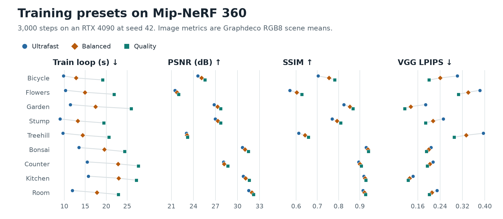
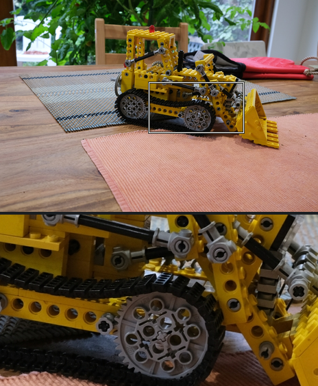
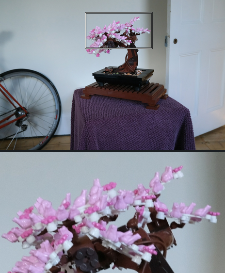
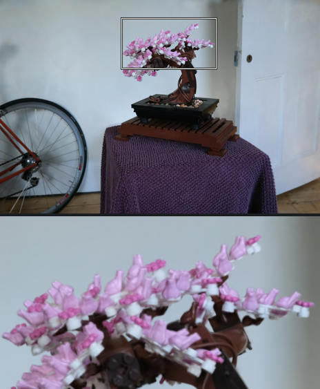

# PERF-GS

**Efficient, extensible & low vram 3dgs training**

On an **RTX 4090**, *Ultrafast* preset averages **27.10 dB PSNR in 11.85 seconds** of training-loop time across the nine Mip-NeRF 360 scenes. *Quality* preset, instead, reaches **27.79 dB in 23.24 seconds**.

For GPUs with less VRAM, start with the *Balanced* preset: it streams in training images from RAM and used an average of **2.72-2.89 GiB of VRAM at loop end** across the nine scenes. [VRAM and system RAM breakdown](docs/benchmarks.md#where-memory-goes)
Check out [VRAM by preset and workstation](docs/benchmarks.md) for benchmarks comparing RTX 4080 to RTX 4090.

[Quickstart](#quickstart) · [Benchmarks](#mip-nerf-360) · [Gallery](#reconstructions)

<p align="center">
  <a href="assets/stump-rtx4090-orbit.webp?raw=true&amp;v=a218367871"></a>
  <br><em>Stump · Ultrafast · RTX 4090 · real-time training</em> · <a href="assets/stump-rtx4090-orbit.gif?raw=true&amp;v=43369c9190">GIF</a>
</p>

**9.21 s for 3,000 optimization steps.** Playback starts with the training loop. Before the clip, the hub spent 0.38 s loading Stump, 0.53 s waiting for Start, and 2.95 s preparing training. The result appeared **13.08 s after scene open**. The same loop took 8.96 s in a separate unrecorded hub run and 8.95 s in the headless benchmark.

## Mip-NeRF 360

| Preset (RTX 4090 24 GB) | Training loop | PSNR ↑ | SSIM ↑ | VGG LPIPS ↓ | VRAM at loop end |
| --- | ---: | ---: | ---: | ---: | ---: |
| Ultrafast | 11.85 s | 27.10 dB | 0.7930 | 0.2567 | 5.29 GiB |
| Balanced (default) | 17.31 s | 27.42 dB | 0.8143 | 0.2229 | 2.81 GiB |
| Quality | 23.24 s | 27.79 dB | 0.8274 | 0.2011 | 6.14 GiB |

Each entry is a mean across nine scenes, with one headless Vulkan run per scene at seed 42. The clock covers 3,000 training steps and excludes loading, initialization, evaluation and export. Graphdeco scored all 246 held-out views per preset at quarter resolution outdoors and half resolution indoors. [Per-scene CSV](docs/NVIDIA_GeForce_RTX_4090_presets.csv) · [Workstation and software](docs/NVIDIA_GeForce_RTX_4090_system.txt) · [Reproduce the benchmark](docs/benchmark-rtx4090.md)



## Quickstart

Run the hub from the repository root with Python 3.10+ and a Vulkan or D3D12 GPU.

**Windows PowerShell.** If this checkout already has the benchmark environment, launch the hub directly.

```powershell
.\.venv\Scripts\python.exe -m trainer.frontend.app --hub
```

For a fresh Windows checkout with Python 3.11 and the `py` launcher installed, run these setup commands once before launching the hub.

```powershell
py -3.11 -m venv .venv
.\.venv\Scripts\python.exe -m pip install -e .
```

Use `.\.venv\Scripts\python.exe` for the other `python` examples below, or activate the environment in your current shell with `.\.venv\Scripts\Activate.ps1`.

**Other platforms or an active Python environment**

```sh
python -m pip install -e .
python -m trainer.frontend.app --hub
```

Drop the folder containing `images/` and `sparse/0/` into the hub and click **Start Training**. Explore the result, export a PLY, or train again from the original point cloud. If you have photos only, choose **Reconstruct to COLMAP** first. [Hub walkthrough](docs/usage.md#interactive-hub)


**Try a sample from the command line.** Download the Tanks & Temples sample archive (about 650 MB) and train the truck scene.

```sh
python scripts/data/download_tandt_db.py --set tandt
python -m trainer.frontend.app --scene datasets/tandt/truck --no-viewer --save-ply
```

The model is saved in `outputs/train/<run-name>/output.ply`. Evaluation is off by default. Add `--run-report` for held-out metrics. [Datasets](docs/usage.md#datasets) · [Compatibility and first-run help](docs/usage.md#first-run-help)

## Reconstructions

Each row pairs a held-out photograph with the three renders scored in the RTX 4090 benchmark. Each preset trained for 3,000 steps. The box marks the detail shown beneath each full view. Select a tile to see the crop at native resolution.

<table>
  <thead>
    <tr>
      <th scope="col" width="25%">Reference photo</th>
      <th scope="col" width="25%">Ultrafast</th>
      <th scope="col" width="25%">Balanced</th>
      <th scope="col" width="25%">Quality</th>
    </tr>
  </thead>
  <tbody>
    <tr><th scope="rowgroup" colspan="4" align="left">Kitchen</th></tr>
    <tr>
      <td><a href="assets/reconstructions/kitchen-reference.webp"></a></td>
      <td><a href="assets/reconstructions/kitchen-ultrafast.webp"></a></td>
      <td><a href="assets/reconstructions/kitchen-balanced.webp"></a></td>
      <td><a href="assets/reconstructions/kitchen-quality.webp"></a></td>
    </tr>
  </tbody>
  <tbody>
    <tr><th scope="rowgroup" colspan="4" align="left">Bicycle</th></tr>
    <tr>
      <td><a href="assets/reconstructions/bicycle-reference.webp"></a></td>
      <td><a href="assets/reconstructions/bicycle-ultrafast.webp"></a></td>
      <td><a href="assets/reconstructions/bicycle-balanced.webp"></a></td>
      <td><a href="assets/reconstructions/bicycle-quality.webp"></a></td>
    </tr>
  </tbody>
  <tbody>
    <tr><th scope="rowgroup" colspan="4" align="left">Stump</th></tr>
    <tr>
      <td><a href="assets/reconstructions/stump-reference.webp"></a></td>
      <td><a href="assets/reconstructions/stump-ultrafast.webp"></a></td>
      <td><a href="assets/reconstructions/stump-balanced.webp"></a></td>
      <td><a href="assets/reconstructions/stump-quality.webp"></a></td>
    </tr>
  </tbody>
  <tbody>
    <tr><th scope="rowgroup" colspan="4" align="left">Room</th></tr>
    <tr>
      <td><a href="assets/reconstructions/room-reference.webp"></a></td>
      <td><a href="assets/reconstructions/room-ultrafast.webp"></a></td>
      <td><a href="assets/reconstructions/room-balanced.webp"></a></td>
      <td><a href="assets/reconstructions/room-quality.webp"></a></td>
    </tr>
  </tbody>
  <tbody>
    <tr><th scope="rowgroup" colspan="4" align="left">Bonsai</th></tr>
    <tr>
      <td><a href="assets/reconstructions/bonsai-reference.webp"></a></td>
      <td><a href="assets/reconstructions/bonsai-ultrafast.webp"></a></td>
      <td><a href="assets/reconstructions/bonsai-balanced.webp"></a></td>
      <td><a href="assets/reconstructions/bonsai-quality.webp"></a></td>
    </tr>
  </tbody>
</table>

Scenes and reference photography from Barron et al., CVPR 2022. [Mip-NeRF 360 dataset](https://jonbarron.info/mipnerf360/)

## How it works

Python and SlangPy drive the same Slang rendering, optimization and densification shaders on Vulkan and D3D12. The trainer starts with COLMAP points, adds stereo matches from training views and fits a lens response from those views. Vulkan is the default. On Windows, select D3D12 with `--backend d3d12`. [Shaders](shaders/) · [Preset settings](docs/usage.md#training)

## Datasets

The download helpers link to three datasets that can be obtained separately by users · [Download instructions](docs/usage.md#datasets)

| Dataset | Project / attribution | Included scene selection |
| --- | --- | --- |
| Mip-NeRF 360 | [Barron et al., CVPR 2022](https://jonbarron.info/mipnerf360/) | bicycle, bonsai, counter, garden, kitchen, room, stump (plus optional flowers and treehill) |
| Tanks & Temples | [Knapitsch et al., ACM TOG 2017](https://www.tanksandtemples.org/) | train, truck |
| Deep Blending | [Hedman et al., ACM TOG 2018](https://repo-sam.inria.fr/fungraph/deep-blending/) | drjohnson, playroom |

## License

This project is provided under the BSD 3-Clause License, see [LICENSE](LICENSE) for details. See [NOTICE](NOTICE.md) for licensing details on other software and data.

## Contributing

Before you can contribute, EA must have a Contributor License Agreement (CLA) on file that has been signed by each contributor. You can sign [here](https://electronicarts.na1.echosign.com/public/esignWidget?wid=CBFCIBAA3AAABLblqZhByHRvZqmltGtliuExmuV-WNzlaJGPhbSRg2ufuPsM3P0QmILZjLpkGslg24-UJtek*).
