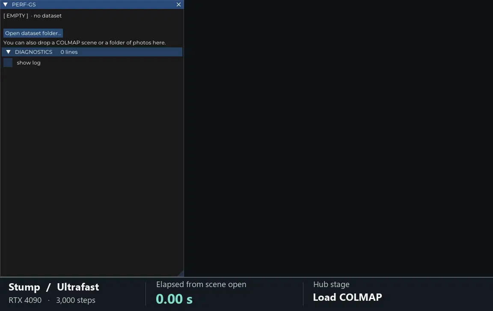
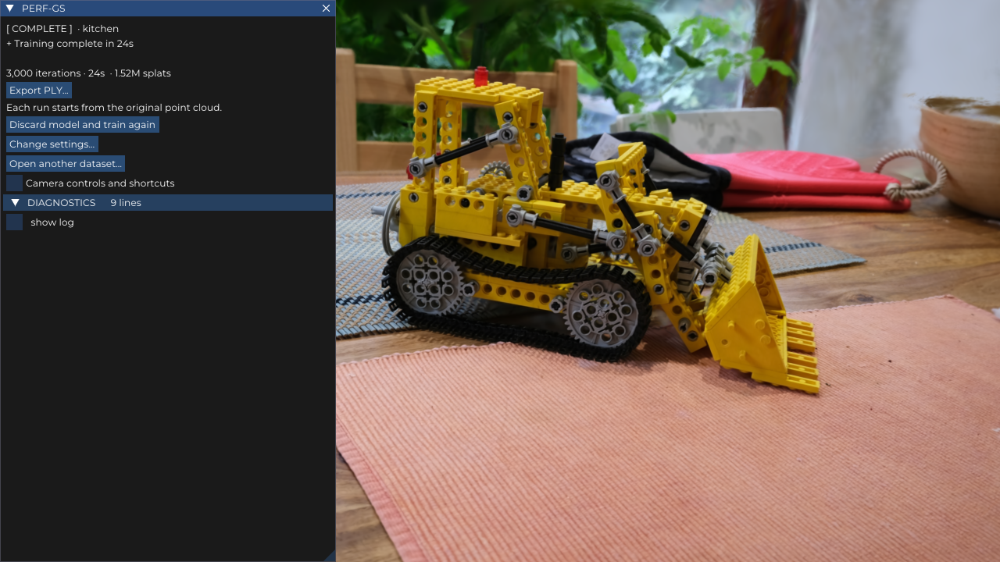
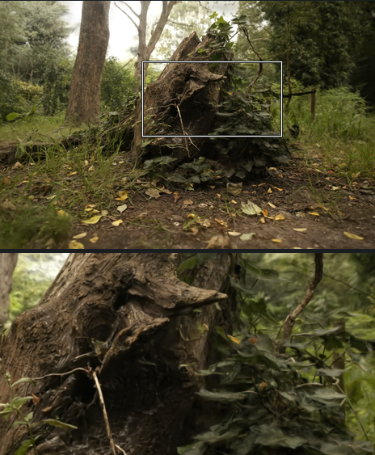
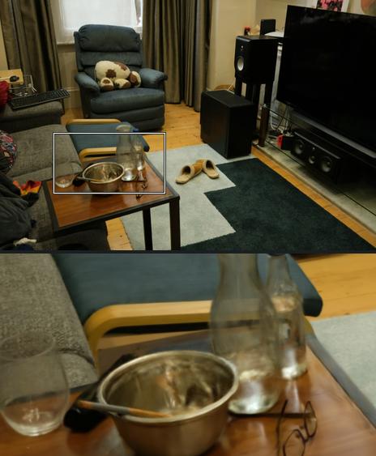

# PERF-GS

**3DGS in seconds.**

On MipNerf360, we average **27.13 dB PSNR in 17.62 seconds** with Ultrafast preset and **27.78 dB PSNR in 33.85 seconds** with **Quality** preset.

[Quickstart](#quickstart) · [Benchmarks](#mip-nerf-360-at-3000-steps) · [Gallery](#reconstructions)

<p align="center">
  <a href="assets/perfgs-demo.webp?raw=true"></a>
  <br><em>Stump · Ultrafast · RTX 4080 · real-time playback</em> · <a href="assets/perfgs-demo.gif?raw=true">GIF (61 MiB)</a>
</p>

**18.14 s from opening the scene to training completion** = 0.19 s to load COLMAP + 0.52 s before pressing Start + 3.41 s for setup + 14.02 s of optimization. The clock stays at 18.14 s during the final camera move.

## Mip-NeRF 360

| Preset | Training loop | Launch to saved PLY | PSNR ↑ | SSIM ↑ | VGG LPIPS ↓ |
| --- | ---: | ---: | ---: | ---: | ---: |
| Ultrafast | 17.62 s | 31.28 s | 27.13 dB | 0.7936 | 0.2567 |
| Balanced (default) | 25.97 s | 41.30 s | 27.39 dB | 0.8143 | 0.2229 |
| Quality | 33.85 s | 49.56 s | 27.78 dB | 0.8275 | 0.2011 |

Headless runs on Windows, RTX 4080 16 GB, Vulkan, seed 42. The training loop excludes loading, initialization and export. Launch to saved PLY includes all three and a disk sync. Each scene contributes equally. Graphdeco’s RGB8 evaluator scores 246 held-out views at quarter resolution outdoors and half resolution indoors. [Reproduce the benchmark](docs/mipnerf360_3k.md#reproduce-the-benchmark) · [Per-scene results and published comparisons](docs/benchmarks.md)

Ultrafast requires NVIDIA’s separately licensed non-commercial research masks. Download them once with `python scripts/data/download_stbn.py`. Balanced and Quality work with the base install. [Mask terms](docs/stbn_pixel_sampling.md)

<details>
<summary>Speed versus quality</summary>


</details>

## Quickstart

With Python 3.10+ and a Vulkan or D3D12 GPU, launch the hub from the repository root.

```sh
python -m pip install -e .
python -m trainer.frontend.app --hub
```

Drop the folder containing `images/` and `sparse/0/` into the hub. Click **Start Training**, explore the result, then choose **Export PLY...**. If you have photos only, choose **Reconstruct to COLMAP** first. [Hub walkthrough](docs/usage.md#interactive-hub)



**Try a sample from the command line.** Download the Tanks & Temples sample archive (about 650 MB) and train the truck scene.

```sh
python scripts/data/download_tandt_db.py --set tandt
python -m trainer.frontend.app --scene datasets/tandt/truck --no-viewer --save-ply
```

The model is saved in `outputs/train/<run-name>/output.ply`. Evaluation is off by default. Add `--run-report` for held-out metrics. [Datasets](docs/usage.md#datasets) · [Compatibility and first-run help](docs/usage.md#first-run-help)

## Reconstructions

Each row shows one held-out photograph and all three 3,000-step presets rendered from that camera. Beneath each full view is the same boxed detail, cropped without color or exposure adjustments. Select a tile to see the crop at native resolution.

<table>
  <thead>
    <tr>
      <th scope="col" width="25%">Reference photo</th>
      <th scope="col" width="25%">Ultrafast</th>
      <th scope="col" width="25%">Balanced</th>
      <th scope="col" width="25%">Quality</th>
    </tr>
  </thead>
  <tbody>
    <tr><th scope="rowgroup" colspan="4" align="left">Kitchen</th></tr>
    <tr>
      <td><a href="assets/reconstructions/kitchen-reference.webp"></a></td>
      <td><a href="assets/reconstructions/kitchen-ultrafast.webp"></a></td>
      <td><a href="assets/reconstructions/kitchen-balanced.webp"></a></td>
      <td><a href="assets/reconstructions/kitchen-quality.webp"></a></td>
    </tr>
  </tbody>
  <tbody>
    <tr><th scope="rowgroup" colspan="4" align="left">Bicycle</th></tr>
    <tr>
      <td><a href="assets/reconstructions/bicycle-reference.webp"></a></td>
      <td><a href="assets/reconstructions/bicycle-ultrafast.webp"></a></td>
      <td><a href="assets/reconstructions/bicycle-balanced.webp"></a></td>
      <td><a href="assets/reconstructions/bicycle-quality.webp"></a></td>
    </tr>
  </tbody>
  <tbody>
    <tr><th scope="rowgroup" colspan="4" align="left">Stump</th></tr>
    <tr>
      <td><a href="assets/reconstructions/stump-reference.webp"></a></td>
      <td><a href="assets/reconstructions/stump-ultrafast.webp"></a></td>
      <td><a href="assets/reconstructions/stump-balanced.webp"></a></td>
      <td><a href="assets/reconstructions/stump-quality.webp"></a></td>
    </tr>
  </tbody>
  <tbody>
    <tr><th scope="rowgroup" colspan="4" align="left">Room</th></tr>
    <tr>
      <td><a href="assets/reconstructions/room-reference.webp"></a></td>
      <td><a href="assets/reconstructions/room-ultrafast.webp"></a></td>
      <td><a href="assets/reconstructions/room-balanced.webp"></a></td>
      <td><a href="assets/reconstructions/room-quality.webp"></a></td>
    </tr>
  </tbody>
  <tbody>
    <tr><th scope="rowgroup" colspan="4" align="left">Bonsai</th></tr>
    <tr>
      <td><a href="assets/reconstructions/bonsai-reference.webp"></a></td>
      <td><a href="assets/reconstructions/bonsai-ultrafast.webp"></a></td>
      <td><a href="assets/reconstructions/bonsai-balanced.webp"></a></td>
      <td><a href="assets/reconstructions/bonsai-quality.webp"></a></td>
    </tr>
  </tbody>
</table>

Scenes and reference photography from Barron et al., CVPR 2022. [Mip-NeRF 360 dataset](https://jonbarron.info/mipnerf360/)

## How it works

Python and SlangPy drive the same Slang rendering, optimization and densification shaders on Vulkan and D3D12. The trainer starts with COLMAP points, adds stereo matches from training views and fits a lens response from those views. Vulkan is the default. On Windows, select D3D12 with `--backend d3d12`. [Shaders](shaders/) · [Preset settings](docs/usage.md#training)

## Datasets

The download helpers link to three datasets that can be obtained separately by users · [Download instructions](docs/usage.md#datasets)

| Dataset | Project / attribution | Included scene selection |
| --- | --- | --- |
| Mip-NeRF 360 | [Barron et al., CVPR 2022](https://jonbarron.info/mipnerf360/) | bicycle, bonsai, counter, garden, kitchen, room, stump (plus optional flowers and treehill) |
| Tanks & Temples | [Knapitsch et al., ACM TOG 2017](https://www.tanksandtemples.org/) | train, truck |
| Deep Blending | [Hedman et al., ACM TOG 2018](https://repo-sam.inria.fr/fungraph/deep-blending/) | drjohnson, playroom |

## License

This project is provided under the BSD 3-Clause License, see [LICENSE](LICENSE.md) for details. See [NOTICE](NOTICE.md) for licensing details on other software and data.

## Contributing

Before you can contribute, EA must have a Contributor License Agreement (CLA) on file that has been signed by each contributor. You can sign [here](https://electronicarts.na1.echosign.com/public/esignWidget?wid=CBFCIBAA3AAABLblqZhByHRvZqmltGtliuExmuV-WNzlaJGPhbSRg2ufuPsM3P0QmILZjLpkGslg24-UJtek*).
