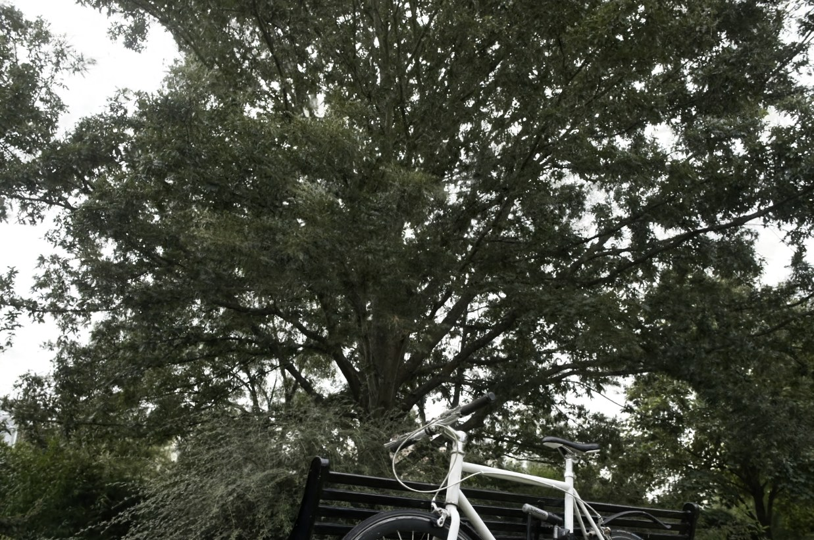
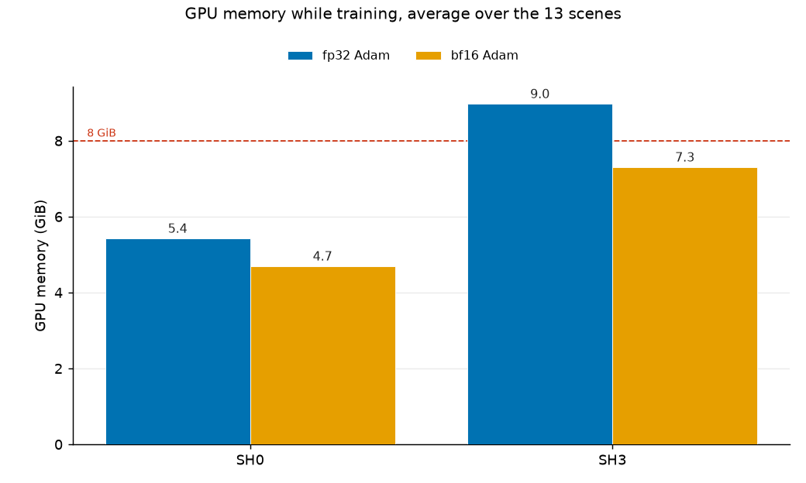

<!-- Images in assets/ are real outputs of this repo: teaser.jpg and
     examples_strip.jpg are renders from a trained bicycle scene (Mip-NeRF 360,
     30k iters); the Results figures are generated from the benchmark runs by
     scripts/plots/plot_readme_results.py, and pareto.png by
     scripts/plots/plot_pareto.py. -->

# PERF-GS
A fast, modular and efficient Slang-based 3DGS trainer.


An extensible 3D Gaussian Splatting [[1]](#ref-3dgs) trainer written in [Slang](https://shader-slang.org) and driven from Python through [SlangPy](https://slangpy.shader-slang.org).<br>
On an RTX 4080 it trains a Mip-NeRF 360 [[2]](#ref-mipnerf360) scene in 25.2 seconds on average at SH0 and 36.0 seconds at SH3, supervising every pixel (23.5 and 34.5 seconds with 50% sparse supervision). The codebase has no CUDA dependencies, is directly integratable with pytorch frontend and all shaders are dispatched via SlangPy and written in Slang.

<p align="center">
  
  <br><em>Mip-NeRF 360 bicycle, trained end to end by this pipeline and rendered from a held-out camera.</em>
</p>

By writing the kernels in Slang and having the whole system driven by slangpy, we aim to allow distributing this trainer on any system and any backend. 

**Portability first.** The rasterizer, the gradients, the optimizer, and the densification kernels are all Slang. The same source compiles to SPIR-V for Vulkan and DXIL for D3D12 today, with room for more backends as slang-rhi grows. There are no `.cu` files anywhere and nothing that assumes a specific vendor.

**Modular codebase.** Most 3DGS trainer usually live on a performance-readability spectrum, we aimed to have both, while also having flexible portability.

**Built to be extended.** Primitives, losses, and densification strategies are separate shader units behind small interfaces, so adding a new primitive kind or a new loss should be a rather local change rather than surgery across the whole pipeline.


## Features

- Full training from COLMAP [[3]](#ref-colmap) scenes: tile-binned forward rasterization, a hand-written backward pass, Adam [[4]](#ref-adam), and a held-out evaluation split.
- Densification you choose per run: a gradient (AbsGS-style [[5]](#ref-absgs)) path, and a structure-aware (SAD-GS-style [[6]](#ref-sadgs)) path that grid-splits gaussians which under-resolve local image structure.
- Mip-Splatting [[7]](#ref-mipsplatting) 3D smoothing filter for scale-correct, anti-aliased rendering.
- Deterministic Nsight GPU Trace capture hooks for profiling the real, optimized kernels (this is Nvidia specific, but we want to allow integrating profiling also on AMD Radeon GPU Profiler (RGP)).

<p align="center">
  
  <br><em>Three novel views of the same reconstruction. Every frame is rendered from the trained gaussians, not the input photos.</em>
</p>

## Results

**On an RTX 4080, a Mip-NeRF 360 scene trains in 25.2 seconds on average at SH0 (26.50 dB) and 36.0 seconds at SH3 (26.82 dB),** supervising every pixel; with 50% sparse supervision it takes 23.5 and 34.5 seconds (26.42 and 26.73 dB). The indoor scenes take 13.7–18.8 seconds at SH0. Stacking pruning, bf16 optimizer state and 50% sparse supervision trains bicycle in 22.9 seconds and room in 11.6 for under 0.1 dB of PSNR, and the fastest combination we tried in 15.7 and 8.5 seconds for 0.4 and 1.0 dB (see [Speed/quality trade-offs](#speedquality-trade-offs)).

All runs: 3000 iterations, structure-aware densification with Mip-Splatting, every 8th view held out, one run each. Mip-NeRF 360 trains at quarter resolution, Tanks & Temples [[8]](#ref-tandt) at 980×545 and Deep Blending [[9]](#ref-deepblending) at native resolution. Times cover the training loop only. Every configuration is in [docs/benchmark_results.csv](docs/benchmark_results.csv), and [scripts/plots/plot_readme_results.py](scripts/plots/plot_readme_results.py) regenerates the figures.

### Quality and training time

Averages over each dataset's scenes, every pixel supervised. PSNR, SSIM [[10]](#ref-ssim) and LPIPS [[11]](#ref-lpips) are measured on the held-out views; the figures below break them down per scene.

| Dataset | SH | PSNR | SSIM | LPIPS | Time (seconds) |
| --- | ---: | ---: | ---: | ---: | ---: |
| Mip-NeRF 360 | SH0 | 26.50 | 0.809 | 0.216 | 25.2 |
| Mip-NeRF 360 | SH3 | 26.82 | 0.817 | 0.207 | 36.0 |
| Tanks & Temples | SH0 | 22.59 | 0.839 | 0.222 | 26.5 |
| Tanks & Temples | SH3 | 22.87 | 0.847 | 0.209 | 38.4 |
| Deep Blending | SH0 | 29.13 | 0.903 | 0.328 | 22.7 |
| Deep Blending | SH3 | 29.40 | 0.905 | 0.321 | 30.8 |

SH3 adds about 0.3 dB on every dataset (0.27–0.32 dB) for 36–45% more training time.

<p align="center">
  
  <br>
  
</p>

### Training time and GPU memory

Averages per dataset, every pixel supervised:

| Dataset | SH | Time (seconds) | Splats (millions) | VRAM (GiB) |
| --- | ---: | ---: | ---: | ---: |
| Mip-NeRF 360 | SH0 | 25.2 | 3.82 | 5.4 |
| Mip-NeRF 360 | SH3 | 36.0 | 3.84 | 9.0 |
| Tanks & Temples | SH0 | 26.5 | 3.14 | 5.4 |
| Tanks & Temples | SH3 | 38.4 | 3.15 | 8.9 |
| Deep Blending | SH0 | 22.7 | 4.76 | 5.5 |
| Deep Blending | SH3 | 30.8 | 4.80 | 9.0 |

<p align="center">
  
</p>

Memory is reserved up front for up to 7 million splats (`--max-splats`), so it is nearly the same for every scene. With bf16 optimizer state (below), SH3 stays under 8 GiB.

### Sparse supervision (STBN)

`--stbn-pixel-fraction` supervises only a spatiotemporal blue-noise (STBN [[12]](#ref-stbn)) subset of the pixels at each step. At 50% it costs under 0.1 dB and trains 2–7% faster, at 25% it costs 0.1–0.2 dB and trains 6–14% faster; at 2% quality drops sharply.

SH0:

| Pixels / step | M360 PSNR | M360 time (seconds) | T&T PSNR | T&T time (seconds) | DB PSNR | DB time (seconds) |
| --- | ---: | ---: | ---: | ---: | ---: | ---: |
| 100% | 26.50 | 25.2 | 22.59 | 26.5 | 29.13 | 22.7 |
| 50% | 26.42 | 23.5 | 22.52 | 25.4 | 29.24 | 21.4 |
| 25% | 26.27 | 21.6 | 22.42 | 24.0 | 29.02 | 19.6 |
| 10% | 25.85 | 20.7 | 22.13 | 24.1 | 29.03 | 18.6 |
| 2% | 23.39 | 22.6 | 19.82 | 27.5 | 26.96 | 18.0 |

SH3:

| Pixels / step | M360 PSNR | M360 time (seconds) | T&T PSNR | T&T time (seconds) | DB PSNR | DB time (seconds) |
| --- | ---: | ---: | ---: | ---: | ---: | ---: |
| 100% | 26.82 | 36.0 | 22.87 | 38.4 | 29.40 | 30.8 |
| 50% | 26.73 | 34.5 | 22.79 | 37.5 | 29.38 | 29.1 |
| 25% | 26.64 | 32.1 | 22.68 | 36.2 | 29.22 | 26.9 |
| 10% | 26.22 | 31.3 | 22.45 | 36.7 | 29.36 | 26.4 |
| 2% | 23.65 | 35.5 | 19.97 | 43.6 | 27.40 | 26.1 |

<p align="center">
  
  <br>
  
</p>

### Optimizer precision

`--adam-moments bf16` stores the optimizer state in bf16: the same quality, 0.7–1.7 GiB less memory and a slightly faster loop. Averages over all 13 scenes, every pixel supervised:

| SH | Adam moments | M360 PSNR | T&T PSNR | DB PSNR | Time (seconds) | VRAM (GiB) |
| --- | ---: | ---: | ---: | ---: | ---: | ---: |
| SH0 | fp32 | 26.50 | 22.59 | 29.13 | 25.0 | 5.42 |
| SH0 | bf16 | 26.48 | 22.58 | 29.22 | 24.1 | 4.69 |
| SH3 | fp32 | 26.82 | 22.87 | 29.40 | 35.6 | 8.97 |
| SH3 | bf16 | 26.80 | 22.86 | 29.50 | 33.0 | 7.30 |

### Per-step overhead

All numbers above include four recent changes that leave the math unchanged:

- The SSIM loss runs as two LDS-tiled separable passes (11-tap rows, then 11-tap columns) instead of two 121-tap window loops. Its gradient also lands closer to a float64 reference.
- The projection backward resets the 2D gradient seeds it consumes, so no step clears all 7 million slots of six buffers any more.
- The forward depth sort runs only the radix passes the tile index needs: 6 of 8 at quarter resolution.
- Densification bookkeeping only reads live, visible splats, and stops after the last densification step.

Bicycle at iteration 560, Nsight GPU Trace with clocks locked to base, milliseconds per step:

| Pass | Before | After |
| --- | ---: | ---: |
| Gradient seed clear | 0.48 | 0 |
| Radix sort | 1.58 | 1.24 |
| SSIM loss | 1.65 | 0.29 |
| Densification bookkeeping | 0.25 | 0.07 |
| Projection backward | 0.22 | 0.27 |
| **Whole step** | **10.50** | **8.07** |

End to end at SH0, bicycle trains in 27.5 seconds instead of 34.8 (24.44 dB, was 24.42) and room in 13.8 seconds instead of 17.5 (30.68 dB, was 30.76; mean of three seeds, which spread by 0.24 dB). Over the whole benchmark at SH0, Mip-NeRF 360 went from 31.3 to 25.2 seconds, Tanks & Temples from 32.0 to 26.5 and Deep Blending from 29.8 to 22.7, with PSNR within 0.05 dB; at SH3 they take 36.0, 38.4 and 30.8 seconds instead of 41.8, 44.0 and 37.5.

### Speed/quality trade-offs

The knobs that buy speed with quality stack: sparse supervision (`--stbn-pixel-fraction`), bf16 optimizer state (`--adam-moments bf16`), blend-weight pruning (`--prune-blend-weight`, `--prune-blend-from`) and the opaque-core splat kernel (`--splat-kernel opaque_core --splat-profile-power 3 --splat-profile-onset 2`). Each point below is one combination trained on bicycle (one run) and room (mean of three seeds) at SH0 with the current code; the line joins the combinations that nothing else beats on both training time and PSNR.

<p align="center">
  
</p>

Sorted from slowest to fastest; the PSNR change and time are averaged over the two scenes, and bold rows are on the frontier of that average.

| Configuration | bicycle PSNR | bicycle time (seconds) | room PSNR | room time (seconds) | PSNR change (dB) | Time vs. baseline |
| --- | ---: | ---: | ---: | ---: | ---: | ---: |
| baseline (defaults) | 24.44 | 27.5 | 30.68 | 13.8 | 0.00 | 100% |
| bf16 | 24.43 | 27.0 | 30.72 | 13.4 | +0.02 | 98% |
| STBN 50% | 24.34 | 25.7 | 30.71 | 13.1 | −0.04 | 94% |
| **prune** | **24.45** | **25.8** | **30.73** | **12.5** | **+0.03** | **92%** |
| opaque core | 24.22 | 25.3 | 30.27 | 12.3 | −0.32 | 91% |
| **bf16 + prune** | **24.45** | **24.1** | **30.70** | **12.1** | **+0.01** | **88%** |
| STBN 25% | 24.24 | 23.1 | 30.41 | 12.5 | −0.24 | 87% |
| STBN 10% | 23.69 | 21.7 | 30.03 | 12.3 | −0.70 | 84% |
| **bf16 + prune + STBN 50%** | **24.37** | **22.9** | **30.60** | **11.6** | **−0.08** | **84%** |
| bf16 + prune + opaque core | 24.24 | 21.8 | 30.20 | 10.8 | −0.34 | 79% |
| bf16 + prune + STBN 25% | 24.22 | 19.8 | 30.36 | 10.1 | −0.27 | 73% |
| **prune early** | **24.46** | **20.9** | **30.25** | **9.2** | **−0.21** | **71%** |
| **bf16 + prune early + STBN 50% + opaque core** | **24.02** | **15.7** | **29.68** | **8.5** | **−0.71** | **59%** |

"prune" is `--prune-blend-weight 0.2 --prune-blend-from 1900` and "prune early" is `--prune-blend-weight 0.3 --prune-blend-from 500`.

- **Same quality, 12% faster:** `--adam-moments bf16 --prune-blend-weight 0.2 --prune-blend-from 1900`.
- **Within 0.1 dB, 16% faster:** add `--stbn-pixel-fraction 0.5` (bicycle in 22.9 seconds, room in 11.6).
- **Pruning early** is free on bicycle (24.46 dB in 20.9 seconds) but costs room 0.4 dB, so it suits large outdoor scenes.
- **Everything stacked** trains bicycle in 15.7 seconds and room in 8.5 for 0.7 dB.

[scripts/running/eval_pareto.py](scripts/running/eval_pareto.py) reruns the sweep (runs are cached) and every number is in [docs/pareto_results.csv](docs/pareto_results.csv).

### Convergence

<p align="center">
  
</p>

## How it trains

```
COLMAP scene  ->  init gaussians  ->  per-iteration loop:

      sample a training camera
      forward rasterize    (tile bin, depth sort, front-to-back blend)
      backward rasterize   (analytic gradients into fixed-point buffers)
      Adam step            (per-parameter LRs, extent-scaled means LR)
      densify on schedule  (gradient or structure-aware) then Morton re-sort
      refresh the mip 3D filter

  every N iters:  held-out eval  ->  PSNR / SSIM  ->  export PLY
```

The loop keeps the GPU queue shallow with fence-based backpressure instead of draining it every step.

## Backends and portability

| Backend | Status | Shader IR |
|---|---|---|
| Vulkan | primary | SPIR-V |
| D3D12 | cross-checked | DXIL |
| others | as slang-rhi adds them | Slang recompiles, no rewrite |

Every kernel is written once in Slang. Switching backends is a single flag (`--backend vulkan` or `--backend d3d12`), and the smoke tests compile the full shader set on both so a change that breaks one is caught early. Nothing in the training path depends on CUDA, cuBLAS, or a specific driver runtime.

## Install

You need a Vulkan or D3D12 capable GPU with recent drivers, and Python 3.10 or newer.

```bash
python -m venv .venv
# Windows
.venv\Scripts\activate
# Linux / macOS
source .venv/bin/activate

pip install -e ".[dev]"
```

For a regular installation, use `pip install .` or install a built wheel, then
run `python -m trainer.frontend.app`. Wheels and source distributions include
the Slang shaders. Installed runs resolve shaders from package resources and
keep their STBN cache in the working directory; editable checkouts retain the
repository's `.stbn` cache.

Scenes use the Mip-NeRF 360 layout (a COLMAP `sparse/` folder plus `images/`). Point `--scene` at any such folder.

## Datasets

The download helpers link to **three datasets** that can be obtained separately by users:

| Dataset | Project / attribution | Included scene selection |
| --- | --- | --- |
| Mip-NeRF 360 | [Barron et al., CVPR 2022](https://jonbarron.info/mipnerf360/) [[2]](#ref-mipnerf360) | bicycle, bonsai, counter, garden, kitchen, room, stump; optional flowers and treehill |
| Tanks & Temples | [Knapitsch et al., ACM TOG 2017](https://www.tanksandtemples.org/) [[8]](#ref-tandt) | train, truck |
| Deep Blending | [Hedman et al., ACM TOG 2018](https://visual.cs.ucl.ac.uk/pubs/deepblending/) [[9]](#ref-deepblending) | drjohnson, playroom |

Fetch the [Mip-NeRF 360](https://jonbarron.info/mipnerf360/) dataset with the helper script (standard library only, no extra dependencies):

```bash
# The seven public scenes (bicycle, bonsai, counter, garden, kitchen, room, stump)
# -> datasets/360_v2/
python scripts/data/download_mipnerf360.py

# Also fetch the extra scenes (flowers, treehill) -> datasets/360_extra_scenes/
python scripts/data/download_mipnerf360.py --set all
```

The archives are large (~12 GB for the public scenes, ~4.5 GB more for the extras). The download streams to disk with a progress readout, is idempotent (re-running skips scenes already present), and extracts into place. Useful flags:

- `--set {v2,extra,all}` — which scenes to fetch (default `v2`).
- `--dest <dir>` — download somewhere other than the repo `datasets/` folder.
- `--force` — re-download even if the scenes already exist.
- `--keep-zip` — keep the downloaded `.zip` archives after extraction.

Fetch the **Tanks & Temples** and **Deep Blending** scenes (the other datasets the 3DGS papers report on) with a second helper. Both ship in one ~650 MB archive from the INRIA 3DGS authors [[1]](#ref-3dgs):

```bash
# Both -> datasets/tandt/{train,truck} and datasets/db/{drjohnson,playroom}
python scripts/data/download_tandt_db.py

# Only one dataset (still downloads the combined archive)
python scripts/data/download_tandt_db.py --set tandt   # or: --set db
```

Same flags as above (`--dest`, `--force`, `--keep-zip`).

## Quickstart

```bash
# Structure-aware densification with anti-aliasing, headless
python scripts/running/v2_train.py --scene datasets/360_v2/garden \
    --densify-mode structure_aware --mip-splatting --no-viewer

# Watch it train in the live viewer
python scripts/running/v2_train.py --scene datasets/360_v2/room --densify-mode structure_aware

# Cross-check the same run on D3D12
python scripts/running/v2_train.py --scene datasets/360_v2/room --backend d3d12 --no-viewer
```

Each run writes to `outputs/train/<run-name>/`: a `log.jsonl`, a `final_psnr.json` summary, an `output.ply`, and per-camera renders under `cams/`. The plot scripts in `scripts/plots/` turn those into convergence and comparison figures.

The trainer also opens `errors.log` in the initial run directory **before GPU setup** and prints its full path. Python tracebacks and native stderr (including SlangPy/Vulkan errors) go there and are echoed to the terminal and the viewer's **DIAGNOSTICS** log. In hub mode this file covers the entire session, including subsequent runs. Native aborts can close the window before it refreshes; already-written diagnostics remain in the file. This records errors, not crash recovery, and cannot recover messages a driver never emits.

## Testing

```bash
pytest -q
```

The suite covers Slang math against known inputs, gradient checks against finite differences, the CLI contract, the training schedule, and a device-creation smoke test on each backend. GPU tests are skipped automatically where no device is available.

## References

1. <a id="ref-3dgs"></a>Bernhard Kerbl, Georgios Kopanas, Thomas Leimkühler, George Drettakis. *3D Gaussian Splatting for Real-Time Radiance Field Rendering.* ACM Transactions on Graphics 42(4), 2023. [arXiv:2308.04079](https://arxiv.org/abs/2308.04079)
2. <a id="ref-mipnerf360"></a>Jonathan T. Barron, Ben Mildenhall, Dor Verbin, Pratul P. Srinivasan, Peter Hedman. *Mip-NeRF 360: Unbounded Anti-Aliased Neural Radiance Fields.* CVPR 2022. [arXiv:2111.12077](https://arxiv.org/abs/2111.12077)
3. <a id="ref-colmap"></a>Johannes L. Schönberger, Jan-Michael Frahm. *Structure-from-Motion Revisited.* CVPR 2016. [colmap.github.io](https://colmap.github.io/)
4. <a id="ref-adam"></a>Diederik P. Kingma, Jimmy Ba. *Adam: A Method for Stochastic Optimization.* ICLR 2015. [arXiv:1412.6980](https://arxiv.org/abs/1412.6980)
5. <a id="ref-absgs"></a>Zongxin Ye, Wenyu Li, Sidun Liu, Peng Qiao, Yong Dou. *AbsGS: Recovering Fine Details for 3D Gaussian Splatting.* arXiv preprint, 2024. [arXiv:2404.10484](https://arxiv.org/abs/2404.10484)
6. <a id="ref-sadgs"></a>Linjie Lyu, Ayush Tewari, Jianchun Chen, Thomas Leimkühler, Christian Theobalt. *Faster 3D Gaussian Splatting Convergence via Structure-Aware Densification.* SIGGRAPH 2026. [arXiv:2604.28016](https://arxiv.org/abs/2604.28016)
7. <a id="ref-mipsplatting"></a>Zehao Yu, Anpei Chen, Binbin Huang, Torsten Sattler, Andreas Geiger. *Mip-Splatting: Alias-free 3D Gaussian Splatting.* CVPR 2024. [arXiv:2311.16493](https://arxiv.org/abs/2311.16493)
8. <a id="ref-tandt"></a>Arno Knapitsch, Jaesik Park, Qian-Yi Zhou, Vladlen Koltun. *Tanks and Temples: Benchmarking Large-Scale Scene Reconstruction.* ACM Transactions on Graphics 36(4), 2017. [tanksandtemples.org](https://www.tanksandtemples.org/)
9. <a id="ref-deepblending"></a>Peter Hedman, Julien Philip, True Price, Jan-Michael Frahm, George Drettakis, Gabriel Brostow. *Deep Blending for Free-Viewpoint Image-Based Rendering.* ACM Transactions on Graphics 37(6), 2018. [Project page](https://repo-sam.inria.fr/fungraph/deep-blending/)
10. <a id="ref-ssim"></a>Zhou Wang, Alan C. Bovik, Hamid R. Sheikh, Eero P. Simoncelli. *Image Quality Assessment: From Error Visibility to Structural Similarity.* IEEE Transactions on Image Processing 13(4):600–612, 2004. [Project page](https://www.cns.nyu.edu/~lcv/ssim/)
11. <a id="ref-lpips"></a>Richard Zhang, Phillip Isola, Alexei A. Efros, Eli Shechtman, Oliver Wang. *The Unreasonable Effectiveness of Deep Features as a Perceptual Metric.* CVPR 2018. [arXiv:1801.03924](https://arxiv.org/abs/1801.03924)
12. <a id="ref-stbn"></a>Alan Wolfe, Nathan Morrical, Tomas Akenine-Möller, Ravi Ramamoorthi. *Scalar Spatiotemporal Blue Noise Masks.* Eurographics Symposium on Rendering (EGSR) 2022. [arXiv:2112.09629](https://arxiv.org/abs/2112.09629)

## License

This project is provided under the BSD 3 Clause License, see [LICENSE](LICENSE) for details. See [NOTICE](NOTICE.md) for licensing details on other software and data.

## CONTRIBUTING

Before you can contribute, EA must have a Contributor License Agreement (CLA) on file that has been signed by each contributor. You can sign [here](https://electronicarts.na1.echosign.com/public/esignWidget?wid=CBFCIBAA3AAABLblqZhByHRvZqmltGtliuExmuV-WNzlaJGPhbSRg2ufuPsM3P0QmILZjLpkGslg24-UJtek*).
