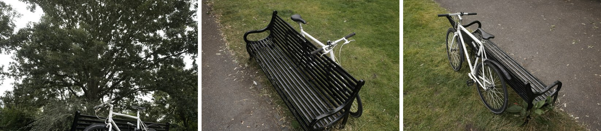

<!-- Images in assets/ are real outputs of this repo: teaser.jpg and
     examples_strip.jpg are renders from a trained bicycle scene (Mip-NeRF 360,
     30k iters); convergence.png is plotted from the per-scene psnr_curve.json
     runs. Swap in your own renders by replacing the files under assets/. -->

# SCATTO-GS
## Slang-Compiled Accelerated Training-Time Optimization for Gaussian Splatting
A fast and efficient Slang-based 3DGS trainer.


A 3D Gaussian Splatting trainer written in [Slang](https://shader-slang.org) and driven from Python through [SlangPy](https://slangpy.shader-slang.org).<br>
It converges in ~47s per scene at SH0 and ~69s at SH3, averaged over the full Mip-NeRF 360 dataset on an RTX 3090. The codebase has no CUDA dependencies, is directly integratable with pytorch frontend and all shaders are dispatched via SlangPy.

<p align="center">
  
  <br><em>Mip-NeRF 360 bicycle, trained end to end by this pipeline and rendered from a held-out camera.</em>
</p>

## Why 

By writing the kernels in Slang and having the whole system driven by slangpy, we aim to allow distributing this trainer on any system and any backend. 

**Portability first.** The rasterizer, the gradients, the optimizer, and the densification kernels are all Slang. The same source compiles to SPIR-V for Vulkan and DXIL for D3D12 today, with room for more backends as slang-rhi grows. There are no `.cu` files anywhere and nothing that assumes a specific vendor.

**Modular codebase.** Most 3DGS trainer usually live on a performance-readability spectrum, we aimed to have both, while also having flexible portability.

**Built to be extended.** Primitives, losses, and densification strategies are separate shader units behind small interfaces, so adding a new primitive kind or a new loss should be a rather local change rather than surgery across the whole pipeline.


## Features

- Full training from COLMAP scenes: tile-binned forward rasterization, a hand-written backward pass, Adam, and a held-out evaluation split.
- Densification you choose per run: a gradient (AbsGS-style) path, and a structure-aware (SAD-GS-style) path that grid-splits gaussians which under-resolve local image structure.
- Mip-Splatting 3D smoothing filter for scale-correct, anti-aliased rendering.
- Deterministic Nsight GPU Trace capture hooks for profiling the real, optimized kernels (this is Nvidia specific, but we want to allow integrating profiling also on AMD Radeon GPU Profiler (RGP)).

<p align="center">
  
  <br><em>Three novel views of the same reconstruction. Every frame is rendered from the trained gaussians, not the input photos.</em>
</p>

## Results

Full Mip-NeRF 360 dataset (9 scenes), quarter resolution, 3000 iterations, structure-aware densification with Mip-Splatting, every 8th view held out for test. Held-out sRGB PSNR and full-loop train time (final metrics pass excluded), for view-independent color (SH0) and the full view-dependent spherical-harmonic model (SH3), on an RTX 3090.

| Scene | PSNR SH0 (dB) | PSNR SH3 (dB) | Time SH0 (seconds) | Time SH3 (seconds) |
|---|---:|---:|---:|---:|
| bicycle | 24.62 | 24.61 | 53.2 | 77.2 |
| flowers | 21.22 | 21.22 | 58.6 | 90.4 |
| garden | 26.56 | 26.54 | 71.4 | 108.4 |
| stump | 26.15 | 26.19 | 54.5 | 82.0 |
| treehill | 22.19 | 22.21 | 58.4 | 81.4 |
| bonsai | 30.17 | 30.16 | 28.9 | 39.9 |
| counter | 27.55 | 27.51 | 36.0 | 53.6 |
| kitchen | 30.06 | 30.10 | 36.2 | 51.4 |
| room | 30.85 | 30.91 | 27.7 | 38.4 |
| **Average** | **26.60** | **26.61** | **47.2** | **69.2** |

<p align="center">
  
  <br>
  
</p>

The higher-order SH bands leave PSNR essentially flat on this dataset (+0.01 dB average) while adding ~47% to train time, so SH0 is the better default here; SH3 is available for scenes with strong view-dependent shading. This is not a claim of a new state of the art — it is a check that a from-scratch Slang implementation reproduces a known-good pipeline faithfully, the bar a research base needs to clear before it is worth building on.

<p align="center">
  
</p>

## How it trains

```
COLMAP scene  ->  init gaussians  ->  per-iteration loop:

      sample a training camera
      forward rasterize    (tile bin, depth sort, front-to-back blend)
      backward rasterize   (analytic gradients into fixed-point buffers)
      Adam step            (per-parameter LRs, extent-scaled means LR)
      densify on schedule  (gradient or structure-aware) then Morton re-sort
      refresh the mip 3D filter

  every N iters:  held-out eval  ->  PSNR / SSIM  ->  export PLY
```

The loop keeps the GPU queue shallow with fence-based backpressure instead of draining it every step, so the CPU never races minutes ahead of the device.

## Architecture

`TrainingHub` handles interactive commands and reconstruction. It delegates each
run to `TrainingApplication`, whose loop owns camera sampling, schedules,
evaluation, and reporting. The backend consumes cameras, learning rates, and
per-step render parameters; it does not depend on COLMAP entries or UI events.

`TrainingPipeline.train_step(camera, lrs=..., contextual=...)` records a complete
optimizer step. Experiments can instead call `record_forward`, `record_loss`,
and `record_backward` inside `pipeline.recording(...)` to inspect intermediate
results without applying Adam. Forward and backward must use the same per-step
parameters; call `clear_gradients()` before each independent gradient sample.

`GpuRuntime` owns command submission and queue waits. The viewer shares that
device while keeping its own rendering buffers; snapshots carry primitive data,
active SH degree, and extinction hardness. Generated contracts keep Python
storage layouts and Slang structures aligned.

Structure-aware buffers are allocated only for that densification mode and
initialized before use. Only training-camera targets and structure fields are
resident on the GPU. Startup reports planned base GPU allocations and training
texture storage; sampler resources and driver overhead are additional.

## Backends and portability

| Backend | Status | Shader IR |
|---|---|---|
| Vulkan | primary | SPIR-V |
| D3D12 | cross-checked | DXIL |
| others | as slang-rhi adds them | Slang recompiles, no rewrite |

Every kernel is written once in Slang. Switching backends is a single flag (`--backend vulkan` or `--backend d3d12`), and the smoke tests compile the full shader set on both so a change that breaks one is caught early. Nothing in the training path depends on CUDA, cuBLAS, or a specific driver runtime.

## Install

You need a Vulkan or D3D12 capable GPU with recent drivers, and Python 3.10 or newer.

```bash
python -m venv .venv
# Windows
.venv\Scripts\activate
# Linux / macOS
source .venv/bin/activate

pip install -e ".[dev]"
```

For a regular installation, use `pip install .` or install a built wheel, then
run `python -m trainer.frontend.app`. Wheels and source distributions include
the Slang shaders. Installed runs resolve shaders from package resources and
keep their STBN cache in the working directory; editable checkouts retain the
repository's `.stbn` cache.

Scenes use the Mip-NeRF 360 layout (a COLMAP `sparse/` folder plus `images/`). Point `--scene` at any such folder.

## Datasets

The download helpers link to **three datasets** that can be obtained separately by users:

| Dataset | Project / attribution | Included scene selection |
| --- | --- | --- |
| Mip-NeRF 360 | [Barron et al., CVPR 2022](https://jonbarron.info/mipnerf360/) | bicycle, bonsai, counter, garden, kitchen, room, stump; optional flowers and treehill |
| Tanks & Temples | [Knapitsch et al., ACM TOG 2017](https://www.tanksandtemples.org/) | train, truck |
| Deep Blending | [Hedman et al., ACM TOG 2018](https://visual.cs.ucl.ac.uk/pubs/deepblending/) | drjohnson, playroom |

Fetch the [Mip-NeRF 360](https://jonbarron.info/mipnerf360/) dataset with the helper script (standard library only, no extra dependencies):

```bash
# The seven public scenes (bicycle, bonsai, counter, garden, kitchen, room, stump)
# -> datasets/360_v2/
python scripts/data/download_mipnerf360.py

# Also fetch the extra scenes (flowers, treehill) -> datasets/360_extra_scenes/
python scripts/data/download_mipnerf360.py --set all
```

The archives are large (~12 GB for the public scenes, ~4.5 GB more for the extras). The download streams to disk with a progress readout, is idempotent (re-running skips scenes already present), and extracts into place. Useful flags:

- `--set {v2,extra,all}` — which scenes to fetch (default `v2`).
- `--dest <dir>` — download somewhere other than the repo `datasets/` folder.
- `--force` — re-download even if the scenes already exist.
- `--keep-zip` — keep the downloaded `.zip` archives after extraction.

Fetch the **Tanks & Temples** and **Deep Blending** scenes (the other datasets the 3DGS papers report on) with a second helper. Both ship in one ~650 MB archive from the INRIA 3DGS authors:

```bash
# Both -> datasets/tandt/{train,truck} and datasets/db/{drjohnson,playroom}
python scripts/data/download_tandt_db.py

# Only one dataset (still downloads the combined archive)
python scripts/data/download_tandt_db.py --set tandt   # or: --set db
```

Same flags as above (`--dest`, `--force`, `--keep-zip`).

## Quickstart

```bash
# Structure-aware densification with anti-aliasing, headless
python scripts/running/v2_train.py --scene datasets/360_v2/garden \
    --densify-mode structure_aware --mip-splatting --no-viewer

# Watch it train in the live viewer
python scripts/running/v2_train.py --scene datasets/360_v2/room --densify-mode structure_aware

# Cross-check the same run on D3D12
python scripts/running/v2_train.py --scene datasets/360_v2/room --backend d3d12 --no-viewer
```

Each run writes to `outputs/train/<run-name>/`: a `log.jsonl`, a `final_psnr.json` summary, an `output.ply`, and per-camera renders under `cams/`. The plot scripts in `scripts/plots/` turn those into convergence and comparison figures.

The trainer also opens `errors.log` in the initial run directory **before GPU setup** and prints its full path. Python tracebacks and native stderr (including SlangPy/Vulkan errors) go there and are echoed to the terminal and the viewer's **DIAGNOSTICS** log. In hub mode this file covers the entire session, including subsequent runs. Native aborts can close the window before it refreshes; already-written diagnostics remain in the file. This records errors, not crash recovery, and cannot recover messages a driver never emits.

## Testing

```bash
pytest -q
```

The suite covers Slang math against known inputs, gradient checks against finite differences, the CLI contract, the training schedule, and a device-creation smoke test on each backend. GPU tests are skipped automatically where no device is available.

## License

This project is provided under the BSD 3 Clause License, see [LICENSE](LICENSE) for details. See [NOTICE](NOTICE.md) for licensing details on other software and data.

## CONTRIBUTING

Before you can contribute, EA must have a Contributor License Agreement (CLA) on file that has been signed by each contributor. You can sign [here](https://electronicarts.na1.echosign.com/public/esignWidget?wid=CBFCIBAA3AAABLblqZhByHRvZqmltGtliuExmuV-WNzlaJGPhbSRg2ufuPsM3P0QmILZjLpkGslg24-UJtek*).
