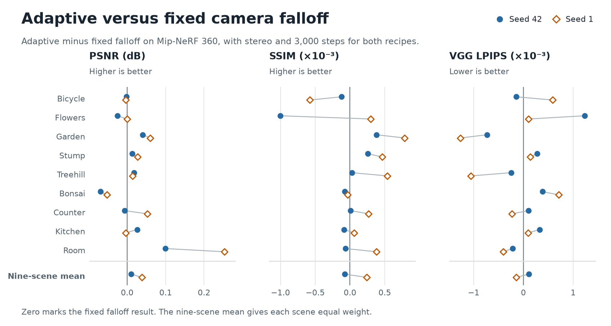
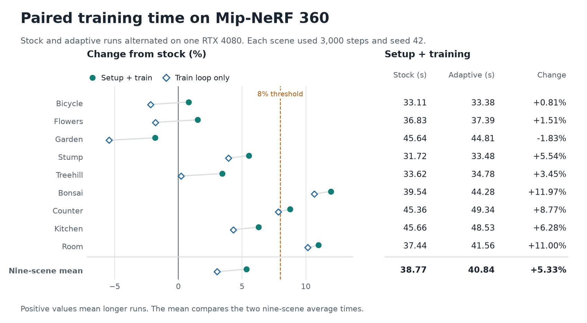
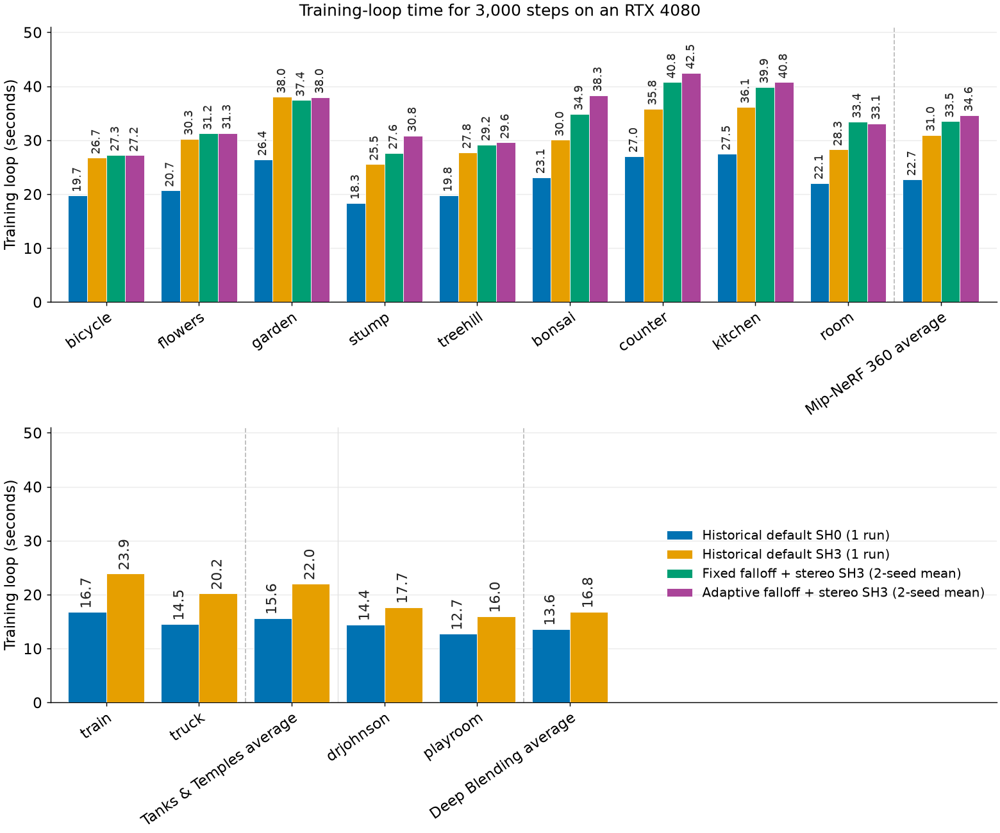
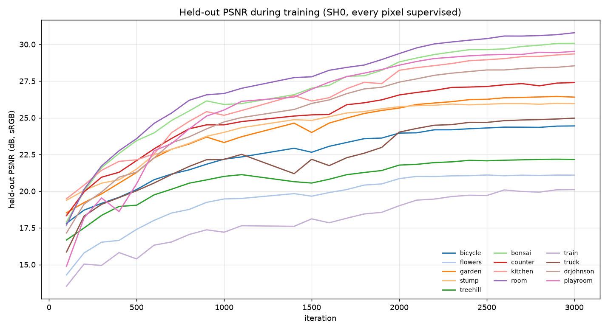

<!-- teaser.jpg and examples_strip.jpg are renders from a 30k-step Mip-NeRF 360
     bicycle run. scripts/plots/plot_readme_results.py produces the overview
     figures, plot_camera_results.py the recipe and lens comparisons, and
     plot_pareto.py the SH0 trade-off plot. -->

# PERF-GS
A fast, modular and efficient Slang-based 3DGS trainer.


An extensible 3D Gaussian Splatting [[1]](#ref-3dgs) trainer written in [Slang](https://shader-slang.org) and driven from Python through [SlangPy](https://slangpy.shader-slang.org).<br>
On an RTX 4080, the 3,000-step SH3 recipe with adaptive lens falloff reaches **27.786 dB and 27.780 dB** on the nine Mip-NeRF 360 scenes at seeds 42 and 1. In a paired seed-42 comparison, the recipe took **40.84 seconds per scene including setup**, versus **38.77 seconds for stock** (+5.33%). The recipe supervises every pixel, initializes extra Gaussians from stereo matches, and fits the lens response once from training photos. [Results](#mip-nerf-360-at-3000-steps) · [Training command](docs/mipnerf360_3k.md#reproduce-the-benchmark) · [Mip-NeRF 360](#ref-mipnerf360)

The trainer runs without CUDA and can be integrated with a PyTorch frontend.

<p align="center">
  
  <br><em>Mip-NeRF 360 bicycle, trained for 30,000 steps and rendered from a held-out camera.</em>
</p>

By writing the kernels in Slang and having the whole system driven by slangpy, we aim to allow distributing this trainer on any system and any backend. 

**Portability first.** The rasterizer, the gradients, the optimizer, and the densification kernels are all Slang. The same source compiles to SPIR-V for Vulkan and DXIL for D3D12 today, with room for more backends as slang-rhi grows. There are no `.cu` files anywhere and nothing that assumes a specific vendor.

**Modular codebase.** Most 3DGS trainer usually live on a performance-readability spectrum, we aimed to have both, while also having flexible portability.

**Built to be extended.** Primitives, losses, and densification strategies are separate shader units behind small interfaces.


## Features

- Full training from COLMAP [[3]](#ref-colmap) scenes: tile-binned forward rasterization, optimized per-splat backward pass, Adam [[4]](#ref-adam), and a held-out evaluation split.
- Densifications: a gradient (AbsGS-style [[5]](#ref-absgs)) path, and a structure-aware (SAD-GS-style [[6]](#ref-sadgs)) path that grid-splits gaussians which under-resolve local image structure.
- Mip-Splatting [[7]](#ref-mipsplatting) 3D smoothing filter for scale-correct, anti-aliased rendering.
- Deterministic Nsight GPU Trace capture hooks for profiling the real, optimized kernels (this is Nvidia specific, but we want to allow integrating profiling also on AMD Radeon GPU Profiler (RGP)).

<p align="center">
  
  <br><em>Three novel views rendered from the same 30,000-step bicycle reconstruction.</em>
</p>

## Results

### Mip-NeRF 360 at 3,000 steps

Each row is an equal-weight mean over nine scenes on an RTX 4080. All recipes use full-pixel supervision and the same 246 held-out views. Stock uses the balanced preset. The fixed and adaptive recipes use the same stereo initialization, short learning-rate schedule and pruning settings. The fixed model uses the same cos⁴ law for every camera. The adaptive model fits its strength from each reconstruction’s training views.

| Seed | SH3 recipe | PSNR ↑ (dB) | SSIM ↑ | VGG LPIPS ↓ | Train loop | Setup + train |
| ---: | --- | ---: | ---: | ---: | ---: | ---: |
| 42 | Stock | 26.959 | 0.8158 | 0.2465 | 32.28 s | 37.14 s |
| 42 | Previous tuned | 27.185 | 0.8226 | 0.2423 | 30.80 s | — |
| 42 | Fixed falloff + stereo | 27.775 | **0.8280** | **0.2405** | 33.17 s | 39.04 s |
| 42 | Adaptive falloff + stereo | **27.786** | 0.8279 | 0.2406 | 35.34 s | 41.57 s |
| 1 | Stock | 26.993 | 0.8159 | 0.2463 | 32.42 s | 37.73 s |
| 1 | Previous tuned | 27.179 | 0.8223 | 0.2423 | 31.25 s | 36.74 s |
| 1 | Fixed falloff + stereo | 27.741 | 0.8277 | 0.2407 | 33.86 s | 40.67 s |
| 1 | Adaptive falloff + stereo | **27.780** | **0.8279** | **0.2405** | 33.91 s | 40.33 s |

Setup includes image preparation, stereo initialization where enabled, and the adaptive fit (0.12 seconds per scene on average). Compared with the archived stock timings, setup plus training took 11.9% and 6.9% longer with adaptive falloff, and 5.1% and 7.8% longer with fixed falloff. The seed-42 archive records only loop time for the previous tune. All timings exclude held-out scoring.

In a separate seed-42 timing run, stock and adaptive alternated on the same GPU for each of the nine scenes. Setup plus training averaged **38.77 s stock and 40.84 s adaptive (+5.33%)**. The training loop alone averaged 33.48 s and 34.49 s (+3.02%). Three scenes exceeded 8% including setup. [Paired timings by scene](docs/mipnerf360_3k_timing.csv)

Across both seeds, adaptive falloff averaged **27.783 dB, 0.82792 SSIM and 0.24054 VGG LPIPS**. Fixed falloff averaged 27.758 dB, 0.82784 SSIM and 0.24055 VGG LPIPS. Room gained 0.100 and 0.253 dB. Bonsai lost 0.070 and 0.053 dB. At seed 42, mean SSIM fell by 0.000074 and LPIPS rose by 0.000109. At seed 1, mean SSIM rose by 0.000242 and LPIPS fell by 0.000146. Against the previous tuned recipe, adaptive PSNR and SSIM improved on all nine scenes and LPIPS improved on seven scenes at each seed. [Per-scene measurements](docs/mipnerf360_3k_results.csv) · [Fixed-falloff comparisons and PLY playback](docs/mipnerf360_3k.md)





### Calibrating the lens on other cameras

On Tanks & Temples truck, `--auto-lens` reached **27.264 dB**, versus 26.023 dB with fixed falloff and 26.176 dB with a flat response. On Deep Blending drjohnson, it selected an almost flat response and reached 29.504 dB, within 0.01 dB of the flat control. PPISP models additional camera effects, including exposure and white balance. [Four-scene plot and table](docs/mipnerf360_3k.md#adapting-the-falloff-to-other-cameras) · [Raw metrics and timings](docs/camera_falloff_results.csv) · [PPISP paper](#ref-ppisp)

### Quality and training time

Each dataset mean weights scenes equally. The default rows use one run per scene from the original balanced-preset sweep. The fixed and adaptive rows average seeds 42 and 1. All runs use 3,000 steps, full-pixel supervision, structure-aware densification and Mip-Splatting, with every eighth view held out for PSNR, SSIM and LPIPS. Mip-NeRF 360 uses quarter resolution outdoors and half resolution indoors, Tanks & Temples uses 979×545 for train and 978×545 for truck, and Deep Blending uses native resolution. [Default sweep](docs/benchmark_results.csv) · [Two-seed measurements](docs/mipnerf360_3k_results.csv) · [SSIM](#ref-ssim) · [LPIPS](#ref-lpips)

| Dataset | Recipe | PSNR | SSIM | LPIPS | Train loop (seconds) |
| --- | ---: | ---: | ---: | ---: | ---: |
| Mip-NeRF 360 | Default SH0 (1 run) | 26.31 | 0.803 | 0.262 | 22.7 |
| Mip-NeRF 360 | Default SH3 (1 run) | 26.96 | 0.816 | 0.247 | 31.0 |
| Mip-NeRF 360 | Fixed falloff + stereo SH3 (2-seed mean) | 27.76 | 0.828 | 0.241 | 33.5 |
| Mip-NeRF 360 | Adaptive falloff + stereo SH3 (2-seed mean) | 27.78 | 0.828 | 0.241 | 34.6 |
| Tanks & Temples | Default SH0 (1 run) | 22.49 | 0.837 | 0.230 | 15.6 |
| Tanks & Temples | Default SH3 (1 run) | 23.07 | 0.850 | 0.210 | 22.0 |
| Deep Blending | Default SH0 (1 run) | 29.21 | 0.904 | 0.334 | 13.6 |
| Deep Blending | Default SH3 (1 run) | 29.41 | 0.905 | 0.331 | 16.8 |

In the original sweep, switching from SH0 to SH3 adds 0.6 dB on Mip-NeRF 360 and Tanks & Temples and 0.2 dB on Deep Blending, for 24–41% more training time. Its higher bands train at 6× the 3DGS learning rate (0.015/20). At SH0 the outdoor Mip-NeRF 360 scenes took 18–26 seconds and the indoor scenes took 22–28 seconds.

<p align="center">
  
  <br>
  
</p>

### Training time and GPU memory

VRAM is the process’s local GPU memory immediately after the training loop, before held-out evaluation. In the matched two-seed Mip-NeRF 360 runs, the fixed and adaptive recipes each used **6.14 GiB**, compared with **9.24 GiB** for stock.

| Dataset | Recipe | Train loop (seconds) | Splats (millions) | VRAM (GiB) |
| --- | ---: | ---: | ---: | ---: |
| Mip-NeRF 360 | Default SH0 (1 run) | 22.7 | 2.68 | 5.7 |
| Mip-NeRF 360 | Default SH3 (1 run) | 31.0 | 2.83 | 9.2 |
| Mip-NeRF 360 | Fixed falloff + stereo SH3 (2-seed mean) | 33.5 | 3.08 | 6.1 |
| Mip-NeRF 360 | Adaptive falloff + stereo SH3 (2-seed mean) | 34.6 | 3.09 | 6.1 |
| Tanks & Temples | Default SH0 (1 run) | 15.6 | 1.57 | 5.5 |
| Tanks & Temples | Default SH3 (1 run) | 22.0 | 1.60 | 9.0 |
| Deep Blending | Default SH0 (1 run) | 13.6 | 2.15 | 5.6 |
| Deep Blending | Default SH3 (1 run) | 16.8 | 2.22 | 9.2 |

<p align="center">
  
</p>

The original precision sweep shown above reserved memory for 7 million splats (`--max-splats`). With bf16 optimizer state, SH3 stayed under 8 GiB. Both falloff recipes use bf16 and reserve space for 5.6 million splats.

In the original SH0 bicycle and room comparison, the default pruning pass removed about 35% of the final splats. Training took 12% less time on average and PSNR fell by 0.12 dB. The default prunes at the last densification step. The fixed and adaptive SH3 recipes start pruning at step 900. [SH0 pruning measurements](docs/pareto_results.csv)

### Sparse supervision (STBN)

`--stbn-pixel-fraction` supervises only a spatiotemporal blue-noise (STBN [[12]](#ref-stbn)) subset of the pixels at each step. At 50% it costs at most 0.17 dB but saves only 0–4% of the time, since the backward pass it thins out is now cheap; at 25% it costs up to 0.17 dB and trains 5–14% faster; at 2% quality drops sharply.

SH0:

| Pixels / step | M360 PSNR | M360 time (seconds) | T&T PSNR | T&T time (seconds) | DB PSNR | DB time (seconds) |
| --- | ---: | ---: | ---: | ---: | ---: | ---: |
| 100% | 26.31 | 22.7 s | 22.49 | 15.6 s | 29.21 | 13.6 s |
| 50% | 26.31 | 22.2 s | 22.32 | 15.4 s | 29.36 | 13.6 s |
| 25% | 26.23 | 19.9 s | 22.32 | 14.3 s | 29.33 | 12.2 s |
| 10% | 25.89 | 17.9 s | 22.04 | 14.5 s | 29.10 | 11.3 s |
| 2% | 24.15 | 17.7 s | 19.98 | 16.5 s | 27.39 | 11.0 s |

SH3:

| Pixels / step | M360 PSNR | M360 time (seconds) | T&T PSNR | T&T time (seconds) | DB PSNR | DB time (seconds) |
| --- | ---: | ---: | ---: | ---: | ---: | ---: |
| 100% | 26.96 | 31.0 s | 23.07 | 22.0 s | 29.41 | 16.8 s |
| 50% | 26.95 | 29.8 s | 23.03 | 22.0 s | 29.43 | 16.4 s |
| 25% | 26.85 | 26.7 s | 23.01 | 20.8 s | 29.34 | 14.7 s |
| 10% | 26.53 | 25.0 s | 22.75 | 20.9 s | 29.19 | 14.3 s |
| 2% | 24.54 | 25.0 s | 20.22 | 24.9 s | 27.42 | 13.8 s |

<p align="center">
  
  <br>
  
</p>

### Optimizer precision

`--adam-moments bf16` stores the optimizer state in bf16: the same quality, 0.7–1.7 GiB less memory and a slightly faster loop. Averages over all 13 scenes, every pixel supervised:

| SH | Adam moments | M360 PSNR | T&T PSNR | DB PSNR | Time (seconds) | VRAM (GiB) |
| --- | ---: | ---: | ---: | ---: | ---: | ---: |
| SH0 | fp32 | 26.31 | 22.49 | 29.21 | 20.2 | 5.65 |
| SH0 | bf16 | 26.35 | 22.50 | 29.36 | 19.7 | 4.92 |
| SH3 | fp32 | 26.96 | 23.07 | 29.41 | 27.4 | 9.20 |
| SH3 | bf16 | 26.96 | 23.03 | 29.39 | 25.4 | 7.53 |

### Rasterizer and binning

All numbers above include a faster rasterizer, binning and SH path, which leave the math unchanged, and a smaller structure-aware split. GPU milliseconds per step on a fixed room model (0.95 million splats, SH3) trained with no densification, no Mip filter and the targets on the GPU:

| Pass | Before | After |
| --- | ---: | ---: |
| Projection + SH | 0.56 | 0.34 |
| Binning (sorts + pair emission) | 3.98 | 1.44 |
| Forward raster | 1.55 | 1.10 |
| Backward raster | 4.56 | 3.53 |
| Loss, projection backward, Adam | 2.34 | 2.33 |
| **Whole step** | **12.99** | **8.74** |

End to end, the default settings train Mip-NeRF 360 in 22.7 seconds instead of 33.7 at SH0 and 31.0 instead of 45.4 at SH3 (26.31 and 26.96 dB, was 26.31 and 26.89); Tanks & Temples and Deep Blending go from 23.0 and 20.0 to 15.6 and 13.6 seconds at SH0.

- Binning sorts the splats by depth once and then the pairs only by tile, so the pair sort keys shrink from 64 to 32 bits. One thread per pair writes the pairs, so a large splat no longer stalls its warp.
- Each splat's blend record holds its inverse covariance, alpha amplitude and view color, so the per-pixel loops no longer invert a 2×2 matrix or evaluate a sigmoid. The projection backward converts the record's gradients once per splat.
- The forward blends two pixels per lane, so each record load serves two pixels. The backward advances two pixels at a time so their transmittance scans overlap. SH is evaluated only for splats that touch a tile.
- The backward's 64-bit fixed-point gradient atomics cost little: float atomics, or none at all, save under 3% of it.
- Structure-aware densification splits a splat into at most 2 children per axis (`--sad-max-split-factor 2`) instead of SADGS's 8: 17% less time; PSNR holds on Mip-NeRF 360 and drops about 0.15 dB on Tanks & Temples and Deep Blending.

### Per-step overhead

The numbers above also include four earlier changes that leave the math unchanged:

- The SSIM loss runs as two LDS-tiled separable passes (11-tap rows, then 11-tap columns) instead of two 121-tap window loops. Its gradient also lands closer to a float64 reference.
- The projection backward resets the 2D gradient seeds it consumes, so no step clears all 7 million slots of six buffers any more.
- The forward depth sort runs only the radix passes the tile index needs: 6 of 8 at quarter resolution.
- Densification bookkeeping only reads live, visible splats, and stops after the last densification step.

Bicycle at iteration 560, Nsight GPU Trace with clocks locked to base, milliseconds per step:

| Pass | Before | After |
| --- | ---: | ---: |
| Gradient seed clear | 0.48 | 0 |
| Radix sort | 1.58 | 1.24 |
| SSIM loss | 1.65 | 0.29 |
| Densification bookkeeping | 0.25 | 0.07 |
| Projection backward | 0.22 | 0.27 |
| **Whole step** | **10.50** | **8.07** |

End to end at SH0, bicycle trains in 27.5 seconds instead of 34.8 (24.44 dB, was 24.42) and room in 13.8 seconds instead of 17.5 (30.68 dB, was 30.76; mean of three seeds, which spread by 0.24 dB). Over the whole benchmark at SH0, Mip-NeRF 360 went from 31.3 to 25.2 seconds, Tanks & Temples from 32.0 to 26.5 and Deep Blending from 29.8 to 22.7, with PSNR within 0.05 dB; at SH3 they take 36.0, 38.4 and 30.8 seconds instead of 41.8, 44.0 and 37.5. These end-to-end numbers predate the half-resolution indoor scenes and the default pruning pass, so they do not match the tables above.

### Speed/quality trade-offs

The original SH0 sweep combined sparse supervision (`--stbn-pixel-fraction`), bf16 optimizer state (`--adam-moments bf16`), earlier blend-weight pruning (`--prune-blend-from`, `--prune-blend-weight`) and the opaque-core splat kernel (`--splat-kernel opaque_core --splat-profile-power 3 --splat-profile-onset 2`). Each point shows one configuration on bicycle (one seed) and room (three seeds, half resolution). The line joins the configurations on the speed–quality frontier.

<p align="center">
  
</p>

Sorted from slowest to fastest; the PSNR change and time are averaged over the two scenes, and bold rows are on the frontier of that average.

| Configuration | bicycle PSNR | bicycle time (seconds) | room PSNR | room time (seconds) | PSNR change (dB) | Time vs. baseline |
| --- | ---: | ---: | ---: | ---: | ---: | ---: |
| no pruning | 24.50 | 22.4 | 30.36 | 24.6 | +0.12 | 113% |
| baseline (defaults) | 24.52 | 19.4 | 30.11 | 22.1 | 0.00 | 100% |
| **bf16** | **24.53** | **18.8** | **30.34** | **21.5** | **+0.12** | **97%** |
| opaque core | 24.28 | 18.1 | 30.05 | 21.7 | −0.15 | 96% |
| STBN 50% | 24.44 | 18.5 | 30.28 | 20.9 | +0.05 | 95% |
| prune | 24.51 | 17.0 | 30.13 | 19.5 | +0.01 | 88% |
| **bf16 + prune** | **24.51** | **16.5** | **30.23** | **19.1** | **+0.06** | **86%** |
| STBN 25% | 24.24 | 16.2 | 30.18 | 18.2 | −0.10 | 83% |
| bf16 + prune + opaque core | 24.25 | 15.5 | 29.83 | 18.6 | −0.27 | 82% |
| prune early | 24.46 | 15.7 | 30.09 | 18.1 | −0.04 | 82% |
| **bf16 + prune + STBN 50%** | **24.42** | **15.5** | **30.23** | **18.1** | **+0.02** | **81%** |
| STBN 10% | 23.68 | 15.1 | 29.89 | 17.1 | −0.53 | 78% |
| **bf16 + prune + STBN 25%** | **24.18** | **13.6** | **30.08** | **15.7** | **−0.18** | **71%** |
| **bf16 + prune early + STBN 50% + opaque core** | **24.01** | **13.1** | **29.50** | **15.7** | **−0.56** | **69%** |

"prune" is `--prune-blend-from 1000`, "prune early" is `--prune-blend-weight 0.3 --prune-blend-from 500`, and "no pruning" turns the default pass off with `--prune-blend-weight 0`.

- **The default pruning pass trades 0.12 dB for speed:** without it, training takes 13% longer (bicycle −0.02 dB, room +0.26 over three seeds).
- **Same quality, 12% faster:** `--prune-blend-from 1000` (bicycle −0.01 dB, room +0.03).
- **Same quality, 14% faster:** add `--adam-moments bf16` (bicycle in 16.5 seconds, room in 19.1); this is `--preset perf`.
- **Same quality, 19% faster:** add `--stbn-pixel-fraction 0.5` to that; with 0.25 instead it is 29% faster for 0.18 dB.
- **Everything stacked** trains bicycle in 13.1 seconds and room in 15.7 for 0.56 dB; this is `--preset ultrafast`. With the faster rasterizer the opaque-core kernel no longer saves time on room, so bf16 + prune + STBN 25% is nearly as fast for a third of the loss.

[scripts/running/eval_pareto.py](scripts/running/eval_pareto.py) reruns the sweep (runs are cached) and every number is in [docs/pareto_results.csv](docs/pareto_results.csv).

### Presets

`--preset` sets several of these knobs at once; explicit flags still override it, and the viewer's panel offers the same choice.

| Preset | Sets |
| --- | --- |
| `ultrafast` | `--adam-moments bf16 --prune-blend-weight 0.3 --prune-blend-from 500 --stbn-pixel-fraction 0.5 --splat-kernel opaque_core --splat-profile-power 3 --splat-profile-onset 2` |
| `perf` | `--adam-moments bf16 --prune-blend-from 1000` |
| `balanced` | nothing: the defaults |
| `quality` | `--lr-recipe quality`: the scale and rotation learning rates start 3× higher and decay to 0.5×, and the opacity learning rate is 0.7× |

The built-in presets were tested on all 13 scenes. LPIPS averages all 13 scene scores. The ultrafast preset supervises 50% of pixels per step and the other presets supervise every pixel. All four presets use a flat response by default. The documented 3,000-step recipe adds `--auto-lens`, stereo initialization and the short schedule to `perf`. [Full recipe](docs/mipnerf360_3k.md#reproduce-the-benchmark)

| SH | Preset | M360 PSNR | M360 time (seconds) | T&T PSNR | T&T time (seconds) | DB PSNR | DB time (seconds) | LPIPS |
| --- | ---: | ---: | ---: | ---: | ---: | ---: | ---: | ---: |
| SH0 | ultrafast | 25.87 | 15.7 s | 21.69 | 11.1 s | 28.93 | 10.6 s | 0.298 |
| SH0 | perf | 26.32 | 19.3 s | 22.40 | 13.3 s | 29.37 | 12.5 s | 0.271 |
| SH0 | balanced | 26.31 | 22.7 s | 22.49 | 15.6 s | 29.21 | 13.6 s | 0.268 |
| SH0 | quality | 26.56 | 25.4 s | 22.48 | 17.2 s | 29.49 | 15.2 s | 0.269 |
| SH3 | ultrafast | 26.58 | 19.9 s | 22.32 | 14.5 s | 29.07 | 12.5 s | 0.285 |
| SH3 | perf | 26.94 | 24.6 s | 23.00 | 17.6 s | 29.44 | 14.6 s | 0.258 |
| SH3 | balanced | 26.96 | 31.0 s | 23.07 | 22.0 s | 29.41 | 16.8 s | 0.254 |
| SH3 | quality | 27.15 | 32.9 s | 23.20 | 24.2 s | 29.58 | 18.2 s | 0.256 |

`perf` costs at most 0.1 dB for 8–21% less time, and `ultrafast` trains in 64–78% of the time for 0.3–0.8 dB. `quality` gains up to 0.3 dB for 6–12% more time (none on Tanks & Temples at SH0), and reaches 27.15 dB on Mip-NeRF 360 at SH3.

### Convergence

The original SH0 sweep measured held-out PSNR every 100 steps. The plot omits steps 1,200 and 1,300 during recovery from the opacity reset. The fixed and adaptive runs measured held-out quality at step 3,000.

<p align="center">
  
</p>

## How it trains

```
COLMAP scene  ->  init gaussians  ->  per-iteration loop:

      sample a training camera
      forward rasterize    (tile bin, depth sort, front-to-back blend)
      backward rasterize   (analytic gradients into fixed-point buffers)
      Adam step            (per-parameter LRs, extent-scaled means LR)
      densify on schedule  (gradient or structure-aware) then Morton re-sort
      prune at the end     (splats that barely show in any view)
      refresh the mip 3D filter

  every N iters:  held-out eval  ->  PSNR / SSIM  ->  export PLY
```

The loop keeps the GPU queue shallow with fence-based backpressure instead of draining it every step.

## Backends and portability

| Backend | Status | Shader IR |
|---|---|---|
| Vulkan | primary | SPIR-V |
| D3D12 | cross-checked | DXIL |
| others | as slang-rhi adds them | Slang recompiles, no rewrite |

Every kernel is written once in Slang. Switching backends is a single flag (`--backend vulkan` or `--backend d3d12`), and the smoke tests compile the full shader set on both so a change that breaks one is caught early. Nothing in the training path depends on CUDA, cuBLAS, or a specific driver runtime.

## Install

You need a Vulkan or D3D12 capable GPU with recent drivers, and Python 3.10 or newer.

```bash
python -m venv .venv
# Windows
.venv\Scripts\activate
# Linux / macOS
source .venv/bin/activate

pip install -e ".[dev]"
```

For a regular installation, use `pip install .` or install a built wheel, then
run `python -m trainer.frontend.app`. Wheels and source distributions include
the Slang shaders. Installed runs resolve shaders from package resources and
keep their STBN cache in the working directory; editable checkouts retain the
repository's `.stbn` cache.

Scenes use the Mip-NeRF 360 layout (a COLMAP `sparse/` folder plus `images/`). Point `--scene` at any such folder.

## Datasets

The download helpers link to **three datasets** that can be obtained separately by users:

| Dataset | Project / attribution | Included scene selection |
| --- | --- | --- |
| Mip-NeRF 360 | [Barron et al., CVPR 2022](https://jonbarron.info/mipnerf360/) [[2]](#ref-mipnerf360) | bicycle, bonsai, counter, garden, kitchen, room, stump; optional flowers and treehill |
| Tanks & Temples | [Knapitsch et al., ACM TOG 2017](https://www.tanksandtemples.org/) [[8]](#ref-tandt) | train, truck |
| Deep Blending | [Hedman et al., ACM TOG 2018](https://visual.cs.ucl.ac.uk/pubs/deepblending/) [[9]](#ref-deepblending) | drjohnson, playroom |

Fetch the [Mip-NeRF 360](https://jonbarron.info/mipnerf360/) dataset with the helper script (standard library only, no extra dependencies):

```bash
# The seven public scenes (bicycle, bonsai, counter, garden, kitchen, room, stump)
# -> datasets/360_v2/
python scripts/data/download_mipnerf360.py

# Also fetch the extra scenes (flowers, treehill) -> datasets/360_extra_scenes/
python scripts/data/download_mipnerf360.py --set all
```

The archives are large (~12 GB for the public scenes, ~4.5 GB more for the extras). The download streams to disk with a progress readout, is idempotent (re-running skips scenes already present), and extracts into place. Useful flags:

- `--set {v2,extra,all}` — which scenes to fetch (default `v2`).
- `--dest <dir>` — download somewhere other than the repo `datasets/` folder.
- `--force` — re-download even if the scenes already exist.
- `--keep-zip` — keep the downloaded `.zip` archives after extraction.

Fetch the **Tanks & Temples** and **Deep Blending** scenes (the other datasets the 3DGS papers report on) with a second helper. Both ship in one ~650 MB archive from the INRIA 3DGS authors [[1]](#ref-3dgs):

```bash
# Both -> datasets/tandt/{train,truck} and datasets/db/{drjohnson,playroom}
python scripts/data/download_tandt_db.py

# Only one dataset (still downloads the combined archive)
python scripts/data/download_tandt_db.py --set tandt   # or: --set db
```

Same flags as above (`--dest`, `--force`, `--keep-zip`).

## Quickstart

```bash
# Structure-aware densification with anti-aliasing, headless
python scripts/running/v2_train.py --scene datasets/360_v2/garden \
    --densify-mode structure_aware --mip-splatting --no-viewer

# Watch it train in the live viewer
python scripts/running/v2_train.py --scene datasets/360_v2/room --densify-mode structure_aware

# Trade time for quality, or quality for time (see Presets)
python scripts/running/v2_train.py --scene datasets/360_v2/room --preset quality --no-viewer

# Cross-check the same run on D3D12
python scripts/running/v2_train.py --scene datasets/360_v2/room --backend d3d12 --no-viewer
```

Each run writes to `outputs/train/<run-name>/`: a `log.jsonl`, a `final_psnr.json` summary, an `output.ply`, and per-camera renders under `cams/`. The plot scripts in `scripts/plots/` turn those into convergence and comparison figures.

The trainer also opens `errors.log` in the initial run directory **before GPU setup** and prints its full path. Python tracebacks and native stderr (including SlangPy/Vulkan errors) go there and are echoed to the terminal and the viewer's **DIAGNOSTICS** log. In hub mode this file covers the entire session, including subsequent runs. Native aborts can close the window before it refreshes; already-written diagnostics remain in the file. This records errors, not crash recovery, and cannot recover messages a driver never emits.

## Testing

```bash
pytest -q
```

The suite covers Slang math against known inputs, gradient checks against finite differences, the CLI contract, the training schedule, and a device-creation smoke test on each backend. GPU tests are skipped automatically where no device is available.

## References

1. <a id="ref-3dgs"></a>Bernhard Kerbl, Georgios Kopanas, Thomas Leimkühler, George Drettakis. *3D Gaussian Splatting for Real-Time Radiance Field Rendering.* ACM Transactions on Graphics 42(4), 2023. [arXiv:2308.04079](https://arxiv.org/abs/2308.04079)
2. <a id="ref-mipnerf360"></a>Jonathan T. Barron, Ben Mildenhall, Dor Verbin, Pratul P. Srinivasan, Peter Hedman. *Mip-NeRF 360: Unbounded Anti-Aliased Neural Radiance Fields.* CVPR 2022. [arXiv:2111.12077](https://arxiv.org/abs/2111.12077)
3. <a id="ref-colmap"></a>Johannes L. Schönberger, Jan-Michael Frahm. *Structure-from-Motion Revisited.* CVPR 2016. [colmap.github.io](https://colmap.github.io/)
4. <a id="ref-adam"></a>Diederik P. Kingma, Jimmy Ba. *Adam: A Method for Stochastic Optimization.* ICLR 2015. [arXiv:1412.6980](https://arxiv.org/abs/1412.6980)
5. <a id="ref-absgs"></a>Zongxin Ye, Wenyu Li, Sidun Liu, Peng Qiao, Yong Dou. *AbsGS: Recovering Fine Details for 3D Gaussian Splatting.* arXiv preprint, 2024. [arXiv:2404.10484](https://arxiv.org/abs/2404.10484)
6. <a id="ref-sadgs"></a>Linjie Lyu, Ayush Tewari, Jianchun Chen, Thomas Leimkühler, Christian Theobalt. *Faster 3D Gaussian Splatting Convergence via Structure-Aware Densification.* SIGGRAPH 2026. [arXiv:2604.28016](https://arxiv.org/abs/2604.28016)
7. <a id="ref-mipsplatting"></a>Zehao Yu, Anpei Chen, Binbin Huang, Torsten Sattler, Andreas Geiger. *Mip-Splatting: Alias-free 3D Gaussian Splatting.* CVPR 2024. [arXiv:2311.16493](https://arxiv.org/abs/2311.16493)
8. <a id="ref-tandt"></a>Arno Knapitsch, Jaesik Park, Qian-Yi Zhou, Vladlen Koltun. *Tanks and Temples: Benchmarking Large-Scale Scene Reconstruction.* ACM Transactions on Graphics 36(4), 2017. [tanksandtemples.org](https://www.tanksandtemples.org/)
9. <a id="ref-deepblending"></a>Peter Hedman, Julien Philip, True Price, Jan-Michael Frahm, George Drettakis, Gabriel Brostow. *Deep Blending for Free-Viewpoint Image-Based Rendering.* ACM Transactions on Graphics 37(6), 2018. [Project page](https://repo-sam.inria.fr/fungraph/deep-blending/)
10. <a id="ref-ssim"></a>Zhou Wang, Alan C. Bovik, Hamid R. Sheikh, Eero P. Simoncelli. *Image Quality Assessment: From Error Visibility to Structural Similarity.* IEEE Transactions on Image Processing 13(4):600–612, 2004. [Project page](https://www.cns.nyu.edu/~lcv/ssim/)
11. <a id="ref-lpips"></a>Richard Zhang, Phillip Isola, Alexei A. Efros, Eli Shechtman, Oliver Wang. *The Unreasonable Effectiveness of Deep Features as a Perceptual Metric.* CVPR 2018. [arXiv:1801.03924](https://arxiv.org/abs/1801.03924)
12. <a id="ref-stbn"></a>Alan Wolfe, Nathan Morrical, Tomas Akenine-Möller, Ravi Ramamoorthi. *Scalar Spatiotemporal Blue Noise Masks.* Eurographics Symposium on Rendering (EGSR) 2022. [arXiv:2112.09629](https://arxiv.org/abs/2112.09629)
13. <a id="ref-ppisp"></a>Isaac Deutsch, Nicolas Moënne-Loccoz, Gavriel State, Zan Gojcic. *PPISP: Physically-Plausible Compensation and Control of Photometric Variations in Radiance Field Reconstruction.* 2026. [arXiv:2601.18336](https://arxiv.org/abs/2601.18336)

## License

This project is provided under the BSD 3 Clause License, see [LICENSE](LICENSE) for details. See [NOTICE](NOTICE.md) for licensing details on other software and data.

## CONTRIBUTING

Before you can contribute, EA must have a Contributor License Agreement (CLA) on file that has been signed by each contributor. You can sign [here](https://electronicarts.na1.echosign.com/public/esignWidget?wid=CBFCIBAA3AAABLblqZhByHRvZqmltGtliuExmuV-WNzlaJGPhbSRg2ufuPsM3P0QmILZjLpkGslg24-UJtek*).
