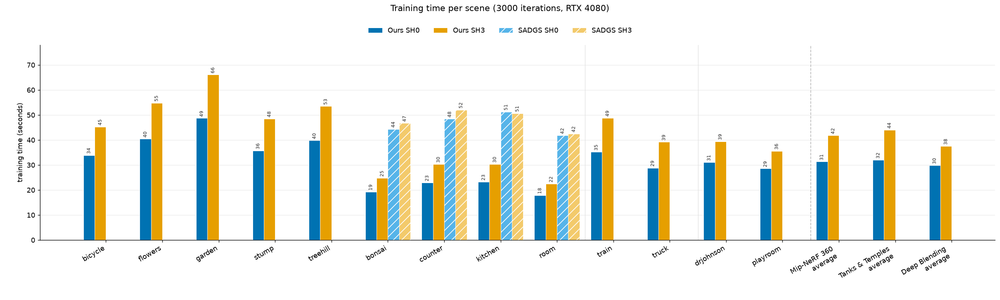
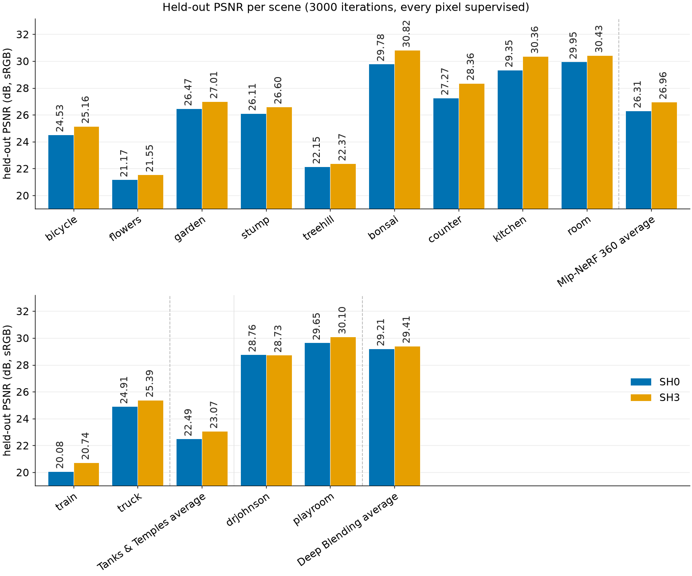
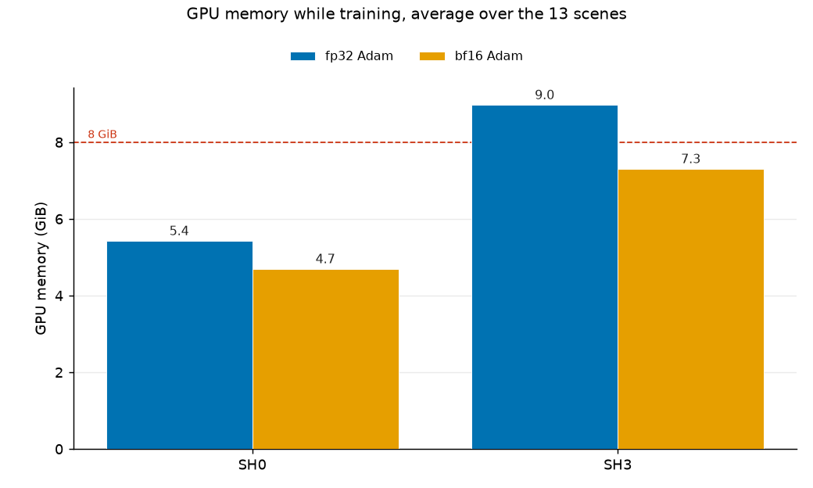
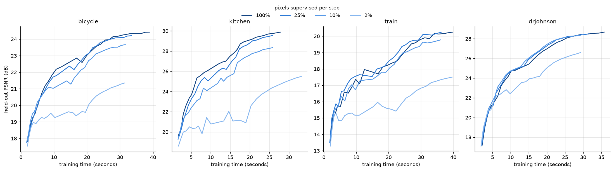
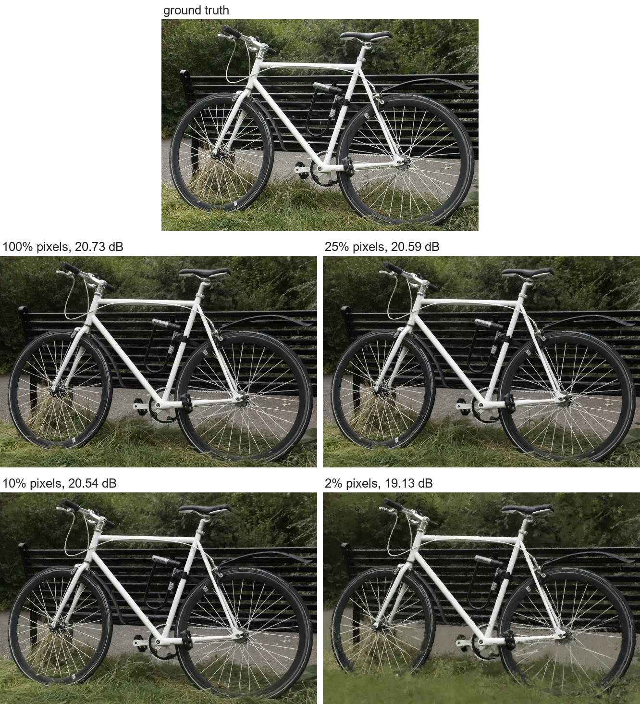
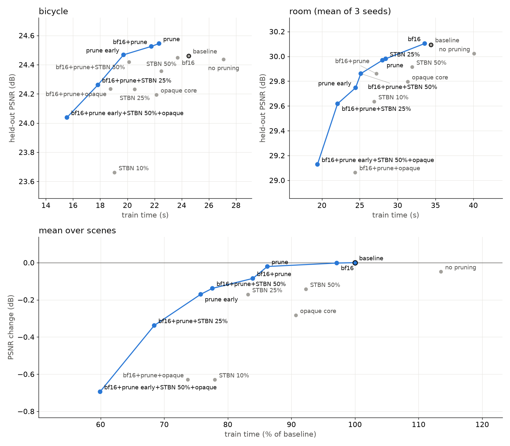
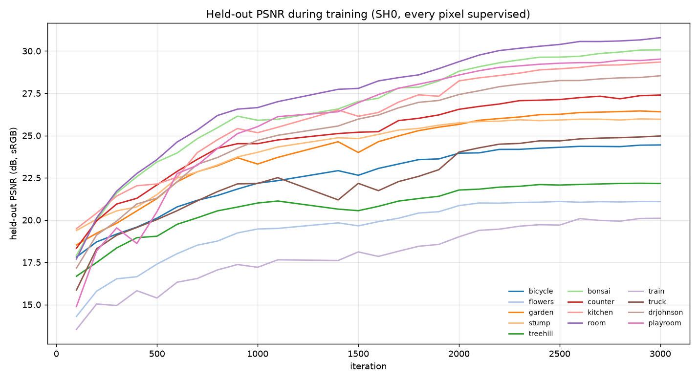

# Training benchmarks

## Current presets

All three presets train for 3,000 steps on the nine Mip-NeRF 360 scenes at seed 42. Training and evaluation use the stored `images_4` photos outdoors and `images_2` indoors. Graphdeco’s RGB8 evaluator scores all 246 held-out views. Each scene contributes equally to every mean. [Benchmark commands](mipnerf360_3k.md#reproduce-the-benchmark) · [Per-scene metrics and timing](mipnerf360_3k_presets.csv)

| Preset | Train loop | Launch to saved PLY | PSNR ↑ | SSIM ↑ | VGG LPIPS ↓ |
| --- | ---: | ---: | ---: | ---: | ---: |
| Ultrafast | 17.62 s | 31.28 s | 27.13 dB | 0.7936 | 0.2567 |
| Balanced | 25.97 s | 41.30 s | 27.39 dB | 0.8143 | 0.2229 |
| Quality | 33.85 s | 49.56 s | 27.78 dB | 0.8275 | 0.2011 |

| Preset | Setup + train loop | Launch to model | Launch to closed PLY | Launch to exit | Launch to synced PLY | Gaussians |
| --- | ---: | ---: | ---: | ---: | ---: | ---: |
| Ultrafast | — | 28.30 s | 30.38 s | 31.24 s | 31.28 s | 1.43 M |
| Balanced | — | 36.32 s | 40.39 s | 41.24 s | 41.30 s | 2.07 M |
| Quality | 41.25 s | 43.57 s | — | — | 49.56 s | 3.08 M |

The train loop starts after image loading, stereo initialization and target setup. Launch clocks start at process creation. “Launch to model” ends when the trained Gaussians are ready, before export. The README’s saved-PLY clock ends at disk sync. The ultrafast and balanced writers closed the file before process exit, and the timing harness synced it just afterward. Quality synced the PLY before held-out evaluation. Dashes mark clocks without observations on all nine scenes.

The ultrafast and balanced scores come from replaying the exact timed PLY files. Quality uses the same native renderer to save the held-out images after export. We selected the ultrafast timing runs before scoring using the external GPU process log. A separate viewer was open during two runs in the initial repeat, which averaged 18.78 s per training loop across all nine scenes. The table uses the uncontended runs for those two scenes. The CSV records each selected run name. [Saved-model replay check](mipnerf360_3k.md#reproduce-the-benchmark)

The benchmark machine ran Windows on a 32-core Ryzen Threadripper PRO 5975WX with 128 GiB of RAM and an RTX 4080 16 GB (driver 610.60). Python 3.11.9 and SlangPy 0.42.0 ran the Vulkan trainer. Stereo matching ran on the CPU. The independent CUDA evaluation used PyTorch 2.10.0+cu128 and torchvision 0.25.0.

## Published Mip-NeRF 360 comparisons

These are the authors’ reported Mip-NeRF 360 means. SAD-GS used an H100, with a batch of two training images per indoor step and one per outdoor step. Its released evaluator at `029814f` uses the same RGB8 PSNR, SSIM and VGG LPIPS calculations as Graphdeco. Its published training script selects `images` with automatic sizing, so the exact source-image dimensions for the paper run remain unverified. Our RTX 4080 measurements use one image per step. The original 3DGS paper reports two larger training budgets on an RTX A6000. Hardware, software and timing boundaries differ across papers. [SAD-GS, Table 1 and Section 4.1](https://arxiv.org/html/2604.28016v1#S4.T1) · [3DGS, Table 1](https://repo-sam.inria.fr/fungraph/3d-gaussian-splatting/3d_gaussian_splatting_low.pdf)

| Published method | Steps | GPU | PSNR ↑ | SSIM ↑ | LPIPS ↓ | Time reported |
| --- | ---: | --- | ---: | ---: | ---: | ---: |
| SAD-GS | 3,000 | H100 | 27.25 dB | 0.821 | 0.197 | 52.96 s optimization |
| Original 3DGS | 7,000 | RTX A6000 | 25.60 dB | 0.770 | 0.279 | 6 min 25 s training |
| FastGS | 30,000 | RTX 4090 | 27.56 dB | 0.797 | 0.261 | 1.93 min training |
| Original 3DGS | 30,000 | RTX A6000 | 27.21 dB | 0.815 | 0.214 | 41 min 33 s training |

SAD-GS reports 4.05 million final Gaussians at 3,000 steps. FastGS reports 0.40 million at 30,000 steps. [SAD-GS, Table 1](https://arxiv.org/html/2604.28016v1#S4.T1) · [FastGS, Table 1](https://openaccess.thecvf.com/content/CVPR2026/papers/Ren_FastGS_Training_3D_Gaussian_Splatting_in_100_Seconds_CVPR_2026_paper.pdf)

## Historical quality and training time

The remaining benchmarks cover the earlier trainer through revision `269556b`. Its four preset names and defaults apply only to that version. The sweeps include Mip-NeRF 360 (M360), Tanks & Temples (T&T) and Deep Blending (DB). SH0 and SH3 indicate spherical-harmonic degree. Unless a table includes setup, its times cover the optimizer loop. [Current preset settings](usage.md#training)

Each dataset mean weights scenes equally. The default rows use one run per scene from the original balanced-preset sweep. The Mip-NeRF 360 stereo recipes average seeds 42 and 1. All runs use 3,000 steps, structure-aware densification and Mip-Splatting, with every eighth view held out for PSNR, SSIM and LPIPS. The evaluation images are quarter resolution outdoors and half resolution indoors for Mip-NeRF 360, 979×545 for train and 978×545 for truck in Tanks & Temples, and native resolution for Deep Blending. [Default sweep](benchmark_results.csv) · [Two-seed measurements](mipnerf360_3k_results.csv) · [SSIM paper](https://www.cns.nyu.edu/~lcv/ssim/) · [LPIPS paper](https://arxiv.org/abs/1801.03924)

| Dataset | Recipe | PSNR | SSIM | LPIPS | Train loop (seconds) |
| --- | ---: | ---: | ---: | ---: | ---: |
| Mip-NeRF 360 | Default SH0 (1 run) | 26.31 | 0.803 | 0.262 | 22.7 |
| Mip-NeRF 360 | Default SH3 (1 run) | 26.96 | 0.816 | 0.247 | 31.0 |
| Mip-NeRF 360 | Fixed falloff + stereo SH3 (2-seed mean) | 27.76 | 0.828 | 0.241 | 33.5 |
| Mip-NeRF 360 | Adaptive falloff + stereo SH3 (2-seed mean) | 27.78 | 0.828 | 0.241 | 34.6 |
| Tanks & Temples | Default SH0 (1 run) | 22.49 | 0.837 | 0.230 | 15.6 |
| Tanks & Temples | Default SH3 (1 run) | 23.07 | 0.850 | 0.210 | 22.0 |
| Deep Blending | Default SH0 (1 run) | 29.21 | 0.904 | 0.334 | 13.6 |
| Deep Blending | Default SH3 (1 run) | 29.41 | 0.905 | 0.331 | 16.8 |

In the original sweep, switching from SH0 to SH3 adds 0.6 dB on Mip-NeRF 360 and Tanks & Temples and 0.2 dB on Deep Blending, for 24–41% more training time. Its higher bands train at 6× the 3DGS learning rate (0.015/20). At SH0 the outdoor Mip-NeRF 360 scenes took 18–26 seconds and the indoor scenes took 22–28 seconds.

  
   
  

## Training time and GPU memory

VRAM is the process’s local GPU memory immediately after the training loop, before held-out evaluation. In the matched two-seed Mip-NeRF 360 runs, the fixed and adaptive recipes each used **6.14 GiB**, compared with **9.24 GiB** for stock.

| Dataset | Recipe | Train loop (seconds) | Splats (millions) | VRAM (GiB) |
| --- | ---: | ---: | ---: | ---: |
| Mip-NeRF 360 | Default SH0 (1 run) | 22.7 | 2.68 | 5.7 |
| Mip-NeRF 360 | Default SH3 (1 run) | 31.0 | 2.83 | 9.2 |
| Mip-NeRF 360 | Fixed falloff + stereo SH3 (2-seed mean) | 33.5 | 3.08 | 6.1 |
| Mip-NeRF 360 | Adaptive falloff + stereo SH3 (2-seed mean) | 34.6 | 3.09 | 6.1 |
| Tanks & Temples | Default SH0 (1 run) | 15.6 | 1.57 | 5.5 |
| Tanks & Temples | Default SH3 (1 run) | 22.0 | 1.60 | 9.0 |
| Deep Blending | Default SH0 (1 run) | 13.6 | 2.15 | 5.6 |
| Deep Blending | Default SH3 (1 run) | 16.8 | 2.22 | 9.2 |

  

The original precision sweep shown above reserved memory for 7 million splats (`--max-splats`). With bf16 optimizer state, SH3 stayed under 8 GiB. Both SH3 falloff recipes use bf16 and reserve space for 5.6 million splats.

In the original SH0 bicycle and room comparison, the default pruning pass removed about 35% of the final splats. Training took 12% less time on average and PSNR fell by 0.12 dB. The default prunes at the last densification step. The fixed and adaptive SH3 recipes start pruning at step 900. [SH0 pruning measurements](pareto_results.csv)

## Historical presets

At revision `269556b`, the CLI and viewer offered the following four presets. The flags shown here reproduce their historical definitions.

| Preset | Sets |
| --- | --- |
| `ultrafast` | `--adam-moments bf16 --prune-blend-weight 0.3 --prune-blend-from 500 --stbn-pixel-fraction 0.5 --splat-kernel opaque_core --splat-profile-power 3 --splat-profile-onset 2` |
| `perf` | `--adam-moments bf16 --prune-blend-from 1000` |
| `balanced` | Default settings |
| `quality` | `--lr-recipe quality` starts the scale and rotation learning rates at 3× and decays them to 0.5×. The opacity learning rate is 0.7×. |

The four earlier presets were tested on all 13 scenes. LPIPS averages all 13 scene scores. The historical ultrafast preset supervised 50% of pixels per step and the others supervised every pixel. They all used a flat response by default. The adaptive SH3 study added `--auto-lens`, stereo initialization and the short schedule to the former `perf` preset. [Historical reproduction commands](mipnerf360_3k.md#reproduce-the-earlier-sh3-comparison)

| SH | Preset | M360 PSNR | M360 time (seconds) | T&T PSNR | T&T time (seconds) | DB PSNR | DB time (seconds) | LPIPS |
| --- | ---: | ---: | ---: | ---: | ---: | ---: | ---: | ---: |
| SH0 | ultrafast | 25.87 | 15.7 s | 21.69 | 11.1 s | 28.93 | 10.6 s | 0.298 |
| SH0 | perf | 26.32 | 19.3 s | 22.40 | 13.3 s | 29.37 | 12.5 s | 0.271 |
| SH0 | balanced | 26.31 | 22.7 s | 22.49 | 15.6 s | 29.21 | 13.6 s | 0.268 |
| SH0 | quality | 26.56 | 25.4 s | 22.48 | 17.2 s | 29.49 | 15.2 s | 0.269 |
| SH3 | ultrafast | 26.58 | 19.9 s | 22.32 | 14.5 s | 29.07 | 12.5 s | 0.285 |
| SH3 | perf | 26.94 | 24.6 s | 23.00 | 17.6 s | 29.44 | 14.6 s | 0.258 |
| SH3 | balanced | 26.96 | 31.0 s | 23.07 | 22.0 s | 29.41 | 16.8 s | 0.254 |
| SH3 | quality | 27.15 | 32.9 s | 23.20 | 24.2 s | 29.58 | 18.2 s | 0.256 |

`perf` costs at most 0.1 dB for 8–21% less time, and `ultrafast` trains in 64–78% of the time for 0.3–0.8 dB. `quality` gains up to 0.3 dB for 6–12% more time (none on Tanks & Temples at SH0), and reaches 27.15 dB on Mip-NeRF 360 at SH3.

## Sparse supervision (STBN)

`--stbn-pixel-fraction` selects a spatiotemporal blue-noise subset of pixels each step. At 50%, the largest PSNR loss was 0.17 dB and training time fell by 0–4%. At 25%, time fell by 5–14% with up to 0.17 dB lost. The 2% runs gave the lowest PSNR on every dataset. [Wolfe et al., Scalar Spatiotemporal Blue Noise Masks](https://arxiv.org/abs/2112.09629) · [Sampling implementation](stbn_pixel_sampling.md)

**SH degree 0**

| Pixels / step | M360 PSNR | M360 time (seconds) | T&T PSNR | T&T time (seconds) | DB PSNR | DB time (seconds) |
| --- | ---: | ---: | ---: | ---: | ---: | ---: |
| 100% | 26.31 | 22.7 s | 22.49 | 15.6 s | 29.21 | 13.6 s |
| 50% | 26.31 | 22.2 s | 22.32 | 15.4 s | 29.36 | 13.6 s |
| 25% | 26.23 | 19.9 s | 22.32 | 14.3 s | 29.33 | 12.2 s |
| 10% | 25.89 | 17.9 s | 22.04 | 14.5 s | 29.10 | 11.3 s |
| 2% | 24.15 | 17.7 s | 19.98 | 16.5 s | 27.39 | 11.0 s |

**SH degree 3**

| Pixels / step | M360 PSNR | M360 time (seconds) | T&T PSNR | T&T time (seconds) | DB PSNR | DB time (seconds) |
| --- | ---: | ---: | ---: | ---: | ---: | ---: |
| 100% | 26.96 | 31.0 s | 23.07 | 22.0 s | 29.41 | 16.8 s |
| 50% | 26.95 | 29.8 s | 23.03 | 22.0 s | 29.43 | 16.4 s |
| 25% | 26.85 | 26.7 s | 23.01 | 20.8 s | 29.34 | 14.7 s |
| 10% | 26.53 | 25.0 s | 22.75 | 20.9 s | 29.19 | 14.3 s |
| 2% | 24.54 | 25.0 s | 20.22 | 24.9 s | 27.42 | 13.8 s |

  
   
  

## Optimizer precision

The bf16 Adam state used 0.7–1.7 GiB less memory and shortened the training loop. Dataset PSNR changed by at most 0.15 dB. Time and memory below average all 13 scenes under full-pixel supervision.

| SH | Adam moments | M360 PSNR | T&T PSNR | DB PSNR | Time (seconds) | VRAM (GiB) |
| --- | ---: | ---: | ---: | ---: | ---: | ---: |
| SH0 | fp32 | 26.31 | 22.49 | 29.21 | 20.2 | 5.65 |
| SH0 | bf16 | 26.35 | 22.50 | 29.36 | 19.7 | 4.92 |
| SH3 | fp32 | 26.96 | 23.07 | 29.41 | 27.4 | 9.20 |
| SH3 | bf16 | 26.96 | 23.03 | 29.39 | 25.4 | 7.53 |

## Speed/quality trade-offs

The original SH0 sweep combined sparse supervision (`--stbn-pixel-fraction`), bf16 optimizer state (`--adam-moments bf16`), earlier blend-weight pruning (`--prune-blend-from`, `--prune-blend-weight`) and the opaque-core splat kernel (`--splat-kernel opaque_core --splat-profile-power 3 --splat-profile-onset 2`). Each point shows one configuration on bicycle (one seed) and room (three seeds, half resolution). The line joins the configurations on the speed–quality frontier.

  

Rows run from slowest to fastest by the two-scene average. Bold rows lie on the frontier of mean PSNR change versus relative training time.

| Configuration | bicycle PSNR | bicycle time (seconds) | room PSNR | room time (seconds) | PSNR change (dB) | Time vs. baseline |
| --- | ---: | ---: | ---: | ---: | ---: | ---: |
| no pruning | 24.50 | 22.4 | 30.36 | 24.6 | +0.12 | 113% |
| baseline (defaults) | 24.52 | 19.4 | 30.11 | 22.1 | 0.00 | 100% |
| **bf16** | **24.53** | **18.8** | **30.34** | **21.5** | **+0.12** | **97%** |
| opaque core | 24.28 | 18.1 | 30.05 | 21.7 | −0.15 | 96% |
| STBN 50% | 24.44 | 18.5 | 30.28 | 20.9 | +0.05 | 95% |
| prune | 24.51 | 17.0 | 30.13 | 19.5 | +0.01 | 88% |
| **bf16 + prune** | **24.51** | **16.5** | **30.23** | **19.1** | **+0.06** | **86%** |
| STBN 25% | 24.24 | 16.2 | 30.18 | 18.2 | −0.10 | 83% |
| bf16 + prune + opaque core | 24.25 | 15.5 | 29.83 | 18.6 | −0.27 | 82% |
| prune early | 24.46 | 15.7 | 30.09 | 18.1 | −0.04 | 82% |
| **bf16 + prune + STBN 50%** | **24.42** | **15.5** | **30.23** | **18.1** | **+0.02** | **81%** |
| STBN 10% | 23.68 | 15.1 | 29.89 | 17.1 | −0.53 | 78% |
| **bf16 + prune + STBN 25%** | **24.18** | **13.6** | **30.08** | **15.7** | **−0.18** | **71%** |
| **bf16 + prune early + STBN 50% + opaque core** | **24.01** | **13.1** | **29.50** | **15.7** | **−0.56** | **69%** |

"prune" is `--prune-blend-from 1000`, "prune early" is `--prune-blend-weight 0.3 --prune-blend-from 500`, and "no pruning" turns the default pass off with `--prune-blend-weight 0`.

- Disabling the default pruning pass took 13% longer for a mean gain of 0.12 dB (bicycle −0.02 dB, room +0.26 dB over three seeds).
- Starting blend pruning at step 1,000 saved 12% (bicycle −0.01 dB, room +0.03 dB).
- Adding `--adam-moments bf16` gave the `perf` preset, 14% faster at 16.5 seconds on bicycle and 19.1 seconds on room.
- Adding 50% STBN sampling to `perf` saved 19% against baseline. At 25% sampling it saved 29% and lost 0.18 dB.
- The `ultrafast` preset trained bicycle in 13.1 seconds and room in 15.7 seconds, with a mean PSNR loss of 0.56 dB. With the faster rasterizer the opaque-core kernel no longer saves time on room, so bf16 + prune + STBN 25% is nearly as fast for a third of the loss.

The evaluation script reuses cached runs when available. [Run the sweep](../scripts/running/eval_pareto.py) · [Per-run measurements](pareto_results.csv)

## Convergence

The original SH0 sweep measured held-out PSNR every 100 steps. The plot omits steps 1,200 and 1,300 during recovery from the opacity reset. The fixed and adaptive SH3 runs measured held-out quality at step 3,000.

  

## Rasterizer and binning

The historical sweep used depth-sorted binning, an optimized rasterizer and SH path, and a smaller structure-aware split. The table gives GPU milliseconds per step for a fixed room model with 0.95 million SH3 splats, densification and the Mip filter disabled, and targets resident on the GPU.

| Pass | Before | After |
| --- | ---: | ---: |
| Projection + SH | 0.56 | 0.34 |
| Binning (sorts + pair emission) | 3.98 | 1.44 |
| Forward raster | 1.55 | 1.10 |
| Backward raster | 4.56 | 3.53 |
| Loss, projection backward, Adam | 2.34 | 2.33 |
| **Whole step** | **12.99** | **8.74** |

End to end, the default settings train Mip-NeRF 360 in 22.7 seconds instead of 33.7 at SH0 and 31.0 instead of 45.4 at SH3 (26.31 and 26.96 dB, was 26.31 and 26.89). Tanks & Temples and Deep Blending go from 23.0 and 20.0 to 15.6 and 13.6 seconds at SH0.

- Binning sorts the splats by depth once and then the pairs only by tile, so the pair sort keys shrink from 64 to 32 bits. One thread per pair writes the pairs, so a large splat no longer stalls its warp.
- Each splat's blend record holds its inverse covariance, alpha amplitude and view color, so the per-pixel loops no longer invert a 2×2 matrix or evaluate a sigmoid. The projection backward converts the record's gradients once per splat.
- The forward blends two pixels per lane, so each record load serves two pixels. The backward advances two pixels at a time so their transmittance scans overlap. SH is evaluated only for splats that touch a tile.
- The backward's 64-bit fixed-point gradient atomics were tested against float atomics and a version without atomics. Both alternatives saved under 3% of backward time.
- Structure-aware densification splits a splat into at most 2 children per axis (`--sad-max-split-factor 2`) instead of the 8 used by SAD-GS. Training took 17% less time, with similar PSNR on Mip-NeRF 360 and a drop of about 0.15 dB on Tanks & Temples and Deep Blending. [Structure-aware densification](structure_aware_densification.md) · [SAD-GS paper](https://arxiv.org/abs/2604.28016)

## Per-step overhead

The earlier release reduced overhead in four parts of a training step.

- The SSIM loss runs as two LDS-tiled separable passes (11-tap rows, then 11-tap columns) instead of two 121-tap window loops. Its gradient also lands closer to a float64 reference.
- The projection backward resets the 2D gradient seeds it consumes, so no step clears all 7 million slots of six buffers any more.
- At quarter resolution, the forward sort uses six of the eight radix passes for tile indices.
- Densification bookkeeping only reads live, visible splats, and stops after the last densification step.

Nsight GPU Trace measured the following times in milliseconds on bicycle at iteration 560, with GPU clocks locked to base.

| Pass | Before | After |
| --- | ---: | ---: |
| Gradient seed clear | 0.48 | 0 |
| Radix sort | 1.58 | 1.24 |
| SSIM loss | 1.65 | 0.29 |
| Densification bookkeeping | 0.25 | 0.07 |
| Projection backward | 0.22 | 0.27 |
| **Whole step** | **10.50** | **8.07** |

In this earlier SH0 comparison, bicycle fell from 34.8 to 27.5 seconds (24.42 to 24.44 dB). Room fell from 17.5 to 13.8 seconds (30.76 to 30.68 dB, averaged over three seeds spanning 0.24 dB). Across the datasets, SH0 times fell from 31.3 to 25.2 seconds on M360, from 32.0 to 26.5 on T&T and from 29.8 to 22.7 on DB, with PSNR within 0.05 dB. SH3 times fell from 41.8 to 36.0, 44.0 to 38.4 and 37.5 to 30.8 seconds, respectively. These measurements predate the switch to half-resolution indoor images and the default pruning pass.
