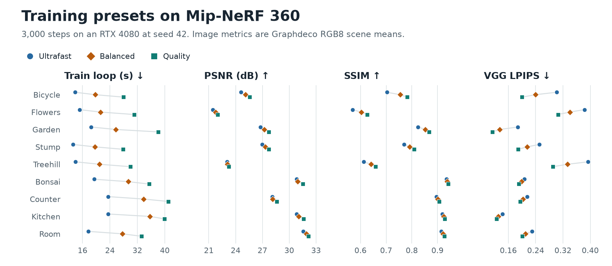
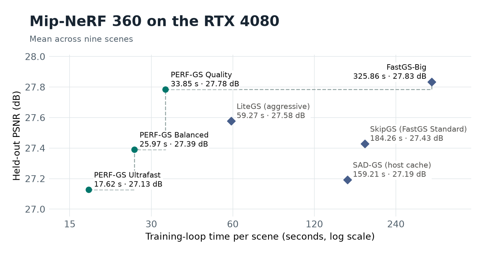

# Training benchmarks

## Current presets

These measurements are from the **RTX 4080 16 GB**. All three presets train for 3,000 steps on the nine Mip-NeRF 360 scenes at seed 42. Training and evaluation use the stored `images_4` photos outdoors and `images_2` indoors. Graphdeco’s RGB8 evaluator scores all 246 held-out views. Each scene contributes equally to every mean. [Benchmark commands](mipnerf360_3k.md#reproduce-the-benchmark) · [Per-scene RTX 4080 measurements](mipnerf360_3k_presets.csv)

| Preset | Train loop | Launch to saved PLY | PSNR ↑ | SSIM ↑ | VGG LPIPS ↓ | VRAM at loop end |
| --- | ---: | ---: | ---: | ---: | ---: | ---: |
| Ultrafast | 17.62 s | 31.28 s | 27.13 dB | 0.7936 | 0.2567 | 5.29 GiB |
| Balanced | 25.97 s | 41.30 s | 27.39 dB | 0.8143 | 0.2229 | 2.80 GiB |
| Quality | 33.85 s | 49.56 s | 27.78 dB | 0.8275 | 0.2011 | 6.13 GiB |

VRAM is the trainer process’s local GPU memory on the RTX 4080, sampled at the end of each headless training loop and recorded in the CSV as `vram_usage_bytes`. Balanced and Quality stream photos from system RAM. Ultrafast keeps the training photos and their structure fields on the GPU for speed.

| Preset | Setup + train loop | Launch to model | Launch to closed PLY | Launch to exit | Launch to synced PLY | Gaussians |
| --- | ---: | ---: | ---: | ---: | ---: | ---: |
| Ultrafast | — | 28.30 s | 30.38 s | 31.24 s | 31.28 s | 1.43 M |
| Balanced | — | 36.32 s | 40.39 s | 41.24 s | 41.30 s | 2.07 M |
| Quality | 41.25 s | 43.57 s | — | — | 49.56 s | 3.08 M |

The train loop starts after image loading, stereo initialization and target setup. Launch clocks start at process creation. “Launch to model” ends when the trained Gaussians are ready, before export. “Launch to saved PLY” ends at disk sync. The ultrafast and balanced writers closed the file before process exit, and the timing harness synced it just afterward. Quality synced the PLY before held-out evaluation. Dashes mark clocks without observations on all nine scenes.

The ultrafast and balanced scores come from replaying the exact timed PLY files. Quality uses the same native renderer to save the held-out images after export. We selected the ultrafast timing runs before scoring using the external GPU process log. A separate viewer was open during two runs in the initial repeat, which averaged 18.78 s per training loop across all nine scenes. The table uses the uncontended runs for those two scenes. The CSV records each selected run name. [Saved-model replay check](mipnerf360_3k.md#reproduce-the-benchmark)

The benchmark machine ran Windows on a 32-core Ryzen Threadripper PRO 5975WX with 128 GiB of RAM and an RTX 4080 16 GB (driver 610.60). Python 3.11.9 and SlangPy 0.42.0 ran the Vulkan trainer. Stereo matching ran on the CPU. The independent CUDA evaluation used PyTorch 2.10.0+cu128 and torchvision 0.25.0.

## RTX 4080 comparison

The dashed line connects configurations that improve on the best PSNR reached at a shorter training time. Each horizontal tick doubles the training-loop budget.

| External trainer | Recipe | Mean train loop | Mean PSNR |
| --- | --- | ---: | ---: |
| LiteGS | Aggressive, 1M target splats, 10,000 requested steps | 59.27 s | 27.58 dB |
| SAD-GS | 3,000 steps, float32 structure maps cached in system RAM | 159.21 s | 27.19 dB |
| SkipGS on FastGS Standard | 30,000 steps, backward skipping from step 15,000 | 184.26 s | 27.43 dB |
| FastGS-Big | 30,000 steps, authors’ per-scene Big settings | 325.86 s | 27.83 dB |

FastGS-Big gained **0.050 dB** over PERF-GS Quality (27.8345 vs. 27.7848 dB), using **9.63×** its training-loop time. LiteGS completes whole passes through the training views, yielding 9,760–9,982 updates across scenes. SAD-GS uses two views per indoor iteration and one outdoors. Transfers from its host cache count toward the loop. On bicycle, a densification step spilled into shared GPU memory on this 16 GB card.

SkipGS uses FastGS Standard’s densification settings. It skipped 50,426 of 135,009 backward passes from its activation point across the nine scenes. FastGS-Big uses a different densification recipe.

All trainers ran headless on the same RTX 4080 16 GB, with one seed-42 run per scene. PERF-GS used Windows and Vulkan. The other trainers used WSL2 and CUDA. The wall clock starts after loading and initialization, includes the final GPU synchronization, and stops before model export or evaluation. [Per-scene PERF-GS data](mipnerf360_3k_presets.csv) · [LiteGS data](mipnerf360_litegs_4080.csv) · [Additional trainers](mipnerf360_peers_4080.csv)

All runs used the stored `images_4` outdoors and `images_2` indoors. Each trainer’s native renderer produced the 246 held-out views. Graphdeco’s RGB8 PSNR uses identical reference pixels for each method. Views contribute equally within each scene, and the nine scene means contribute equally to each point. [Reproduce LiteGS](mipnerf360_3k.md#compare-litegs-on-the-same-gpu) · [Reproduce the other trainers](mipnerf360_3k.md#reproduce-the-additional-trainers)

## Published Mip-NeRF 360 comparisons

These are the authors’ reported Mip-NeRF 360 means. SAD-GS used an H100, with a batch of two training images per indoor step and one per outdoor step. Its released evaluator at `029814f` uses the same RGB8 PSNR, SSIM and VGG LPIPS calculations as Graphdeco. Its published training script selects `images` with automatic sizing, so the exact source-image dimensions for the paper run remain unverified. PERF-GS uses one training image per step. The original 3DGS paper reports two larger training budgets on an RTX A6000. Hardware, software and timing boundaries differ across papers. [SAD-GS, Table 1 and Section 4.1](https://arxiv.org/html/2604.28016v1#S4.T1) · [3DGS, Table 1](https://repo-sam.inria.fr/fungraph/3d-gaussian-splatting/3d_gaussian_splatting_low.pdf)

| Published method | Steps | GPU | PSNR ↑ | SSIM ↑ | LPIPS ↓ | Time reported |
| --- | ---: | --- | ---: | ---: | ---: | ---: |
| SAD-GS | 3,000 | H100 | 27.25 dB | 0.821 | 0.197 | 52.96 s optimization |
| Original 3DGS | 7,000 | RTX A6000 | 25.60 dB | 0.770 | 0.279 | 6 min 25 s training |
| FastGS | 30,000 | RTX 4090 | 27.56 dB | 0.797 | 0.261 | 1.93 min training |
| Original 3DGS | 30,000 | RTX A6000 | 27.21 dB | 0.815 | 0.214 | 41 min 33 s training |
| EDGS + 3DGS | 30,000 | A100 | 28.02 dB | 0.839 | 0.141 | 27 min including initialization |
| dBS (MCMC) | 30,000 | A100 | 28.70 dB | 0.842 | 0.185 | 24.42 min training |

EDGS and dBS report averages over all nine scenes. The EDGS benchmark uses quarter-resolution outdoor images and half-resolution indoor images. Its evaluator writes two VGG LPIPS scores, and the paper reports one without identifying which. dBS specifies joint-RGB PSNR and leaves the LPIPS backbone unspecified. [EDGS, Table 1](https://openaccess.thecvf.com/content/CVPR2026/papers/Kotovenko_EDGS_Eliminating_Densification_for_Efficient_Convergence_of_3DGS_CVPR_2026_paper.pdf#page=5) · [EDGS benchmark](https://github.com/CompVis/EDGS/blob/f90b022445fc88368f75e66e8fb34aea88372cac/full_eval.py) · [EDGS evaluator](https://github.com/CompVis/EDGS/blob/f90b022445fc88368f75e66e8fb34aea88372cac/metrics.py) · [dBS results and protocol](https://arxiv.org/html/2610.22778v1#S5.SS1)

Opt3DGS reports 29.96 dB on seven scenes, omitting flowers and treehill. Averaging our same 3,000-step Quality models over those seven gives 29.26 dB, versus 27.78 dB over all nine. [Opt3DGS, §5 and Table 1](https://ojs.aaai.org/index.php/AAAI/article/download/37438/41400#page=5) · [PERF-GS per-scene scores](mipnerf360_3k_presets.csv)

SAD-GS reports 4.05 million final Gaussians at 3,000 steps. FastGS reports 0.40 million at 30,000 steps. [SAD-GS, Table 1](https://arxiv.org/html/2604.28016v1#S4.T1) · [FastGS, Table 1](https://openaccess.thecvf.com/content/CVPR2026/papers/Ren_FastGS_Training_3D_Gaussian_Splatting_in_100_Seconds_CVPR_2026_paper.pdf)
