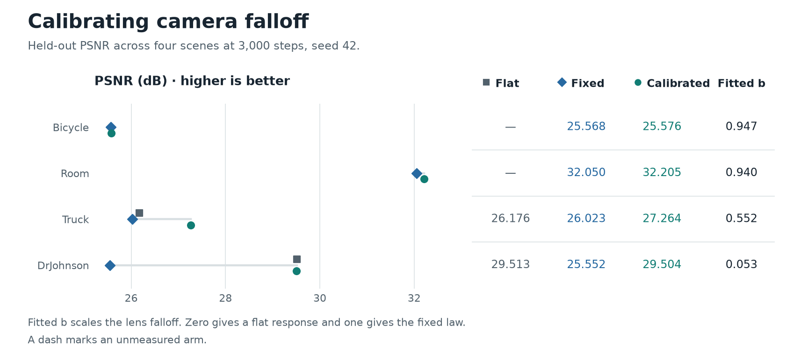

# Mip-NeRF 360 at 3,000 steps

## Reproduce the benchmark

Install the trainer, activate its Python environment and fetch all nine scenes with `python scripts/data/download_mipnerf360.py --set all`. For presets with sparse pixel supervision, first run `python scripts/data/download_stbn.py` to obtain the NVIDIA scalar blue-noise masks. [Preset settings and asset terms](usage.md#training)

Run this PowerShell sweep on an idle GPU. It launches one process per scene and preset at seed 42. Both training and held-out evaluation use `images_4` outdoors and `images_2` indoors at their stored dimensions. Stereo initialization uses a separate 672-pixel-wide working image for up to 28 training-camera anchors and can add up to 256,000 starting points. Its cost belongs to setup.

```powershell
foreach ($preset in 'ultrafast', 'balanced', 'quality') {
  python scripts/running/eval_sweep.py --axis seed --values 42 --iters 3000 `
    --name "mip360_3k_preset_$preset" --no-plot --extra --preset $preset `
    --eval-every 0 --preview-every 0 --no-write-ground-truths --run-report --save-test-renders
}
```

The sweep reuses completed runs by name. Choose a new name or pass `--force` if a cached run lacks the saved test PNGs. For the reference scores, use CUDA PyTorch, torchvision, tqdm and the pretrained VGG and LPIPS weights. These PowerShell commands prepare Graphdeco’s directory layout, pair each RGB8 render with the original photo decoded by Pillow, and score every held-out image. The model-directory argument can also be passed directly to the reference checkout’s `python metrics.py -m` command. [Graphdeco reference evaluation](https://github.com/graphdeco-inria/gaussian-splatting/blob/54c035f7834b564019656c3e3fcc3646292f727d/metrics.py)

```powershell
git clone https://github.com/graphdeco-inria/gaussian-splatting.git outputs/graphdeco_reference
git -C outputs/graphdeco_reference checkout 54c035f7834b564019656c3e3fcc3646292f727d
$models = foreach ($run in Get-ChildItem outputs/train -Directory -Filter 'sweep_mip360_3k_preset_*') {
  $model = "outputs/graphdeco_input/$($run.Name)"
  python scripts/running/prepare_graphdeco.py $run.FullName $model | Out-Host
  if ($LASTEXITCODE -ne 0) { throw "Could not prepare $model" }
  $model
}
python scripts/running/score_graphdeco.py --graphdeco outputs/graphdeco_reference $models
```

To score the model from a timed, training-only run, use `--no-evaluation --save-ply` as shown below. Then run `python scripts/running/prepare_graphdeco.py RUN MODEL --ply RUN/output.ply`, substituting the training directory for `RUN` and a fresh output directory for `MODEL`. The converter uses the training log and configuration, restores the PLY’s 3D filter, and renders the registered held-out cameras. Use the same reference scoring command on `MODEL`. Replaying the quality preset’s 4,102,802-splat bicycle PLY at seed 42 reproduced all 76,261,050 RGB8 channel values across its 25 held-out views.

Each model directory contains `results.json` and `per_view.json`. Aggregate the nine scene means with equal weight for each seed. The reference evaluates saved RGB8 images and passes values in [0, 1] to its VGG LPIPS implementation. The wrapper caches the reference VGG network between images. On one indoor and one outdoor held-out view, its PSNR, SSIM and LPIPS matched the standalone upstream script exactly. The trainer’s historical study below scores the floating-point renders and passes values in [−1, 1] to its LPIPS evaluator. [Per-scene preset measurements](mipnerf360_3k_presets.csv) · [Historical float-image measurements](mipnerf360_3k_results.csv)

For elapsed training time including process startup and final PLY export, run each scene in a fresh process and time it externally, using the same `--downsample` setting. Specify the scene path, preset and seed for each measurement. The example shows PowerShell timing for outdoor garden.

```powershell
Measure-Command {
  python -m trainer.frontend.app --scene datasets/360_v2/garden --downsample 4 --preset quality --seed 42 `
    --no-viewer --no-evaluation --save-ply --no-write-ground-truths --preview-every 0 --eval-every 0
}
```

`Measure-Command` stops at process exit. The training log records the optimizer loop under `train_complete.train_wall_s`, and the benchmark CSV distinguishes model readiness, PLY closure, process exit and a completed file sync. In the clean training-only CLI, the writer closes the PLY before exit and the timing harness syncs it immediately afterward. The quality run synced its PLY before scoring held-out views. Fresh processes may reuse filesystem and shader disk caches. Graphdeco’s `full_eval.py` times its training commands including model saves. [Per-scene timing boundaries](mipnerf360_3k_presets.csv) · [Upstream timing script](https://github.com/graphdeco-inria/gaussian-splatting/blob/54c035f7834b564019656c3e3fcc3646292f727d/full_eval.py)

## Earlier SH3 comparison

The compact SH3 recipe starts with the supplied COLMAP point cloud, adds up to 256,000 stereo matches verified in a third training view, and uses the `short` learning-rate and loss schedule. The original fixed-falloff implementation in commit `c28a801` added 188 lines and removed 15 across `src/` and `shaders/` relative to `d6209e7`. Adaptive calibration adds another 164 lines and removes 14 relative to that commit. Together, the measured recipe and lens changes add 341 production lines and remove 18.

With fixed falloff on an RTX 4080 the two nine-scene means were **27.775 dB** (seed 42) and **27.741 dB** (seed 1). Room gained 1.288 and 1.062 dB over the previous tuned recipe. Bicycle gained 0.250 and 0.214 dB. LPIPS improved on six scenes at both seeds. It rose by about 0.012 on flowers and by less than 0.001 on bicycle and garden. [Per-scene changes at both seeds](../assets/mipnerf360_3k_results.png) · [All scene measurements](mipnerf360_3k_results.csv)

In the original comparison, setup plus training with fixed falloff cost 5.1% more than stock SH3 on seed 42 and 7.8% more on seed 1. The previous tuned recipe runs faster than stock. Its optimizer loop took 30.80 and 31.25 seconds versus 33.17 and 33.86 seconds with fixed falloff. On seed 1, setup plus training took 36.74 seconds for the previous tune and 40.67 seconds with fixed falloff. The archived seed-42 tune records loop time only.

With adaptive falloff, PSNR reached **27.786 and 27.780 dB** on the same two seeds. The nine-scene means improved by 0.010 and 0.039 dB over fixed falloff. Seed 42 moved slightly toward lower SSIM and higher LPIPS, while seed 1 improved on both. Fitting the camera took 0.12 seconds per scene on average. [Adaptive versus fixed by scene](../assets/mipnerf360_3k_adaptive_vs_fixed.png) · [Per-scene metrics and fitted strengths](mipnerf360_3k_results.csv)

The comparison below uses the middle held-out camera in bicycle and room on seed 1. Each row shows the previous tuned recipe, the fixed-falloff recipe and the corresponding photograph. The yellow boxes mark the full-resolution crops.


### Reproduce the earlier SH3 comparison

Use a checkout of revision `20b9ecd` for these two commands. At that revision `perf` and `balanced` supply the historical defaults. The adaptive configuration became the current `quality` preset. This PowerShell command trains each scene once per seed.

```powershell
python scripts/running/eval_sweep.py --axis seed --values '42,1' --iters 3000 `
  --name mip360_3k_adaptive --no-plot --extra `
  --preset perf --sh-degree 3 --lr-recipe short --stereo-init --auto-lens `
  --sad-lambda-l2 6 --lambda-ssim 0.3 --prune-scale3d 1 --prune-blend-weight 0.20 `
  --grad-thresh 0.00058 --densify-from 100 --prune-blend-from 900 `
  --sad-tau-split 0.64 --max-splats 5600000 --eval-every 0 --preview-every 0 `
  --no-write-ground-truths --run-report --eval-lpips
```

Use the same evaluator and GPU for the stock SH3 baseline.

```powershell
python scripts/running/eval_sweep.py --axis seed --values '42,1' --iters 3000 `
  --name mip360_3k_stock --no-plot --extra --preset balanced --sh-degree 3 `
  --eval-every 0 --preview-every 0 --no-write-ground-truths --run-report --eval-lpips
```

Read `outputs/train/sweep_mip360_3k_adaptive_<scene>_<seed>/run_report.json` and the corresponding `stock` files. Each report should have `iters_completed == 3000` and `quality.n_lpips_views == quality.n_test_views`. The sweep caches completed runs by name. To reproduce the fixed recipe, change `--auto-lens` to `--natural-vignetting` and give the sweep a different `--name`.

A separate fixed-falloff run through the ordinary CLI on bicycle at seed 1 scored 25.569 dB, 0.78175 SSIM and 0.22669 LPIPS over all 25 held-out views. The timed fixed-falloff sweep run at that seed scored 25.573 dB, 0.78179 and 0.22666.

## Scoring and timing

Both seeds use the same split. Sorting images by name and holding out indices 0, 8, 16, … gives 246 held-out views across nine scenes. Stereo matching and optimizer updates use training views. Indoor scenes use half resolution and outdoor scenes use quarter resolution. The benchmark scenes informed recipe selection.

For each seed, take the unweighted mean of the nine scene reports’ `quality.psnr_srgb`, `quality.ssim_srgb` and `quality.lpips`. Each scene averages per-image scores on full-frame, clipped floating-point sRGB. PSNR is averaged in dB, SSIM uses all RGB channels, and VGG LPIPS uses each image at evaluation resolution.

Both the fixed and adaptive comparisons use the native CPU evaluator. For adaptive falloff, 128 held-out renders were scored directly during reporting and 364 from saved full-precision render/target pairs. On those 364, independent scoring reproduced PSNR and SSIM exactly and differed by at most 0.00000006 VGG LPIPS per image. Across all 492 fixed-falloff renders, an independent FP32 GPU VGG evaluation differed by at most 0.00000009 LPIPS per image. The per-scene CSV also includes a separate seed-42 SfM-only variant. It disables stereo initialization, increases the L2 loss weight from 6 to 9 and reduces the blend-pruning weight from 0.20 to 0.15. The CSV identifies the evaluator used for each run. [Per-scene results](mipnerf360_3k_results.csv)

`timing.train_wall_s` measures the optimizer loop through the final GPU drain. Stereo initialization, image loading and target preparation precede that clock. For a setup-inclusive training comparison, time `TrainingApplication.prepare_training_context()` through a GPU drain and add `train_wall_s`. `timing.process_wall_s` also includes final held-out evaluation, including VGG. Use the same timing boundary for both recipes.

A separate seed-42 timing sweep alternated the order of stock and adaptive runs across all nine scenes on the same RTX 4080. Setup plus training averaged 38.77 s stock and 40.84 s adaptive (+5.33%). The loop alone averaged 33.48 s and 34.49 s (+3.02%). Bonsai, room and counter exceeded 8% including setup. Stump and bonsai also had fixed controls in opposite orders. Across those two, adaptive averaged 38.88 s and fixed averaged 38.92 s. The original quality sweep and this separate timing sweep both exclude held-out scoring from the training clock. [All 20 timing runs in execution order](mipnerf360_3k_timing.csv) · [Paired timing plot](../assets/mipnerf360_3k_paired_timing.png)

## Camera response and PLY playback

`--natural-vignetting` applies a fixed cos⁴ falloff with a gamma-2.2 approximation in encoded RGB. For the normalized camera ray `(x, y, 1)` through the pixel center, the RGB gain is `(1 + x² + y²)^(-2 / 2.2)`. Camera intrinsics determine the ray. The same law applies to every scene and view.

For the fixed model, exported PLYs carry the comment `trainer natural_vignetting_v1 cos4_srgb_2.2`. A fitted strength other than zero or one is stored as `trainer natural_vignetting_strength_v2 <strength>`. A flat model needs no comment. The PLY loader and viewer restore the response. To match playback in another renderer, use the gain with the same camera intrinsics and resolution. Ignoring the falloff metadata produces brighter image edges.

## Adapting the falloff to other cameras

All current presets fit one shared strength `b` per single-camera reconstruction with `--auto-lens`. The fitter samples up to 28 decoded training images, finds landmarks seen in two views, and compares pairs of landmarks at different radii. Taking differences in log brightness cancels a shared exposure offset within each image and the intrinsic brightness of each landmark across images. A robust fit reduces the influence of occlusions and view-dependent highlights. The renderer uses `(1 + x² + y²)^(-2 b / 2.2)` during training, evaluation and PLY playback. To override the fit, use `--lens-strength 0` for a flat response, `--lens-strength 1` for the fixed model above, or supply another known strength.

For landmark $p$ in view $i$, write its log brightness as $L_{ip}=R_p+E_i+bG_{ip}$, where $R_p$ is landmark brightness, $E_i$ is exposure and $G_{ip}=(-2/2.2)\log(1+x^2+y^2)$. Two views $i,j$ of two shared landmarks $p,q$ give

$$
(L_{ip}-L_{jp})-(L_{iq}-L_{jq})=b\big[(G_{ip}-G_{jp})-(G_{iq}-G_{jq})\big].
$$

Both unknown brightness terms cancel. The fit uses Huber weights and restricts $b$ to $[0,2]$.

All rows below use 3,000 steps at seed 42 on the same RTX 4080. The first three scores are mean held-out PSNR in dB. SSIM and VGG LPIPS are for the calibrated model. Bicycle and room had fixed and calibrated runs only.

| Scene | Flat PSNR | Fixed PSNR | Calibrated PSNR | SSIM ↑ | LPIPS ↓ | Fitted strength | Fit time |
| --- | ---: | ---: | ---: | ---: | ---: | ---: | ---: |
| Bicycle | — | 25.568 | 25.576 | 0.7820 | 0.2260 | 0.947 | 0.070 s |
| Room | — | 32.050 | 32.205 | 0.9275 | 0.2702 | 0.940 | 0.109 s |
| Truck | 26.176 | 26.023 | 27.264 | 0.9102 | 0.1316 | 0.552 | 0.121 s |
| DrJohnson | 29.513 | 25.552 | 29.504 | 0.9072 | 0.3309 | 0.053 | 0.072 s |



Across these four scenes, mean setup plus training took 31.78 seconds calibrated and 31.81 seconds fixed. The train loop averaged 26.02 and 25.94 seconds. Truck’s calibrated SSIM and LPIPS improved to 0.9102 and 0.1316, compared with 0.9014 and 0.1472 fixed and 0.9053 and 0.1448 flat. On DrJohnson the calibrated and flat responses were within 0.01 dB. [Full image metrics and elapsed times](camera_falloff_results.csv)

The fit estimates the radial falloff of the processed images. Within supported reconstructions it requires binary COLMAP tracks, one camera record and enough matched points at different radii. Otherwise it uses a flat response. It runs once during setup and reuses the existing per-pixel shader operation. The fitted value is recorded in `config.json` under `cli_args.lens_strength`. [Calibration code](../src/trainer/data/lens_calibration.py) · [Renderer](../shaders/common/camera.slang)

PPISP also models the response curve, exposure and white balance. [PPISP, Sections 4 and 5](https://arxiv.org/html/2601.18336v2)

## Regenerate the figures and overview tables

From the repository root, run the following commands with NumPy, Matplotlib and Pillow installed. They read the published CSVs and require no GPU or training outputs.

```sh
python scripts/plots/plot_camera_results.py
python scripts/plots/plot_readme_results.py --overview-only
```

The first command prints the current preset table and plots per-scene results. It also writes the fixed and adaptive quality comparisons, the paired stock-versus-adaptive timing plot and the four-scene lens comparison. The second regenerates the historical PSNR and training-loop overview plots and prints the corresponding quality and resource tables. [Preset measurements](mipnerf360_3k_presets.csv) · [Historical sweep](benchmark_results.csv) · [SH3 lens study](mipnerf360_3k_results.csv) · [Paired timings](mipnerf360_3k_timing.csv) · [Lens measurements](camera_falloff_results.csv)
