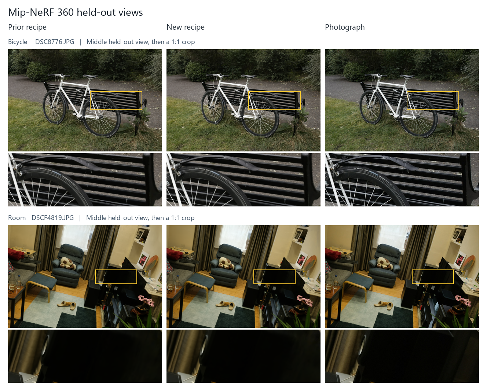

# Mip-NeRF 360 at 3,000 steps

The compact SH3 recipe starts with the supplied COLMAP point cloud, adds up to 256,000 stereo matches verified in a third training view, and uses the `short` learning-rate and loss schedule. The renderer applies a fixed camera response during training and rendering. Relative to `d6209e7`, the implementation adds 187 lines and removes 13 across `src/` and `shaders/` (200 changed lines).

On an RTX 4080 the two nine-scene means were **27.775 dB** (seed 42) and **27.741 dB** (seed 1). Room gained 1.288 and 1.062 dB over the previous tuned recipe. Bicycle gained 0.250 and 0.214 dB. LPIPS improved on six scenes at both seeds. It rose by about 0.012 on flowers and by less than 0.001 on bicycle and garden. [Per-scene changes at both seeds](../assets/mipnerf360_3k_results.png) · [All scene measurements](mipnerf360_3k_results.csv)

The timing baseline is a fresh run of the stock SH3 trainer. Including setup, the new recipe cost 5.1% more on seed 42 and 7.8% more on seed 1. The previous tuned recipe runs faster than stock. Its optimizer loop took 30.80 and 31.25 seconds versus 33.17 and 33.86 seconds for the new recipe. On seed 1, setup plus training took 36.74 seconds for the previous tune and 40.67 seconds for the new one. The archived seed-42 tune records loop time only.

The comparison below uses the middle held-out camera in bicycle and room on seed 1. Each row shows the previous tuned recipe, the new recipe and the corresponding photograph. The yellow boxes mark the full-resolution crops.



## Reproduce the benchmark

From the repository root, activate the trainer environment and fetch all nine scenes with `python scripts/data/download_mipnerf360.py --set all`. Native VGG LPIPS requires `torch`, `torchvision`, `lpips` and the pretrained VGG weights. To check the evaluator before starting, run `python -c "from trainer.common import perceptual; assert perceptual.load('vgg')"`.

Run the sweep on an idle GPU. This PowerShell command trains each scene once per seed and writes a full held-out report for each run.

```powershell
python scripts/running/eval_sweep.py --axis seed --values '42,1' --iters 3000 `
  --name mip360_3k_fast --no-plot --extra `
  --preset perf --sh-degree 3 --lr-recipe short --stereo-init --natural-vignetting `
  --sad-lambda-l2 6 --lambda-ssim 0.3 --prune-scale3d 1 --prune-blend-weight 0.20 `
  --grad-thresh 0.00058 --densify-from 100 --prune-blend-from 900 `
  --sad-tau-split 0.64 --max-splats 5600000 --eval-every 0 --preview-every 0 `
  --no-write-ground-truths --run-report --eval-lpips
```

Use the same evaluator and GPU for the stock SH3 baseline.

```powershell
python scripts/running/eval_sweep.py --axis seed --values '42,1' --iters 3000 `
  --name mip360_3k_stock --no-plot --extra --preset balanced --sh-degree 3 `
  --eval-every 0 --preview-every 0 --no-write-ground-truths --run-report --eval-lpips
```

Read `outputs/train/sweep_mip360_3k_fast_<scene>_<seed>/run_report.json` and the corresponding `stock` files. Each report should have `iters_completed == 3000` and `quality.n_lpips_views == quality.n_test_views`. The sweep caches completed runs by name. Use a new `--name` when changing flags.

A separate run through the ordinary CLI on bicycle at seed 1 scored 25.569 dB, 0.78175 SSIM and 0.22669 LPIPS over all 25 held-out views. The timed sweep run at that seed scored 25.573 dB, 0.78179 and 0.22666.

## Scoring and timing

Both seeds use the same split. Sorting images by name and holding out indices 0, 8, 16, … gives 246 held-out views across nine scenes. Stereo matching and optimizer updates use training views. Indoor scenes use half resolution and outdoor scenes use quarter resolution. The benchmark scenes informed recipe selection.

For each seed, take the unweighted mean of the nine scene reports’ `quality.psnr_srgb`, `quality.ssim_srgb` and `quality.lpips`. Each scene averages per-image scores on full-frame, clipped floating-point sRGB. PSNR is averaged in dB, SSIM uses all RGB channels, and VGG LPIPS uses each image at evaluation resolution.

The reported two-seed comparison uses the CPU evaluator. Across all 492 new-recipe renders, an independent FP32 GPU VGG evaluation differed by at most 0.00000009 LPIPS per image. The per-scene CSV also includes a separate seed-42 SfM-only variant. It disables stereo initialization, increases the L2 loss weight from 6 to 9 and reduces the blend-pruning weight from 0.20 to 0.15. The CSV identifies the evaluator used for each run. [Per-scene results](mipnerf360_3k_results.csv)

`timing.train_wall_s` measures the optimizer loop through the final GPU drain. Stereo initialization, image loading and target preparation precede that clock. For a setup-inclusive training comparison, time `TrainingApplication.prepare_training_context()` through a GPU drain and add `train_wall_s`. `timing.process_wall_s` also includes final held-out evaluation, including VGG. Use the same timing boundary for both recipes.

## Camera response and PLY playback

`--natural-vignetting` applies a fixed cos⁴ falloff with a gamma-2.2 approximation in encoded RGB. For the normalized camera ray `(x, y, 1)` through the pixel center, the RGB gain is `(1 + x² + y²)^(-2 / 2.2)`. Camera intrinsics determine the ray. The same law applies to every scene and view.

Exported PLYs carry the comment `trainer natural_vignetting_v1 cos4_srgb_2.2`. The repository’s PLY loader and viewer restore this setting. Other renderers can read the standard Gaussian attributes and implement the gain above to match playback. A renderer that ignores the comment displays brighter image edges.

## Adapting the falloff to other cameras

An experimental `--auto-lens` option fits one shared strength `b` per single-sensor reconstruction. It samples up to 28 decoded training images, finds landmarks seen in two cameras, and compares pairs of landmarks at different radii. Taking differences in log brightness cancels a shared exposure offset within each image and the intrinsic brightness of each landmark across images. A robust fit reduces the influence of occlusions and view-dependent highlights. The renderer uses `(1 + x² + y²)^(-2 b / 2.2)` during training, evaluation and PLY playback. A strength of zero gives a flat response and one gives the fixed model above.

All rows below use 3,000 steps at seed 42 on the same RTX 4080. The first three scores are mean held-out PSNR in dB. SSIM and VGG LPIPS are for the calibrated model. Bicycle and room had fixed and calibrated runs only.

| Scene | Flat PSNR | Fixed PSNR | Calibrated PSNR | SSIM ↑ | LPIPS ↓ | Fitted strength | Fit time |
| --- | ---: | ---: | ---: | ---: | ---: | ---: | ---: |
| Bicycle | — | 25.568 | 25.576 | 0.7820 | 0.2260 | 0.947 | 0.070 s |
| Room | — | 32.050 | 32.205 | 0.9275 | 0.2702 | 0.940 | 0.109 s |
| Truck | 26.176 | 26.023 | 27.264 | 0.9102 | 0.1316 | 0.552 | 0.121 s |
| DrJohnson | 29.513 | 25.552 | 29.504 | 0.9072 | 0.3309 | 0.053 | 0.072 s |


Across these four scenes, mean setup plus training took 31.78 seconds calibrated and 31.81 seconds fixed. The train loop averaged 26.02 and 25.94 seconds. Truck’s calibrated SSIM and LPIPS improved to 0.9102 and 0.1316, compared with 0.9014 and 0.1472 fixed and 0.9053 and 0.1448 flat. On DrJohnson the calibrated and flat responses were within 0.01 dB. [Full image metrics and elapsed times](camera_falloff_results.csv)

The fit estimates the radial falloff of the processed images. It requires binary COLMAP tracks, one camera record and enough matched points at different radii. Otherwise it uses a flat response. It runs once during setup and reuses the existing per-pixel shader operation. The automatic variant is a separate prototype with 154 additional production lines and 14 removals relative to the fixed implementation. The two-seed Mip-NeRF 360 results above use the fixed recipe.

PPISP also models the response curve, exposure and white balance. Its authors measured 0.10 ms per render without their image-based controller and 0.84 ms with it on an RTX 5090. [PPISP, Sections 4 and 5](https://arxiv.org/html/2601.18336v2)

## Regenerate the figures and overview tables

From the repository root, run the following commands with NumPy, Matplotlib and Pillow installed. They read the published CSVs and require no GPU or training outputs.

```sh
python scripts/plots/plot_camera_results.py
python scripts/plots/plot_readme_results.py --overview-only
```

The first command writes the per-scene quality changes and the four-scene lens comparison. The second regenerates the PSNR and training-loop overview plots and prints the dataset quality and resource tables. [Historical sweep](benchmark_results.csv) · [3,000-step measurements](mipnerf360_3k_results.csv) · [Lens measurements](camera_falloff_results.csv)
